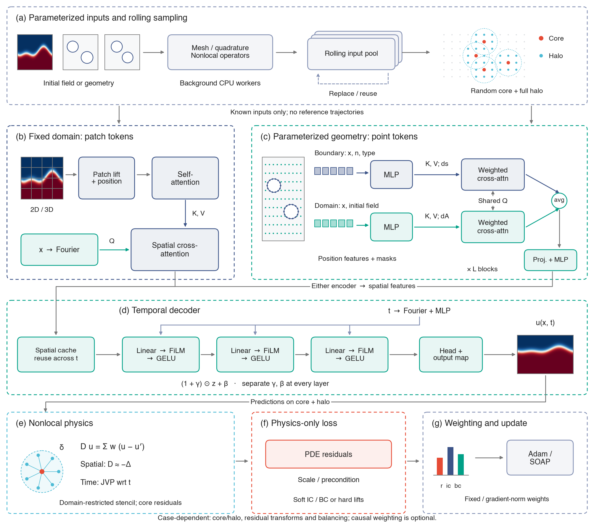

# nonlocal-pino

Physics-only neural operators and PINNs for phase-field dynamics, using nonlocal
spatial operators and shared spatial/time network evaluation. The PINO examples
learn families of solutions from known initial fields, geometry or material fields;
**positive-time reference solutions are used only for evaluation**.

Source code is hosted at [NanxiiChen/nonlocal-pino](https://github.com/NanxiiChen/nonlocal-pino).

The [technical report site](https://nanxiichen.github.io/nonlocal-pino/) covers
the architecture, nonlocal spatial calculus, training strategies and the five
main PINO cases. See the [local build guide](website/README.md).



[Editable master-figure PDF](assets/pino-architecture/pino_master_figure.pdf) ·
[Vector SVG](website/architecture.svg) ·
[Source and reproduction settings](artifacts/pino_master_figure.json).
The two encoder paths are alternatives. Spatial attention precedes all three
time-FiLM decoder layers. Sampling, residual transforms and loss weighting are
case-dependent; causal weighting is an optional control. Field textures are
schematic, not solver predictions.

## Physics-only neural-operator examples

| Main example | What varies between samples | Physical model / horizon | Representative phase relative L2 | Reference / evaluation scope |
|---|---|---|---:|---|
| [Ice melting 3D](examples/icemelting3d/README.md#pino-overview) | Initial ellipsoid axes, center and rotation | Driven Allen–Cahn, 5 s |0.100% pooled; 0.171% terminal | Native nonlocal, 8 held-out inputs; historical 5k model separately checked against local FEM |
| [Electropolish 2D](examples/electropolish2d/README.md#pino-overview) | Initial rough metal/electrolyte interface | Coupled KKS AC/CH, 5 s | 1.547% pooled; 1.326% terminal | Independent local FD101, 64 unseen inputs |
| [Spinodal 2D](examples/confined_ch2d/README.md#pino-overview) | Positions and radii of two impermeable holes | Confined Cahn–Hilliard, T=3 |4.833% pooled; 5.193% terminal | Native nonlocal, 8 reused reserved development geometries |
| [Two-phase flow 2D](examples/channel_nsch2d/README.md#pino-overview) | Independent smooth upper/lower channel profiles | Fully coupled incompressible NS–CH, T=6 |1.643% pooled; 2.196% terminal | Independent local FEM, 3 reused reserved geometries |
| [Ceramic-particle corrosion 2D](examples/particle_corrosion2d/README.md) | Positions, sizes and shapes of six inert particles around a fixed pit | Coupled KKS AC/CH, 350 s | **2.93% overall / 5.76% terminal** against local FEM, **1.45% / 2.78%** against direct nonlocal evolution | Same four development geometries for both references |

These are means of per-sample errors from the selected final checkpoints, not
one common benchmark. Targets, quadratures and evaluation populations differ;
the example READMEs give the definitions, auxiliary-field errors, limitations,
direct checkpoints and **3–4 sample evolution figures**. Small reused geometry
cohorts do not establish population or cross-seed accuracy. Spinodal remains
in the existing `confined_ch2d` directory; the full NS–CH operator is
`channel_nsch2d`, distinct from the prescribed-flow `twophase2d` pilot.

| Example | Condition encoder and queries | Selected training strategy |
|---|---|---|
| Melting |3D initial volume -> patch tokens -> query cross-attention | Adam 10,000, B16; hard IC; tanh latent residual; background rolling core+halo pool |
| Electropolish | 2D initial image -> patch tokens -> spatial cross-attention -> time FiLM | Adam 10,000, width 96, B8, 16 shared times; original AC/CH + soft IC/BC, five balanced losses; background rolling core+halo pool |
| Spinodal | Boundary and domain-function point streams -> normalized cross-attention | SOAP 50000, width 256, B16; online rolling geometry pool; hard IC/mass; eliminated chemical potential and resolvent residual |
| Two-phase flow | Boundary and domain-function point streams -> normalized cross-attention | SOAP 20000, width 192, B8; lr 1e-3 to 1e-5; 36 random times in two18-time blocks; online rolling geometry pool; hard flow/initial data; integral spatial derivatives, time JVP and fixed residual normalization |
| Ceramic-particle corrosion | Boundary and initial-field point streams with coordinate-only queries | Adam 20,000 updates, width 256, 4 geometry draws and 32 random times per update. Rolling geometry and core/halo pools, joint AC/CH losses and time JVP |

Regular domains use patch tokens; irregular geometry uses physical point sets
with boundary arc-length/domain-area measures. Queries carry coordinates/time,
without query-local initial-field features. Each operator prepares spatial
features once and shares that work across times; temporal derivatives use JVP.
Online initial fields are fresh continuous draws. Geometry pools roll in newly
constructed **operators/known inputs**, without solving training trajectories.

Melting uses a background rolling spatial pool with 256 cores and 32 initial
sets, trained cold for 10,000 Adam updates. Its selected final model gives
0.100% pooled and 0.171% terminal phase L2 on eight native-reference inputs.
The paired fixed-pool run gives 0.120% and 0.113%; late checkpoints fluctuate.
The [case comparison](examples/icemelting3d/README.md#spatial-sampling-controls)
records this endpoint dependence and the reused test cohort.

Electropolish uses a bounded background spatial producer. With the same
width-96, 16-time, 10,000-step recipe, rolling improves phase L2 from
1.747% to 1.547% in one paired seed and from 2.633% to 2.465% in the other.
Warm steps cost about 4–5% more on the current RTX 4090. The default uses
256 cores and preserves each complete halo. See the
[paired results](examples/electropolish2d/README.md#current-rolling-pool-default)
for concentration errors, timing and evaluation scope.

Completed nonlocal/local-AD controls, final-weight error distributions and
three-input reference/prediction comparisons are documented for
[Electropolish](examples/electropolish2d/README.md#current-rolling-nonlocallocal-ad-research-control)
and [ceramic-particle corrosion](examples/particle_corrosion2d/README.md#opt-in-matched-rolling-nonlocallocal-ad-study).
The violins show one strictly paired initialization (seed 42), with 64 test
inputs per method. Each input's phase and concentration channels are separately
normalized using discrete L2 over the complete space-time evaluation grid,
then averaged equally; the headline error averages these 64 input-level values.
Particle references use independent local FEM, and Electropolish uses local FD.
[Figure provenance](artifacts/pino_derivative_comparisons.json) preserves exact
saved configurations, checkpoints, metric definitions and external data paths;
[CPU regeneration](assets/README.md#nonlocallocal-ad-comparisons) rebuilds the
four compact comparison images. These controls do not replace selected SOTA
results above or establish a universal accuracy/speed advantage.

The five approved publication main figures are collected in
[assets/pino-main](assets/pino-main/README.md), with170mmeditable PDF originals,
matching PNG previews and [direct source/configuration records](artifacts/pino_main_figures.json).
They show predicted phase, reference interfaces and instantaneous spatial phase
errors; these panel metrics differ from the complete-space-time channel-average
metric used for the comparison distributions.

Run from the repository root, one GPU job at a time:

```bash
source .venv/bin/activate
python -m examples.icemelting3d.train --config=examples/icemelting3d/configs/train_operator.py
python -m examples.electropolish2d.train --config=examples/electropolish2d/configs/train_operator.py
python -m examples.confined_ch2d.train --config=examples/confined_ch2d/configs/train_operator.py
XLA_PYTHON_CLIENT_MEM_FRACTION=0.97 python -m examples.channel_nsch2d.train
```

The channel default uses the qualified96 GB GPU preset (~83.50 GiB active memory,
9.16h training). Its README also records historical smaller-memory controls
with different time-sampling/budget settings. The other three commands explicitly select PINO; their
no-argument `train.py` entries retain single-IVP PINN defaults. All launchers
create fresh runs. Existing evaluation banks and direct artifact paths must be
available; reference preparation commands are in each example.

The ceramic-particle result uses the explicit width-256 preset. Its input
preparation and launch commands are in the [corrosion run guide](examples/particle_corrosion2d/README.md#run-the-documented-case).

Seeds are runtime provenance through `--seed`, not tuned strategy fields.
Defaults use ordinary compilation and reject a conflicting inherited
`--xla_gpu_deterministic_ops=true`. Saved configurations govern old checkpoint
replay; checkpoints/references load by direct paths, without file hashes.

## Other examples and single-problem PINNs

- [Heterogeneous corrosion 2D](examples/heterogeneous_corrosion2d/README.md): activation-controlled material-map PINO pilot with fixed initial pit/geometry. Mild cold5000 phase L2 0.795% native/1.010% local FV; stronger spatial contrast with width96/cold10000 gives0.865%/1.227% on4 held-out materials and substantially larger asymmetric growth. A matched Adam local-AD control gives0.872% against the same local FV target, with17.92ms versus nonlocal14.60ms warm updates. The example records SOAP failure controls, material-response diagnostics and remaining concentration-residual limitations.
- [Corrosion2D](examples/corrosion2d/README.md): KKS pit corrosion, matched-graph/local-AD controls.
- [Corrosion1D](examples/corrosion1d/README.md): Earlier one-dimensional implementation.
- [Elasticity2D](examples/elasticity2d/README.md): Nonlocal elasticity with independent FEM.
- [Precipitate2D](examples/precipitate2d/README.md): Periodic coherent elastic precipitation with mechanical equilibration.
- [Two-phase prescribed flow](examples/twophase2d/README.md): Periodic CH transport/deformation with prescribed velocity, without coupled NS.
- The four main example directories also retain their original single-problem
  PINNs and research controls. In particular, confined CH's no-argument PINN
  uses 30 time windows; its geometry PINO uses one global-time operator.
- [Elasticity PINO design](docs/design/pino_elasticity2d.md) remains a design document.

Single-problem defaults, seed checks and local/nonlocal controls are documented
in the corresponding READMEs. Their error values should not be substituted for
operator errors over varying inputs.

## Setup and use

```bash
uv sync --frozen
source .venv/bin/activate
python -m examples.electropolish2d.train --helpshort
python -m unittest discover -s tests -v
```

Use this project's own `.venv`. The lockfile preserves the source dependency
versions and CUDA13 JAX choice. CPU checks use `JAX_PLATFORMS=cpu`.
FEniCS reference/checking commands run separately in `fenicsenv` with
`PYTHONPATH=.:src`; do not combine the two environments. Examples use explicit
configuration files; review their external paths before launching a new run.

## Structure

```text
src/nonlocal_pinn/
  operators/ geometry/ nn/ training/ baselines/ io/
examples/                 # case geometry, BCs, configs, CLI and formulations
assets/pino/              # compact README evolution figures
assets/pino-setups/       # setup PNG previews, editable PDFs and legacy SVGs
website/                  # static technical report source and build
tests/                    # existing focused numerical/restart regressions
artifacts/index.yaml      # external artifact ownership, JSON-compatible YAML
scripts/check_artifacts.py
docs/                     # rules, progress, decisions, deferred issues, tasks and migration
```

Shared code lives in the package; examples keep case definitions and stable
config entry paths. The project has no runtime import from the other project
or the source checkout. FEM references remain independent of PINN operators;
the [coupled residual experiment](examples/corrosion2d/README.md) additionally
uses direct integration of the same graph to isolate PINN optimization error.

## Artifacts and recovery

Existing `/root/autodl-tmp/data/<example>` and `tf-logs/<example>` paths are
retained. TF-log directories also hold fields, checkpoints, optimizer/replay
state and experiment scripts. New experiments use separate named outputs;
authorized historical run renames are recorded in the artifact index.
The [artifact index](artifacts/index.yaml) records current ownership; check it
with `python scripts/check_artifacts.py`.

Generated research galleries, videos, experiment arrays/checkpoints and compiler
dumps under `docs/tasks` are **local artifacts, not Git content**. Git keeps
source, Markdown, configs, metrics and regeneration scripts. Curated figures are
the deliberate documentation exception, collected in [assets](assets/README.md).
The five accepted [material setup schematics](assets/pino-setups/README.md) have
PNG previews in the example READMEs and matching editable PDFs for paper writing.
Their [publication manifest](artifacts/pino_setup_figures.json) links exact
source parameters, rendering settings and verification records; the ten files
stay below 2 MiB combined. Six earlier SVG setups remain as historical artwork.
CPU renderers reproduce prescribed inputs without learned/evolved fields. The evolution figures' direct
inputs, sample identities and regeneration command are recorded in
[figure provenance](artifacts/pino_readme_figures.json); raw arrays/weights stay
external. Figure links in
archived reports refer to optional local files; they can be restored on this
host from the direct-path [local artifact manifest](artifacts/local_files.json):

```bash
python scripts/restore_local_artifacts.py --list --all
python scripts/restore_local_artifacts.py --restore --all
python scripts/check_repository_content.py
```

Existing local files remain at their original paths. Restoration checks sizes
and exact bytes, uses no file hashes and refuses to overwrite different local
files. On another host, regenerate from the recorded data/checkpoints or make
the external archive available. Small migration fixtures remain in Git. Ignoring
and untracking outputs limits future growth; old Git history is retained and
therefore is not reduced by this cleanup.

Old run identity includes source/input/config paths and replay-store paths.
Changed package layout is a new run identity: historical in-place resume is
not promised. Use the original checkout for historical continuation, or design
an explicit checkpoint import into an isolated new run. Do not bypass checks.

Source/recovery baseline: `/root/nonlocal-KKS`, `dev@61352f1`. Verified full
history and working-tree backup: `/root/nonlocal-KKS-split-backup-20261024`.
To abandon the split, return to the original repository and its environment;
no reset, deletion or data restoration is needed. See [migration/recovery notes](docs/migration/README.md).

## Research records

[Progress](docs/PROGRESS.md), [decisions](docs/DECISIONS.md),
[development](docs/DEVELOPMENT.md), [numerical rules](docs/NUMERICAL_METHODS.md),
[JAX rules](docs/JAX_GUIDELINES.md), and [plotting guidelines](docs/PLOTTING_GUIDELINES.md).
Original history remains available in
Git and the source checkout; the new dashboard does not duplicate old logs.

Mesh generation additionally uses the explicit `mesh` extra:
`uv sync --frozen --extra mesh` (Gmsh4.15.2, matching the baseline).
