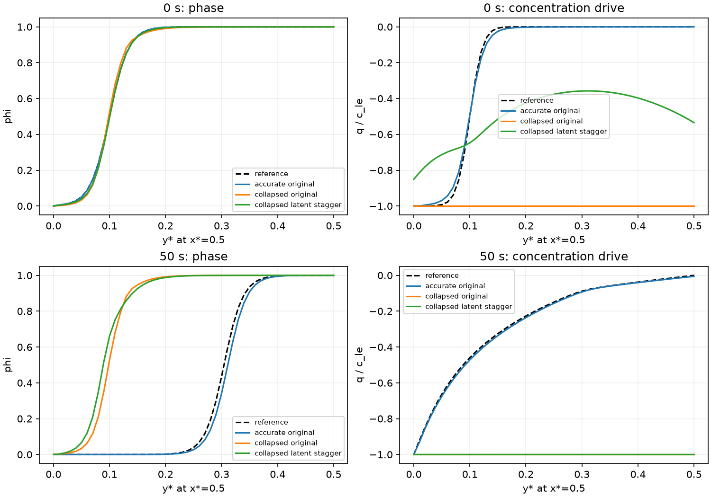

# Corrosion boundary and initial concentration-drive audit — 2026-10-25

## Status and conclusion

Completed read-only CPU replay of three saved models at1000/5000 training
updates, evaluating physical times0,2.5,50 s. No training, PDE, BC, reference,
configuration or checkpoint change. No blocker or process remains running.

The user's hypothesis correctly prioritizes accuracy on the **small transport
scale**: good phase or total-c fitting can hide a completely wrong q profile.
However, the collapsed original model already satisfies the pit-mouth
concentration BC extremely accurately. Outer-solid concentration and the
initial-interface q profile fail instead. This is evidence against pit-mouth
precision alone being sufficient, not proof that boundaries are irrelevant.
The audit establishes states and local sensitivities, not training causality.

## Goal and acceptance

Identify separately the pit-mouth Dirichlet condition, outer-solid Dirichlet
condition and curved-pit initial interface. Trace their required q values to
the implemented KKS/PDE equations, compare accurate/collapsed checkpoints,
and check whether an exact boundary substitution restores the initial drive.
All delivered using explicit file paths and no hashes. The prior GPU numerical
variation diagnosis remains valid and is not replaced by an unproved boundary
causality claim.

## Exact identities from implemented equations

The KKS mapping and CH residual are

$$
c=c_L+\Delta c_0h(\phi),\qquad
q=c-\Delta c_0h(\phi)-c_{Le}=c_L-c_{Le},\qquad
c_t+N_{CH}D_\delta q=0.
$$

Here \(h(\phi)=3\phi^2-2\phi^3\), \(\Delta c_0=c_{Se}-c_{Le}\),
and the active preset has \(c_{Se}=1\), \(c_{Le}=0.0356643356643\).
Consequently:

| Data | phi | c | c_L | q |
|---|---|---|---|---|
| Pit mouth | 0 | 0 | 0 | -c_Le |
| Outer solid | 1 | 1 | c_Le | 0 |
| Analytic IC | phi_0 | c_Se*h(phi_0) | c_Le*h(phi_0) | c_Le*[h(phi_0)-1] |

The graph operator annihilates constants. If the network instead chooses
\(c_L\simeq0\) throughout, then \(q\simeq-c_{Le}\) and CH transport
is almost zero, even though \(c\simeq\Delta c_0h(\phi)\) still has
a steep phase-shaped spatial profile. The same wrong state fits the pit mouth
but misses solid concentration by c_Le. Its solid squared concentration error
is only \(c_{Le}^2\approx0.001272\), while losing essentially100% of
this transport range. These statements concern transport; constant nonzero q
still appears in AC, so they do not imply an exact stationary solution of the
full coupled PDE or zero AC driving.

Sources: `src/nonlocal_pinn/nn/constraints.py`,
`examples/corrosion2d/train.py::_bc_info`,
`examples/corrosion2d/losses.py::ic_values`, and
`examples/corrosion2d/residuals.py::compute_pde`.
The audit independently checks q endpoints, analytic-IC identity, graph
constant annihilation and stable-raw/physical reconstruction agreement.

## Measurements

Boundary columns are maximum absolute errors on the actual128 sampled BC
points across physical times0,2.5,50 s, at the final5000-update checkpoint.
Initial arc is free grid nodes with reference0.05<phi_0<0.95. Its q column is
RMSE divided by c_Le, not a relative L2 denominator. Dq RMS is on all free nodes
at physical time0. Stable raw c_L is computed in float64 to avoid subtraction
of order-one phase and concentration fields.

| Model | pit c BC max error | solid c BC max error | initial arc q RMSE / c_Le | initial Dq RMS |
|---|---:|---:|---:|---:|
| accurate original | 0.00545683 | 0.000263035 | 0.0349568 | 3.43029 |
| collapsed original | 1.98979e-09 | 0.0356643 | 0.704964 | 1.69193e-06 |
| collapsed latent stagger | 0.00956348 | 0.0356642 | 0.376553 | 0.488905 |

Reference initial Dq free-node RMS is4.29762. At physical time50 s it is0.135825.
The collapsed original has terminal predicted Dq RMS1.65e-6, versus0.421818
for the accurate original. The latter's terminal Dq **error** is still large
(relative2.94): finite transport and low phase error do not certify transport
accuracy. The full data retain this distinction.

On graph pit nodes the collapsed original even returns phi=c=0 to FP32
precision; on sampled solid points its q error is essentially the full c_Le.
The successful trajectory has small but nonzero pit BC errors. Thus fitting
pit BC more tightly alone is not sufficient to select the correct trajectory.

At1000 training updates the collapsed original already has initial q in
[-0.0356643353,-0.0356643279] on the interface arc: almost no range, despite
initial phi RMSE only0.0181 there. The ultimately accurate trajectory at1000
also has poor physical-field accuracy and smoothed initial q/Dq, but later
recovers a much better q profile; neither one early snapshot nor a boundary
error threshold establishes an irreversible basin or unique cause.

The plot uses x*=0.5 at the final checkpoint. All models fit a plausible initial
phase profile (upper left), but their initial q profiles differ greatly (upper
right). At50 s the collapsed models retain a small pit and almost constant q.

## Frozen exact-BC probe and limits

At the collapsed original final checkpoint, set q to its exact reference
boundary value while holding every interior value fixed:

- Pit-only substitution changes initial free-node Dq RMS by7.64e-9 and
  initial-arc Dq RMS by1.61e-8: the pit condition was already satisfied.
- Solid-only substitution creates a large boundary-layer graph action
  (change RMS72.35), but changes initial-arc Dq by exactly0. The compact
  horizon0.02 does not connect the remote solid boundary directly to this arc.
- Neither frozen substitution reconstructs the missing interior initial q
  profile; solid clamping increases global Dq error because the frozen wrong
  interior cannot adjust. This is not evidence against correctly imposing BCs
  during a full solve or training.

The onset of the reference drive is not solely a pit BC effect: the analytic
IC itself already gives nonuniform \(q_0=c_{Le}[h(\phi_0)-1]\).
Both boundary maintenance and initial/interior q accuracy matter. The curved
initial arc is prescribed only at t=0, not a permanent zero-concentration
boundary along a moving interface.

## Initial-boundary corner incompatibility

The finite-width analytic tanh IC is not exactly zero over the Dirichlet mouth.
On the actual sampled mouth points its phi ranges0.00296555..0.0494894,
and c ranges2.633e-5..0.00710517. Dirichlet data require both exactly zero.
The matched graph reference replaces boundary nodes with their prescribed
values even at0 s, while the PINN's randomly sampled interior IC uses the
unmodified analytic profile. Exact simultaneous continuous interpolation at
the initial-boundary corner is therefore not available from these two targets
if the full analytic IC is continued to the boundary. Finite random IC/BC
sample losses can nevertheless both be small by forming a narrow layer; this
is not a proof that the discrete training constraints are infeasible.
This is a disclosed compatibility issue, not a newly discovered different
reference BC model or proof that the numerically checked reference is wrong.
No data or boundary condition was silently corrected.

## Implications for the next controlled experiment

A physically traceable variable is

$$
s=\frac{c_L}{c_{Le}}=1+\frac{q}{c_{Le}},\qquad
s_{pit}=0,\quad s_{solid}=1,\quad s_0=h(\phi_0)
$$

for this c_Se=1 preset. The KKS raw second output already parameterizes s.
Measuring BC concentration loss in s (or q/c_Le) gives it an order-one target
range and avoids phase/c cancellation. Replacing a c loss by an s loss changes
the optimization weighting and phase/concentration coupling, so it must be an
explicit ablation; it is not a new physical PDE. Tanh endpoint gradients can
still saturate, so normalization is not a guaranteed recovery mechanism.

First isolate normalized concentration **BC** fitting against the existing
original/latent controls; then separately assess normalized **IC** drive fitting
or an IC/BC warmup before full PDE training. Keep the corner incompatibility
explicit and do not demand impossible exact agreement or change IC physics
without a declared choice. These are proposed follow-up experiments, not
results of this audit. Hard IC and reference-trajectory priors are unnecessary
for testing this hypothesis.

## Artifacts and verification

- [Audit script](corrosion-boundary-drive-audit.py)
- [Detailed metrics](corrosion-boundary-drive-audit.json)
- [Profile figure](corrosion-boundary-drive-audit.png)

Explicit run paths, checkpoints and region/time scopes are in JSON. Six CPU
checkpoint evaluations complete; assertions for graph constants, q BC/IC
identities and stable physical reconstruction pass. The figure was visually
inspected. No production numerical code changed. Task-end syntax, JSON and
link checks and git diff --check are recorded below.

Exact next separate action: design a same-budget normalized-BC-only original/
latent ablation, with explicit corner treatment and concentration-drive metrics,
while addressing the prior GPU reproducibility limitation. No training process
was launched. No Git history operation was performed.

Completion: new audit Python AST, strict finite JSON, six explicit checkpoint
paths and all report links pass; git diff --check passes. Six CPU evaluations
and numerical identity assertions passed; figure inspected. Memory updated:
docs/PROGRESS.md, docs/DECISIONS.md and this archived task. Example README now
explains q endpoints/scale and initial-boundary compatibility. No new training,
physical choice, external artifact path or Git history operation.
