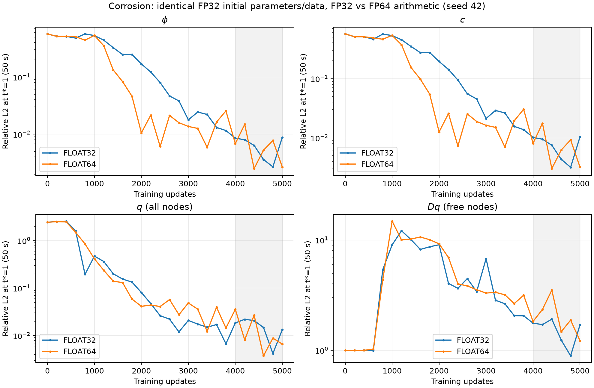

# Corrosion FP64 accuracy control — completed 2026-10-26

## Goal, scope and outcome

Complete the user-approved5000-update FP64 accuracy control after the
[performance benchmark](fp64-performance.md). One paired seed42 cold start is
complete, through canonical examples/corrosion2d/train.py. Original phase
residual, raw-edge KKS CH, normalized concentration BCs (s_bc), nodal IC/BC,
SOAP1e-3,50s,5000 updates, AC1e-7/CH1; stagger/causal/hard IC remain off.
Seed is runtime provenance, not a tuned strategy option.

FP64 reaches small field errors earlier and improves this final5000 checkpoint,
but does not establish better late-window stability or a lower error floor.
Production default stays FP32 pending paired independent-seed validation.
No physical/reference change, old artifact move, Git commit/merge/push or new
reference solve. GPU training exits0; no process remains running.

## Direct paths and reproducibility

FP32 baseline:
`/root/autodl-tmp/tf-logs/corrosion2d/20261025-transport-kks_raw_edges-chl1-s_bc-icmatched_graph-bcmatched_graph-phase-seed42`.
FP64 run:
`/root/autodl-tmp/tf-logs/corrosion2d/20261026-precision-float64-phase-seed42`.
Both final models: `ckpt_005000.eqx` (equals `model_final.eqx`).
Reference unchanged:
`/root/autodl-tmp/data/corrosion2d/results_matched_graph_20261024.npz`.
FP64 stdout: `reports/corrosion-fp64-accuracy-20261026/train-float64.log`.
Whole subprocess wall1494.45s (~24.9min), including compile/evaluation/saves.
Do not compare that wall time with the historical FP32 run's uncontrolled wall;
use the synchronized benchmark for the measured ~11.5% arithmetic slowdown.

```bash
source .venv/bin/activate
python examples/corrosion2d/train.py --seed=42 \
  --config.train.compute_dtype=float64 \
  --config.log.run_name=<fresh-run-name>
```

[Launch source](corrosion-fp64-accuracy-launch.py),
[manifest](corrosion-fp64-accuracy-launch.json),
[preflight source](corrosion-fp64-accuracy-preflight.py),
[preflight evidence](corrosion-fp64-accuracy-preflight.json),
[independent audit/plot source](corrosion-fp64-accuracy-audit.py),
[raw metrics/histories](corrosion-fp64-accuracy-audit.json),
[intermediate FP64 reload](corrosion-fp64-accuracy-reload.json).
These scripts remain runnable from the repository root as modules; use
JAX_PLATFORMS=cpu for the audit and cuda for preflight. Do not rerun the launch
into an occupied path; it deliberately fails rather than overwriting artifacts.

## Controlled precision policy

Matched configs explicitly declare train.compute_dtype=float32 or float64.
Both modes generate parameter initialization, IC/BC targets, coordinates,
stored operator arrays and temporal draws in FP32, then exactly promote floating
arrays. Actual saved initial parameters match baseline exactly (18 leaves),
reference graph rows/columns/weights match, and selected temporal/target promotion
checks pass. First five FP64 loss values exactly reproduce the earlier benchmark
first update. Native FP64 random draws or rebuilt geometry were not used.

Network/PDE/gradient/SOAP arrays are true FP64; precision.json verifies initial
and final parameters18 leaves/345104bytes, SOAP76 leaves/6129840bytes, and fixed
data305 floating leaves. The existing Optax scalar LR schedule remains FP32.
The benchmark independently checked the compiled tensor precision. New runs
snapshot training_precision.py along with the training source. Historical FP32
checkpoints remain loadable; use a promoted template for new FP64 checkpoints.

Stored FP32 diagonal is preserved: its max constant-field defect is0.00048828125
(relative diagonal3.49e-8), or502.93 after the physical AC diffusion coefficient,
5.03e-5 after the AC L1 loss scale. Reference uses exact float64 row sums of the
same edge weights. This pre-existing evaluation mismatch is explicitly retained
in the arithmetic-only control; no claim of fully corrected graph consistency.
Stable CH edge differences already annihilate constants. A diagonal-consistent
control is separate work, not an unreported part of this precision change.

## Independent final-model results

Physical terminal time t*=1 is50s. q=c_L-c_le; q/Dq table excludes Dirichlet
nodes. Independent CPU network/JVP evaluation and SciPy exact-row-sum graph:

| Metric | FP32 | FP64 |
|---|---:|---:|
| phi | 0.00883537688 | 0.00267671626 |
| c | 0.010425604 | 0.00320701249 |
| q (free) | 0.0137246461 | 0.00686140964 |
| Dq (free) | 1.70255665 | 1.22046882 |
| CH RMS (free) | 0.98159888 | 0.704396299 |

Thus final phi/c errors are ~3.30/~3.25 times smaller; q is ~2 times smaller;
Dq and CH RMS improve ~28%. Dq still exceeds1: concentration-gradient accuracy
is unresolved. Both models retain exactly one liquid component at all21 times.

## Late-window qualification

Six predefined evaluations at4000,4200,...,5000; these are repeated training
measurements at the fixed terminal physical time, not different physical times.
Late q here follows the training logger's all-node definition; final table q is
free-node, so do not compare those q values interchangeably.

| Metric | FP32 median | FP64 median | FP32 max | FP64 max |
|---|---:|---:|---:|---:|
| phi | 0.0071909588 | 0.0060685625 | 0.0088352786 | 0.014882101 |
| c | 0.008512023 | 0.0071555515 | 0.010425489 | 0.017652501 |
| q | 0.016682219 | 0.0084991035 | 0.02206714 | 0.035706625 |
| Dq_free | 1.7057344 | 1.8518727 | 1.9150197 | 3.5127677 |

Phi median improves only~15.6%; its mean worsens0.006348->0.006664 and its maximum
worsens0.008835->0.014882. Dq median worsens1.706->1.852. FP32 already reaches
phi0.002689 at4800, close to FP64 final0.002677, so do not infer a demonstrated
accuracy-floor improvement from the final-only~3.3x ratio. No intermediate
checkpoint selection or extension beyond5000 was used.

Frozen-parameter inference control: promote trained FP32 weights for FP64
inference, phi0.008835377->0.008835303; round trained FP64 weights to FP32 for
inference, phi0.002676716->0.002676708. Maximum physical-field changes <1.7e-6.
The observed final gain therefore comes from different training trajectories,
not simply evaluating the same learned solution with more precision. This does
not establish a unique optimizer mechanism or cross-seed benefit.



[Vector convergence export](corrosion-fp64-accuracy-audit-convergence.svg);
[terminal reference/FP32/FP64 phi,c,q fields](corrosion-fp64-accuracy-audit-fields.png).

## Changes and verification

Production diff: explicit precision config field, pure cast/audit helpers,
common FP32 input construction, promoted JIT inputs/optimizer initialization,
dtype/graph-defect records and source snapshots. Defaults and numerical residual
formulas retain their previous behavior. Documentation explains the option and
limits; artifact index registers the direct run and mixed outcomes.

Seven focused precision/SOAP-gradient/canonical-entry tests pass; GPU preflight
checks exact initialization/graph/promotion/config parity. Independent CPU1000
reload equals GPU phi L2 exactly. Final CPU audit validates final-checkpoint
identity, saved fields and logged L2, finite outputs,26-point histories, graph
transport/JVP,21-time topology and cross-precision inference. An initial audit
raw/physical layout mismatch was corrected in audit code only, with an explicit
shape assertion, before the successful audit. Plots were visually inspected.
All11 archived artifacts pass strict JSON/source AST/relative-link/run/dtype/
activation checks. Artifact inventory passes5 cases/303 directories;
git diff --check passes. No tests were repeated after unchanged production code.

## Status, blocker and next action

Complete; no blocker or remaining approved work. Default FP32 retained.
Potential follow-up: paired FP64 independent-seed checks and/or a separately
specified exact-row-sum diagonal control; neither was executed or claimed here.
