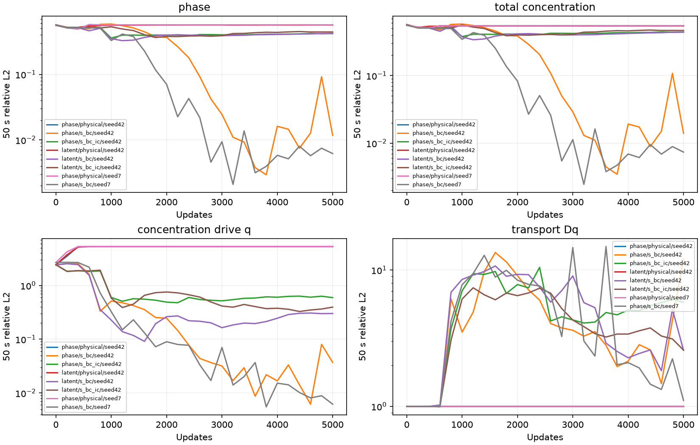
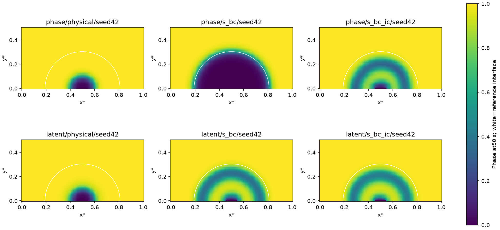
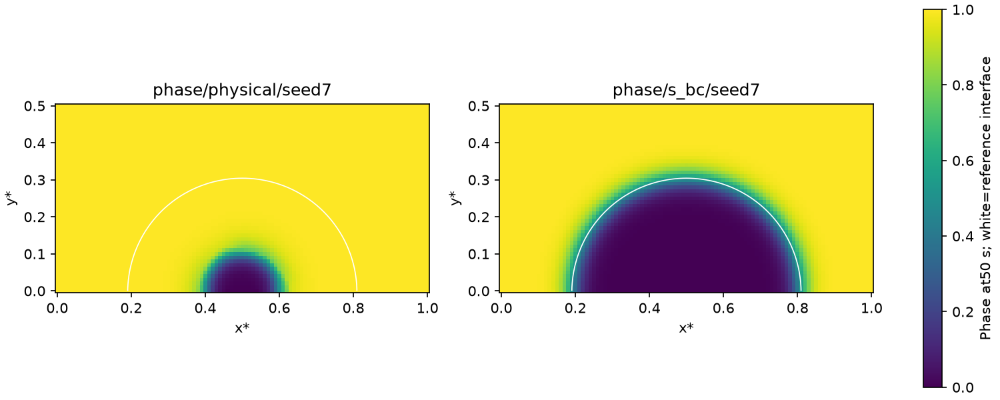
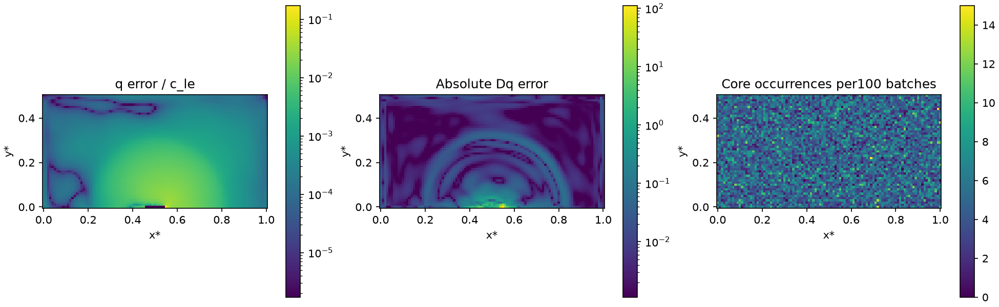

# Normalized corrosion concentration data — 2026-10-25

## Status and purpose

Completed: formal six-run seed42 screen, paired seed7 validation, a full5000-
update deterministic baseline replay,16 focused tests and eight independent CPU
checkpoint/transport audits. All training/audit processes exited. No blocker.
Code/data options and evidence are delivered; localized transport error remains
an explicit numerical limitation rather than a claim of a fully solved PDE.
The previous tool approval-service quota interruption is resolved through a
normal reviewed retry; no approval check was bypassed.

The user asks to handle insufficient initial/boundary concentration-drive
accuracy. Success requires explicit normalized data options, alignment with
the independently solved graph reference, controlled original/transformed
comparisons, a second seed for a promising field gain, and physical/transport
checks that do not hide concentration defects behind interface geometry.
No numerical tolerance target or universal transformed-residual win is assumed.

## Current findings

BC-only normalization markedly improves the original-residual field solution.
Stronger IC normalization restores initial q/Dq but does not improve later
phase evolution in this screen. Full latent residual variants still produce
extra phase bands and are not promoted. The field winner retains localized
transport errors near pit-mouth endpoints, so it is a research candidate and
not a globally validated transport solution. Production defaults, KKS mapping,
AC/CH pre-scales and physical PDE remain unchanged.

## Formulation and implementation

For the current c_Se=1 KKS map,

$$
c=c_L+(1-c_{Le})h(\phi),\quad q=c_L-c_{Le},\quad
s=\frac{c_L}{c_{Le}}=\frac{1+\tanh v}{2},\quad h(p)=3p^2-2p^3.
$$

The existing raw second channel v already parameterizes s. Its boundary targets
are0 at the pit mouth and1 on outer solid boundaries. From the prescribed
analytic initial condition \(c_0=h(\phi_0)\), its initial target is
\(s_0=h(\phi_0)\). These are given-data identities, not trajectory priors.

| Explicit mode | BC pair | IC pair |
|---|---|---|
| physical | phi,c | phi,c |
| s_bc | phi,s | phi,c |
| s_bc_ic | phi,s | phi,s |

Each pair uses the existing mean summed squared data error. PDE losses remain
mean absolute residuals with AC1e-7/CH1 scales. Changing c data error to s changes
both weighting and phase/concentration coupling: it removes cancellation
between phase-geometry error and concentration-state error. At exact phase
BCs, the concentration-component loss/gradient scale changes by1/c_Le²~786;
GradNorm subsequently reweights whole loss components, so this is not a claim
that the final parameter update is always786 times larger. Raw s evaluation
avoids subtraction of order-one c and phase terms. Tanh saturation remains
possible; tests explicitly show normalization cannot recover an exactly-zero
output derivative by itself.

Changes are confined to the research path:

- `examples/corrosion2d/residuals.py`: new normalized-data factory, explicit
  KKS/c_Se1/0<c_Le<1 checks and normalized-IC identity validation. Legacy
  `make_loss_vector` remains the physical objective for archived config callers.
- `examples/corrosion2d/configs/residual_pilot.py`: explicit data-loss, initial-
  sampling and boundary-sampling fields; legacy defaults remain physical,
  random interior IC and random BC.
- `examples/corrosion2d/residual_experiment.py`: validated CLI selection,
  fixed graph BC/IC helpers, initial-state alignment assertion and actual
  sample-count/XLA-flag provenance. Live diagnostics split pit/solid c/q errors
  and initial q/Dq, alongside terminal/pooled phi/c/cL/q/Dq.
- `tests/test_kks_latent.py`: normalized BC/IC target/gradient and unchanged-PDE
  checks, small-drive sensitivity/saturation check, compatible graph data and
  invalid-configuration checks.16 focused tests pass35.37 s.
- Example README documents options, data alignment and limitations.

No hard IC, interface-motion reference profile, hidden hash checks, environment
migration, package change or Git history operation is introduced.

## Boundary/initial alignment

All formal controls use every one of the5151 nodes of the101×51 reference graph
as soft IC data: analytic values in free nodes, prescribed Dirichlet values at
boundary nodes even at0 s. This is exactly the existing reference initial state,
asserted within3e-7; reference time snapshots never enter training losses.
BC data use the same9 pit and201 outer-solid Dirichlet graph nodes. This changes
sampling/objective relative to older random-IC/BC experiments, not the declared
discrete physical problem. Historical accurate checkpoints remain valid but
are not the only control for this changed data sampling.

The finite tanh IC is nonzero at the mouth endpoints. Nodal IC at(0.45,0) is
phi0.05103,c0.007546, while a random zero-BC point at(0.450552,0) demands a t0
slope~92.4. Combining nodal IC with off-grid random BC adds a sharper spatial
constraint than the reference graph spacing0.01. Three preliminary phase runs
using that combination were intentionally stopped for this alignment reason,
with last logged steps2700/500/500 and full sources/logs/reasons preserved.
They are not5000-update results and are excluded from the formal cohort.

Using matched nodal BC and IC represents the same discrete initial-boundary
jump as the reference. It does not construct a smooth compatible continuous
IC or guarantee off-grid BC interpolation; the independent audit evaluates128
held-out random points per boundary group as well.

## Matched settings and deterministic execution

Every formal run is a fresh seed42 cold start with50 s horizon,5000 updates,
SOAP, initial lr0.001, KKS output map, AC1e-7/CH1, five-component GradNorm,
no stagger/causal/interface weighting,101×51 cubic graph,delta0.02,256 PDE
core nodes,100 graph batches and16 uniform times per update. The existing
lr decay0.95 per1000 remains. Configuration, initialization and saved source
bytes are checked across modes. The independent reference remains
`/root/autodl-tmp/data/corrosion2d/results_matched_graph_20261024.npz`.
Its earlier temporal refinement check3.64e-9 and graph-edge checks remain valid.

All new workers explicitly use `XLA_FLAGS=--xla_gpu_deterministic_ops=true`,
no GPU preallocation, a separate /tmp compilation cache and the same highest
FP32 matmul precision. Four identical-input actual full-sized gradient calls
in each old/new path have zero repeat variation under this flag. The CPU
benchmark is slower than the GPU; at most three independent GPU jobs overlap.
No FEniCS/MPI environment or job runs concurrently. These concurrent wall times
are not evidence of relative optimizer performance.

A full5000-update same-configuration baseline replay is exact: initial/final
model and all1000-update checkpoint bytes, prediction arrays, every logged
loss/weight and every evaluation (excluding elapsed time) match. This is a
measured trajectory replay for the current nodal configuration; it does not
establish the unique cause of the earlier historical/current divergence.
Optimizer internal state was not separately serialized or compared.

## Formal seed42 results

All are relative L2, except native full CH RMS. Phi/c include all graph nodes.
q/Dq below use free PDE nodes; q is independently reconstructed from CPU raw
concentration output in float64. Full CH and c_t use actual FP32 AD.

| Residual/data mode/seed | terminal phi | terminal c | terminal q free | terminal Dq free | native CH RMS free |
|---|---:|---:|---:|---:|---:|
| phase/physical/seed42 | 0.570724 | 0.546293 | 5.337034 | 1.000000 | 0.001134 |
| phase/s_bc/seed42 | 0.011771 | 0.014021 | 0.038286 | 12.132977 | 7.003672 |
| phase/s_bc_ic/seed42 | 0.419366 | 0.441519 | 0.612738 | 5.792904 | 1.440085 |
| latent/physical/seed42 | 0.567216 | 0.545684 | 5.337033 | 1.000003 | 0.001671 |
| latent/s_bc/seed42 | 0.420005 | 0.440358 | 0.310543 | 2.579758 | 1.377205 |
| latent/s_bc_ic/seed42 | 0.443629 | 0.466142 | 0.407773 | 2.589063 | 1.378983 |

The best field mode is original residual+s_bc. Its sampled boundary/initial
metrics, pooled-time errors and late4000..5000 medians are in the detailed audit.
The primary comparison uses final5000-step checkpoints, not a transient dip.
Several late-step field/transport errors fluctuate; the full curves are retained.




Both latent normalized modes and original+s_bc_ic retain spurious phase bands.
Accurate initial data or BCs alone do not certify correct later evolution or
prove a transformed-residual advantage. No default is switched to latent mode
and no pre-scales are removed.

## Paired seed validation and stability

Both seeds use the same nodal data/settings and5000 updates. The normalized
BC-only gain repeats; no normalized IC or latent setting is promoted.

| Seed / original-residual data mode | terminal phi | terminal c | q free | Dq free |
|---|---:|---:|---:|---:|
| 42 / physical | 0.570724 | 0.546293 | 5.337034 | 1.000000 |
| 42 / s_bc | 0.011771 | 0.014021 | 0.038286 | 12.132977 |
| 7 / physical | 0.570419 | 0.547459 | 5.337033 | 1.000000 |
| 7 / s_bc | 0.006202 | 0.007379 | 0.006391 | 1.104412 |

For s_bc, late4000..5000 evaluation-window medians and Dq ranges are:

| Seed | median phi L2 | median c L2 | median Dq L2 | Dq range |
|---|---:|---:|---:|---|
| 42 | 0.013653 | 0.016187 | 2.715177 | 1.4682–12.1330 |
| 7 | 0.006016 | 0.007146 | 1.684400 | 1.1044–2.2330 |

These summarize instability; they do not replace the final5000-step primary
metrics or select a favorable checkpoint. Low field error is reproducible
across these two seeds; transport outliers and their magnitude remain seed-
and checkpoint-dependent. Earlier random-data accurate controls are historical
context, not an otherwise identical comparator for these nodal controls.



## Remaining transport error

Independent stable raw-q replay confirms the original+s_bc candidate's terminal
Dq error12.133 and native CH RMS7.004 (reference c_t RMS0.5773). The error is
highly localized:99.9507% of squared Dq error is in the worst1% of free nodes,
and99.2043% lies within one horizon of Dirichlet nodes. In the reference
interface region0.05<phi<0.95 the Dq relative error is0.09145, while global
transport remains defective. Both regional and global results are retained.

The largest error is(0.55,0), at the pit-mouth endpoint just outside the fixed
zero-BC interval: s_prediction0.001240 versus reference0.173169, Dq error-111.52.
It is a free PDE row, sampled as core6 times per100-batch cycle. Its raw
concentration value-3.346 has ds/dv0.002478, not an exactly-zero derivative.
The35 never-core nodes explain only2.84e-6 of squared error, ruling out missed
core coverage as the explanation for this dominant hotspot.

The same candidate's free-node mean CH imbalance is-0.05874, versus reference
mean c_t=-0.20793 (normalized-time units). The magnitude is~28% of that mean
reference rate; seed7 gives-0.005685 (~2.7%). Local spikes therefore cannot be
dismissed solely because the geometric interface is accurate.

This identifies a local boundary-neighborhood fitting/optimization defect;
it does not uniquely prove that L1 versus L2, GradNorm, learning-rate decay or
network representation causes it. Tight Dirichlet values are useful, but the
nearby free-node transport equation must also be satisfied. Small field L2
alone cannot justify a globally accurate transport or concentration claim.



## Early-reference check

A separate diagnostic integrates the same physical graph ODE over5e-6 s and
0.05 s via an equivalent Tc rescaling (all four rate coefficients scale by
the same asserted factor). It never replaces the training reference. At sampled
early times, c_L map-bound excess is at most2.73e-8 and no node exceeds bounds
by1e-6. A fast phase adjustment is measured: free phi RMS change0.002642 at
2.5e-7 s, while total c change is1.09e-7; by0.05 s they are0.002944/0.002448.
This establishes initial stiffness but not a cause of the large late errors;
there is no measured material output-range incompatibility in this probe.

## Reproduction and provenance

```bash
XLA_FLAGS=--xla_gpu_deterministic_ops=true .venv/bin/python -m \
  examples.corrosion2d.residual_experiment train \
  --case corrosion2d --formulation phase --seed 42 \
  --data-loss-mode s_bc --initial-sampling matched_graph \
  --boundary-sampling matched_graph
```

Each run has explicit config, initial/final models,1000-update checkpoints,
physical prediction fields, training/evaluation history, source copies and
train.log. Existing run directories cause failure rather than overwrite.
The config/run identities are explicit, not hash gated. Completed run roots
are listed in the audit/controller JSON files under the existing corrosion
log root; all data/log roots and historical models remain in place.

- [Formal controller](corrosion-normalized-controls.py),
  [commands and return codes](corrosion-normalized-controls.json).
- [Independent audit](corrosion-normalized-audit.py),
  [full field/transport/boundary metrics](corrosion-normalized-audit.json).
- [Second-seed controller](corrosion-normalized-validation.py).
- [Full-trajectory replay](corrosion-normalized-replay.py).
- [Deterministic first-batch probe](corrosion-normalized-determinism.json),
  using the [saved actual GPU probe](corrosion-stagger-gradient-gpu.py).
- [Spatial error audit](corrosion-normalized-spatial-audit.py),
  [spatial metrics](corrosion-normalized-spatial-audit.json).
- [Early-reference diagnostic](corrosion-normalized-early-reference.py),
  [early metrics](corrosion-normalized-early-reference.json).
- [Stopped preliminary records](corrosion-normalized-partial-controls.json),
  [parallel pilot launcher](corrosion-normalized-partial-controls.py),
  [serial pilot launcher](corrosion-normalized-serial-start.py).

## Recommendation, validation and completion

Keep the original physical phase residual and retain s_bc as an explicit
field-improving research option with matched nodal BC/IC, using the command
above. Do not promote s_bc_ic or full latent residual, remove pre-scales, or
call the field candidate a globally validated concentration-transport solver.
Production defaults and legacy physical/random-data research defaults stay
unchanged. This choice separates a measured useful option from unresolved
physics residual accuracy; all outputs and unfavorable controls are retained.

The16 focused tests pass; all eight final models reload on CPU and reproduce
saved physical fields within5e-6. Config/source/initial bytes match across
modes, with seed handled explicitly. Independent phi/c L2 matches summaries;
raw stable concentration, error decomposition, full CH, graph action, BC/IC,
late-window and coverage checks pass. Full baseline trajectory replay is exact.
Two short reference solves preserve physical time-rescaling equivalence and
show no material map-bound violation. Plots were visually inspected.

Task-end archives the self-contained report/scripts/metrics/figures, updates
artifact index and README, clears the active dashboard and records the outcome
in DECISIONS. Syntax, strict finite JSON, direct artifact/checkpoint paths,
Markdown links and git diff --check are verified. No Git history operation.

A subsequent targeted numerical study should address free-node transport
errors near the mixed pit-mouth endpoints and late-step variability, while
retaining global/region-specific metrics. The present experiment does not
uniquely identify a fix among loss norm, balancing, schedule or representation;
no untested correction is silently applied.

### Task-end record

Completed on2026-10-25. Archived21 supporting task artifacts. Added12 direct
run directories (eight primary controls, one exact replay, three explicitly
stopped preliminary controls) and measured outcomes to artifacts/index.yaml.
Updated example README, docs/DECISIONS.md and docs/PROGRESS.md; active task is
None. Final verification: AST parsing of12 changed/runtime/test/replay modules,
strict finite parsing of9 index/metric JSON files,51 local Markdown links,
eight final checkpoint/summary budgets and three stop-reason records pass.
Full replay checkpoint/loss/evaluation equality is confirmed. git diff --check
passes. Numerical sources have not changed since the16-test pass and frozen
training-source comparison; no unchanged expensive suite is repeated. No GPU
training process remains. No Git history change. Remaining numerical transport
limitations and the exact scope of the optional field improvement are above.
