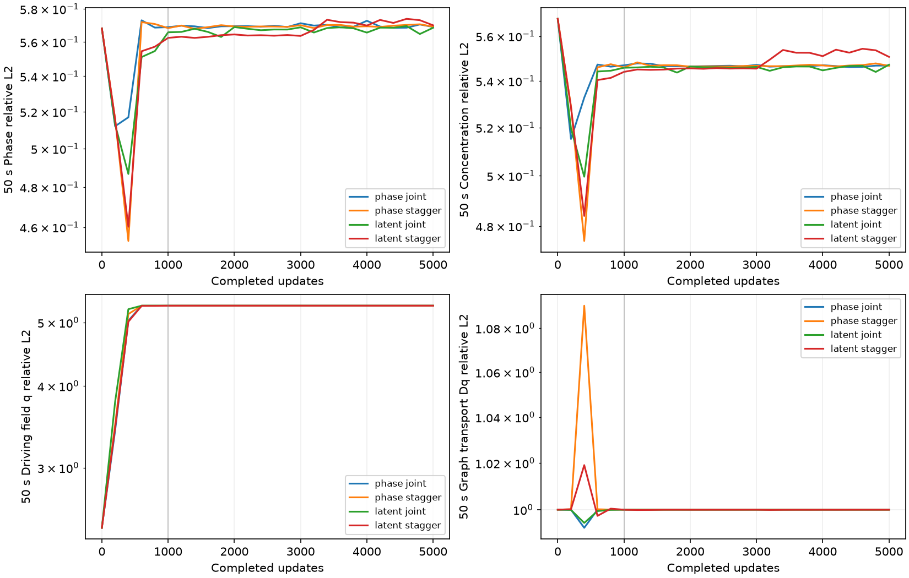
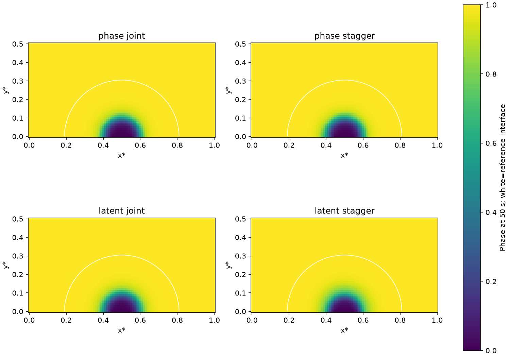

# Corrosion stagger × residual controls — 2026-10-25

## Status and conclusion

Completed: four fresh5000-update runs, a supplemental archived joint-step
replay, focused regression tests, independent CPU checkpoint/transport audit
and identical-input CPU/GPU gradient probes. No process remains running.
No blocker for the requested comparison; the failure to reproduce the earlier
accurate joint trajectory remains an explicitly unresolved limitation.

**The tested warmup loss alternation did not recover concentration or improve
the full latent formulation.** All four arms converge to wrong near-zero
liquid concentration, little/no correct transport and large field errors.
The fresh phase joint arm also fails, so these controls cannot establish a
stable ranking against the previous accurate phase joint result.
Configuration defaults and AC/CH pre-scales remain unchanged. Production's
adaptive-weight state defect is fixed independently of this negative result.

## User goal and preserved setup

Execute the original/full-latent × stagger off/on comparison after the user
pointed out concentration error and the existing stagger scheme. Do not hide
concentration imbalance behind phase/total-c metrics. Acceptance: actual
activation and positive adaptive state verified, four finished runs, same
initialization/reference/model/settings, terminal and pooled field metrics,
transport/residual/boundary checks, explicit limitations and no unsupported
promotion. All delivered.

The physical horizon is50 s (normalized0..1). Each cold start uses seed42,
SOAP, initial lr0.001,5000 updates, KKS output mapping, soft IC/BC, original
AC1e-7/CH1 scales, five-component GradNorm,101×51 graph, delta0.02,
256 core points,100 graph batches and16 times/update. No hard IC, causal
weighting, interface weighting, reference training targets or field freezing.

Reference: `/root/autodl-tmp/data/corrosion2d/results_matched_graph_20261024.npz`.
It is the independently solved graph ODE with matched model/grid/BC/IC,
previous temporal refinement error3.64e-9. Training graph edges/weights match
exactly. This task reuses it; no FEM job or regeneration was needed.

Stagger on means first1000 optimizer updates alternate AC-only and CH-only in
25-update blocks (AC first), followed by4000 joint updates. IC/BC always active.
Actual counts:500 AC-only +500 CH-only +4000 joint; off:5000 joint. This is
loss alternation with shared parameters/KKS, not a split physical-time solver
or independent frozen-field block solve. GradNorm refresh stays every25 in
research; inactive equation gradients are still measured on refresh.

## Implementation

- `examples/corrosion2d/losses.py`: return the **unmasked, unbiased** adaptive
  weights as persistent state; apply bias and AC/CH flags only to effective
  gradient weights. Previously a zeroed equation coefficient could stay zero
  through a nonrefresh switch; nonunit biases could compound. Aux logs keep
  effective weight/* and expose adaptive AC/CH weights. No PDE change.
- `examples/corrosion2d/residual_experiment.py`: explicit validated CLI schedule,
  dynamic fixed-shape boolean activation vector, raw EMA state and activation
  counts. Log every stage transition and adaptive/effective weights separately.
  Live evaluation adds c_L/q and free-node Dq error using reference only for
  evaluation. Network checkpoint layout is unchanged; an old masked controller
  state is not the new state contract.
- `tests/test_kks_latent.py`: actual production nonrefresh switching/nonunit
  bias regression, recorded research gradients and schedule boundaries, and
  real compiled SOAP AC→CH→joint updates without weight refresh.
- Example README documents the state contract, CLI, diagnostics and scope.

## Matched results

All values are relative L2. Field metrics include all grid nodes; q/Dq below
use free PDE nodes and the stable raw-output concentration reconstruction.
Pooled field metrics use all21 reference snapshots; terminal means50 s.

| Residual / schedule | terminal phi | terminal c | pooled phi | pooled c | terminal q (free) | terminal Dq (free) |
|---|---:|---:|---:|---:|---:|---:|
| phase joint | 0.569025 | 0.546800 | 0.368675 | 0.362152 | 5.337034 | 1.000000 |
| phase stagger | 0.569219 | 0.546674 | 0.368845 | 0.361999 | 5.337033 | 1.000003 |
| latent joint | 0.568521 | 0.547164 | 0.368377 | 0.362627 | 5.337034 | 1.000000 |
| latent stagger | 0.570010 | 0.550660 | 0.370594 | 0.366813 | 5.336956 | 0.999989 |

The total-c result is supported by independent concentration diagnostics:
terminal c_L relative error is approximately1 in all four arms; q error is
approximately5.337 on free nodes (all-node live q metric~5.303). Dq relative
error~1 means the predicted transport fails to reproduce the reference, rather
than indicating a solved transport problem. All four BC maximum errors are
~0.0356644, the equilibrium liquid concentration scale.

Native full CH free-node RMS is0.00135–0.00260, while reference c_t RMS is
0.577256. Stable raw-q CH RMS is7.33e-5,7.23e-5,5.28e-5,3.78e-4 in table
order. A wrong nearly constant concentration/phase can yield a small PDE
residual. The native/stable difference also exposes FP32 cancellation in
c−dc*h(phi) before graph action; neither residual is a field-accuracy score.
The CPU raw-q probe prevents this cancellation from hiding the transport error.

Exactly-zero c_L output derivative fractions at the terminal checkpoint are
96.60%,76.99%,96.47%,0% respectively. Latent stagger has nonzero derivatives
but c_L is still near the wrong endpoint, showing that removing exact zeros
alone does not solve the coupled optimization. These are terminal-only probes,
not full training-time statistics. Late4000..5000 medians remain poor; the
transient initial dip is not promoted.

## Why the new original baseline needs qualification

The previous saved phase joint control has terminal phi/c
0.0398383/0.0472192. Its config differs from the new phase joint config only
in run name, and initial checkpoint bytes match. The new joint path instead
ends at0.569025/0.546800. These are actual measured results; the earlier good
checkpoint remains valid evidence of that run and is untouched.

A supplemental5000-update replay substitutes **the archived original
make_step**, keeps the current evaluator/setup, and again fails:
phi/c0.569764/0.546169, c_L~1, q~5.303, Dq~1. Thus the added activation
multiplication/weight-state fix is not a sufficient explanation of failure.
The override and both source paths are recorded explicitly; this diagnostic
is separate from the matched four-arm cohort.

A real full-sized first-batch CPU FP32 GradientRecorder probe finds exactly
equal losses, adaptive weights and parameter gradients between the archived
step and the new all-true mask. GPU comparisons exceed the CPU probe's initial
1e-5 tolerance: the first attempt's gradient difference is1.3072e-5; another
attempt fails the loss comparison (relative CH difference1.7365e-5). Those
failures are retained as logs. Subsequent diagnostic measurement records
rather than suppresses these differences; it does not convert failed checks
into passing equivalence tests.

In the measured GPU probe, old/new gradient relative difference is4.6123e-4.
Repeated **identical inputs to the same compiled step** vary too: the maximum
relative difference from the first repeat is1.1154e-5 for old and4.4059e-4 for
new. The model, weights, times, graph and input arrays are held fixed; updates
are zeroed by GradientRecorder. This directly establishes GPU numerical
variation in these calls. It does not isolate the responsible kernel, prove
which perturbation caused the late collapse, or establish unique blame for
SOAP, graph scatter, output mapping, evaluator layout or masks.

The paired failure is evidence that this particular warmup schedule did not
rescue training. It is not a robust cross-seed algorithm ranking, proof that
original residual generally fails, or a rejection of independently solved
field-block staggering. Before another promotion claim, establish stable
current-runtime joint replay and then repeat matched controls.

## Artifacts and exact replay

All run roots are under `/root/autodl-tmp/tf-logs/corrosion2d/`:

- `20261025-stagger0-every25-phase-mapkks-ac1e-07-ch1.0-seed42`
- `20261025-stagger1000-every25-phase-mapkks-ac1e-07-ch1.0-seed42`
- `20261025-stagger0-every25-latent-mapkks-ac1e-07-ch1.0-seed42`
- `20261025-stagger1000-every25-latent-mapkks-ac1e-07-ch1.0-seed42`
- Supplemental: `20261025-stagger-diagnostic-legacy-joint-phase-seed42`

Each has config, initial/final models,1000-update checkpoints, physical fields,
metrics/loss history and train.log. Paired snapshot files match byte for byte;
no hashes or expected-checksum gates are used. Controllers reject existing
directories, preserving all prior artifacts.

- [Four-run controller](corrosion-stagger-controls.py) and
  [return codes/commands](corrosion-stagger-controls.json).
- [Independent audit](corrosion-stagger-audit.py) and
  [detailed field/transport/activation metrics](corrosion-stagger-audit.json).
- [Legacy-step controller](corrosion-stagger-legacy-control.py).
- [CPU gradient probe](corrosion-stagger-gradient-cpu.py),
  [GPU repeat probe](corrosion-stagger-gradient-gpu.py) and
  [reproducibility records](corrosion-stagger-reproducibility.json).
- Initial GPU threshold failures:
  [gradient](corrosion-stagger-gpu-probe-initial-failure.log),
  [loss](corrosion-stagger-gpu-probe-second-failure.log).

Run scripts from repository root using `.venv/bin/python`; set
`JAX_PLATFORMS=cpu` for CPU audit/probe. Controllers use sequential GPU jobs,
OPENBLAS_NUM_THREADS1/OMP_NUM_THREADS2, no GPU preallocation and explicit
/tmp compilation cache. No FEniCS or MPI work runs concurrently. Controllers
are historical exact commands and refuse an existing completed run directory.

## Validation and next action

Eleven focused tests pass (29.22 s); final live-evaluation edits are followed
by a reference-validation pass (0.69 s) and actual compiled SOAP tests2/2
(7.83 s). Four independent CPU reloads reproduce physical fields within
5e-6; raw concentration/decomposition/transport checks pass, including exact
error decomposition at1e-15 and summary metric agreement. All cohort configs,
initialization bytes, snapshot sources, budgets and logged activation weights
are independently checked. The supplemental config/initial bytes match the
old baseline apart from run name. Final syntax, artifact/link and diff checks
are recorded in the completion note.

Requested execution is complete. No setting is promoted and no scales are
removed. The next separate diagnostic should establish current-runtime GPU
reproducibility and preserve an accurate original joint control before
retuning concentration-specific optimization or testing genuine frozen-field
blocks. Numerical variation is measured; its causal contribution to collapse
remains unresolved. No Git history operation was performed.

Completion checks: git diff --check passes. AST validation passes for the two
changed runtime modules, focused test module and five archived scripts (8
Python files). All new JSON records are finite/parseable; report links,
indexed source/report/reference/artifact files and5000-update budgets pass.
Both generated figures were visually inspected. Final GPU process query is
empty; all training/audit/probe processes exited. Memory files changed:
docs/PROGRESS.md, docs/DECISIONS.md and this archived task. Artifact index and
example README are synchronized. No commit/merge/push/history action.
