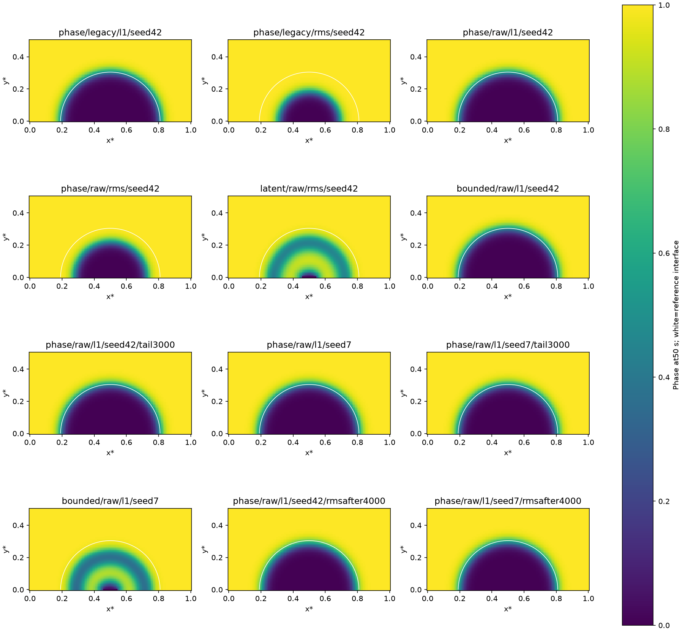
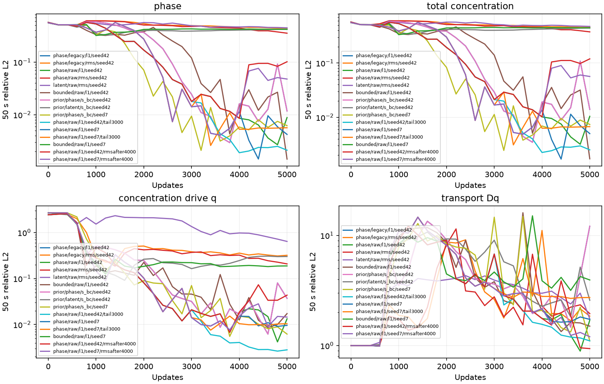

# Corrosion transport optimization — 2026-10-25

## Status and outcome

Completed:12 fresh5000-update/50 s training controls,15-model independent CPU
field/transport/source audits,22 focused tests, exact full baseline replay,
and exact pre-change trajectories for both rate and norm schedules. All
processes exited. No blocker. This completes the bounded optimization study;
it does not claim the remaining concentration-transport problem is solved.

Stable raw-KKS/edge evaluation improves terminal phi/c in both seeds, but
regresses seed7 q/Dq. It is an explicit field-improving option, not a universally
better physical solver. Late rate decay strongly helps seed42 but not seed7
transport. Bounded phase weighting has a very low seed42 final field error,
yet fails seed7 and has poor late field medians. Cold and late CH-RMS controls
both damage phase accuracy. No all-metric, two-seed winner is established;
production and legacy research defaults, KKS, physical PDE and pre-scales stay
unchanged. Keep original phase residual, s_bc and full concentration diagnostics.

## Goal and controlled problem

The user asks to continue optimizing the concentration/transport defects in the
[normalized-data study](corrosion-normalized-data.md), without hiding them
behind low interface/total-c errors. The target is terminal physical fields
plus driving concentration and transport, rather than one favorable residual
or checkpoint. No hard IC or interface-motion prior is introduced.

Every new run uses the same independently solved graph reference:
`/root/autodl-tmp/data/corrosion2d/results_matched_graph_20261024.npz`.
Its previously checked temporal refinement discrepancy is3.64e-9. No new
reference is needed because no physical equation/operator/BC changes. This
study measures optimization of that fixed graph model, not continuum/local-FEM
convergence. Existing historical FEM arrays and artifact roots remain intact.

Fixed settings:50 s,5000 updates,SOAP,initial lr1e-3,AC1e-7/CH1,KKS,
101x51 cubic graph,delta0.02,Kcore256,Kpool100,Nt16,all5151 nodal ICs,
9 pit/201 solid nodal BCs,s_bc,soft IC,GradNorm with five components, no
stagger/causal/interface weighting. Same initial bytes within each seed.
Boundary values at time zero override analytic IC on declared Dirichlet nodes,
as in the reference; no reference time snapshots enter training. At most three
GPU workers overlap, with explicit `--xla_gpu_deterministic_ops=true`, no
preallocation and an isolated /tmp compilation cache. No FEniCS/MPI work.
Concurrent wall times are not optimizer speed measurements.

## Checked numerical changes

For the current c_Se=1 KKS map,

$$
c=c_{Le}\frac{1+\tanh v}{2}+\Delta c\,h(\phi),\qquad
q=c-\Delta c\,h(\phi)-c_{Le}
=\frac{c_{Le}}{2}(\tanh v-1).
$$

`--transport-evaluation kks_raw_edges` evaluates the right-hand q directly and
uses the same graph in edge-difference form:

$$
(Dq)_i=\sum_j w_{ij}(q_i-q_j),\qquad r_{CH}=c_t+N_{CH}Dq.
$$

This removes subtraction of order-one phase/concentration terms and makes
constant-q graph action exactly floating-point zero. The graph, physical
output map and physical c_t JVP are unchanged. The AC residual still uses its
legacy physical-q expression, isolating the CH evaluation change. Current
KKS/c_Se1/0<c_Le<1 assumptions are validated. FP64 independent graph action,
PDE identity and actual gradient checks pass. Tanh saturation is not removed.

`--ch-norm rms` changes only the masked sampled CH reduction from mean absolute
residual to

$$
L_{CH}=\sqrt{M^{-1}\sum r_{CH}^2+\epsilon^2}-\epsilon,
\qquad\epsilon=10^{-12}.
$$

RMS retains residual units and gives larger relative gradients to outliers;
zero/masked gradients are finite and zero. This changes the optimization
objective, not PDE zeros. M counts included free core/time samples per update;
it is a minibatch RMS, not a promise to minimize the full-grid residual norm.
GradNorm, data/AC losses and inherited equation scales remain unchanged.

`--lr-tail-start 3000 --lr-tail-end 1e-5` keeps the original learning rate
through index3000, then decays continuously to1e-5 at index5000. The last
actual update is4999 and uses~1.0022e-5. Optimizer/preconditioning/clipping,
losses and moments continue without reset. It is tested separately from RMS.

`--ch-rms-after 4000` keeps the first4000 updates L1, then switches only CH
to RMS for1000 updates, using two fixed-shape compiled steps and the same
optimizer/adaptive state. GradNorm refresh aligns with the switch. These runs
keep the original0.95-per1000 rate rather than adding the rate tail. The
switch is in training updates, not physical time. No fields freeze in this
joint-parameter experiment.

Legacy physical/normalized-data factories retain their original semantics for
archived callers. New required research config fields are explicit; rate and
norm continuation default to0 (disabled). Shared optimizer/operator modules
are unchanged. Runtime changes are limited to residuals.py, the research
runner/preset and the new transport_optimizer.py helper; tests and README
cover formulas, assumptions, state continuity and configuration rejection.

## Terminal50 s results at5000 updates

Phi/c use every graph node. q/Dq below use free PDE nodes and independent
CPU raw-v concentration reconstruction in float64; Dq uses SciPy graph action.
CH RMS uses that stable q with actual FP32 c_t AD. Live q logs include all
nodes, so their denominator differs slightly from q-free values below.
Native/trained-evaluation CH, initial data, pooled metrics, boundary and spatial
details remain in the full JSON; no favorable region substitutes for global
transport. Every primary result is the final5000 checkpoint.

### Seed42

| Mode | phi L2 | c L2 | q free L2 | Dq free L2 | stable CH RMS |
|---|---:|---:|---:|---:|---:|
| legacy / L1 | 0.0117707 | 0.0140207 | 0.0382855 | 12.133 | 7.00367 |
| legacy / RMS cold | 0.444351 | 0.454684 | 0.32998 | 1.85116 | 0.873862 |
| raw edges / L1 | 0.00883528 | 0.0104255 | 0.0137246 | 1.70256 | 0.981599 |
| raw edges / RMS cold | 0.355213 | 0.375059 | 0.214466 | 1.95105 | 0.862598 |
| latent / raw / RMS cold | 0.449221 | 0.472541 | 0.660075 | 1.74445 | 0.478404 |
| bounded cap11 / raw / L1 | 0.00143305 | 0.00171859 | 0.0178326 | 1.50041 | 0.866084 |
| raw / L1 + LR tail3000 | 0.00211706 | 0.00251421 | 0.00290349 | 1.10384 | 0.63694 |
| raw / L1 to RMS4000 | 0.10172 | 0.119248 | 0.0449079 | 0.93911 | 0.387209 |

### Seed7

| Mode | phi L2 | c L2 | q free L2 | Dq free L2 | stable CH RMS |
|---|---:|---:|---:|---:|---:|
| legacy / L1 | 0.00620199 | 0.00737919 | 0.00639111 | 1.10441 | 0.636819 |
| raw edges / L1 | 0.00422488 | 0.00500591 | 0.00990014 | 1.72981 | 0.998299 |
| raw / L1 + LR tail3000 | 0.00565827 | 0.00672978 | 0.0107334 | 2.73193 | 1.57684 |
| bounded cap11 / raw / L1 | 0.422001 | 0.44614 | 0.193924 | 3.94286 | 1.96782 |
| raw / L1 to RMS4000 | 0.0477004 | 0.0565144 | 0.0149742 | 1.20296 | 0.662663 |

The older seed42 original s_bc control exactly equals the new legacy/L1
baseline and is not duplicated in the table. The archived full-latent s_bc
control is historical context (phi/c0.4200/0.4404), retained in the15-model
audit. Comparing latent/raw/RMS against original/raw/L1 also changes the CH
norm; the proper current phase comparison is latent/raw/RMS versus
phase/raw/RMS. Neither establishes a useful full-latent advantage.



## Late-window stability

Medians/ranges below cover the six saved evaluations at4000,4200,...,5000.
They do not replace final-checkpoint primary results or bound unsampled
updates. For continuation,4000 is the last pre-switch checkpoint and five
later evaluations use RMS. Bounded seed42's final phi0.00143 contrasts with
its median~0.0181 and the seed7 failure; no one-seed SOTA/default is promoted.

| Seed / mode | median phi | median c | median Dq | Dq range |
|---|---:|---:|---:|---|
| 42 / legacy / L1 | 0.013653 | 0.0161865 | 2.71518 | 1.4682–12.133 |
| 42 / raw edges / L1 | 0.00719096 | 0.00851202 | 1.70573 | 0.89088–1.915 |
| 42 / bounded cap11 / raw / L1 | 0.0181321 | 0.0215033 | 1.61507 | 1.3398–2.0811 |
| 42 / raw / L1 + LR tail3000 | 0.0022437 | 0.00266291 | 1.21939 | 1.1039–1.5597 |
| 42 / raw / L1 to RMS4000 | 0.0918473 | 0.107995 | 1.64898 | 0.93912–3.8663 |
| 7 / legacy / L1 | 0.00601592 | 0.00714642 | 1.6844 | 1.1044–2.233 |
| 7 / raw edges / L1 | 0.00506532 | 0.00601193 | 1.69613 | 1.6319–2.1631 |
| 7 / raw / L1 + LR tail3000 | 0.00556084 | 0.00661615 | 2.75686 | 2.6813–2.7955 |
| 7 / bounded cap11 / raw / L1 | 0.422158 | 0.446212 | 3.91077 | 3.1707–4.2375 |
| 7 / raw / L1 to RMS4000 | 0.0492822 | 0.0583622 | 1.4363 | 1.2029–2.1631 |



## What the diagnostics establish

At the frozen earlier accurate model, raw-edge evaluation reduces CH arithmetic
error versus float64 raw-q replay from0.003003 to0.000229, but true CH RMS
remains~7.00367. Roundoff reduction alone does not explain or cure the defect.
At frozen seed42/7 models, substituting exact prescribed nodal q BCs leaves
Dq errors12.13297->12.13328 and1.10441->1.10456. Remaining free-node errors
are not explained by finite nodal BC-value error. This does not rule out
boundary geometry affecting representation/optimization.

Stable q confirms the main remaining concentration error is highly localized:
raw/L1's worst1% free nodes contain99.35%/99.44% of squared Dq error for
seeds42/7. Its interface-region Dq errors0.102/0.046 are much lower than
global1.70/1.73, so good interface fitting cannot certify global transport.
The earlier fixed-pool audit found the dominant mouth row sampled6 times per
100 batches and nonzero output derivative;35 never-core rows explain only
2.84e-6 of that old model's squared error. No pool/geometry changes occur here.

Cold RMS fails fields. Late RMS lowers seed42 global Dq to0.939 but increases
interface Dq to0.660 and phi to0.102; seed7 gives interface Dq0.367 and
phi0.0477. It redistributes error rather than achieving a successful joint
solution. Tail seed42 mean CH imbalance improves to+0.00411, but tail seed7
is+0.01655, compared with its legacy baseline-0.00568 (reference mean c_t
-0.20793). Both signed mean and RMS/global/regional metrics are retained.

The raw outputs share network parameters, and CH physically contains the phase
contribution to c_t. Increasing CH emphasis can change phase evolution as well
as concentration; neither cold nor late RMS isolates a concentration-only
correction. This is structural evidence plus empirical tradeoffs, not proof
that shared representation alone is the unique cause. No tested fix is
claimed for the remaining hotspot.

## Reproducibility, verification and provenance

- New legacy5000 replay: initial/every1000/final parameter bytes, all logged
  losses/weights and prediction/evaluation arrays match the previous s_bc
  model exactly, excluding elapsed time. The three added schema fields are
  accounted for explicitly.
- Both rate-tail controls match no-tail initial/1000/2000/3000 parameters and
  all early loss/evaluation rows exactly. Both RMS-continuation controls match
  initial/1000/2000/3000/4000 and all early rows exactly. Optimizer internal
  state was not separately serialized; code carries it without reset and
  actual SOAP tests verify continued update counts/settings.
- Six initial runs capture identical five-file sources. Four later runs add
  the optimizer helper and change only runner/preset wiring. Two final runs
  change only norm-schedule wiring. Known archived schemas are explicitly
  adapted in the audit; they are not silent runtime defaults. Critical
  numerical/model/sampling/step function ASTs match, and the training loop
  differs only by declared step dispatch. Later source groups match exactly.
- 15 final models reload on CPU and reproduce physical fields within5e-6;
  independently recomputed phi/c L2 matches saved summaries. Stable raw-q,
  exact concentration error decomposition, graph/CH/BC/IC/late/spatial checks
  pass. Held-out BCs use the same fixed128 random points per group; nodal
  agreement does not imply exact continuous BC interpolation.
- 22 focused checks pass:19 existing/new PDE/loss/graph/compatibility checks,
  two rate/actual-SOAP checks and one actual norm-switch/state/component test.
  No unchanged expensive suite is repeated. Plots are visually inspected.

All12 new runs return0 with5000joint updates and no hard IC. Every run has
explicit config, initial/final/1000 checkpoints, physical predictions,
loss/evaluation histories, source snapshots and train.log. Existing folders
fail rather than overwrite. Data/log roots stay unchanged; direct paths and
config checks are used without file hashing. No Git history operation.

## Use and recommendation

For the measured field-improving option, retaining the concentration caveat:

```bash
XLA_FLAGS=--xla_gpu_deterministic_ops=true .venv/bin/python -m \
  examples.corrosion2d.residual_experiment train \
  --case corrosion2d --formulation phase --data-loss-mode s_bc \
  --initial-sampling matched_graph --boundary-sampling matched_graph \
  --transport-evaluation kks_raw_edges --ch-norm l1
```

The directory for a completed seed already exists intentionally. Use a new
explicit log.run_name in a copied config for another identical cold start;
load completed models directly from the controller/audit paths. Do not
silently overwrite or resume model-only files with invented optimizer state.

No global production promotion is made. Retain original phase residual/KKS/
pre-scales; raw edges is an optional field/roundoff improvement with seed7
transport tradeoff. Tail, bounded and RMS schedules remain explicit research
controls. Further work should test a separate concentration parameter block
and true field freezing/block optimization, with phi/c/q/Dq/CH and AC checks.
That is an untested next study, not a correction silently applied here; current
stagger alternates loss activation and does not freeze shared fields.

## Artifacts and task end

- [Independent15-model audit](corrosion-transport-audit.py),
  [complete metrics and direct model paths](corrosion-transport-audit.json).
- [Six-control launcher](corrosion-transport-controls.py) plus
  [bounded control](corrosion-transport-bounded.py).
- [Rate/seed validation](corrosion-transport-validation.py),
  [bounded seed validation](corrosion-transport-bounded-validation.py),
  [final continuation pair](corrosion-transport-continuation.py).
- [Frozen numerical/legacy probe](corrosion-transport-probe.py),
  [metrics](corrosion-transport-probe.json).
- [Frozen exact-BC substitution](corrosion-transport-boundary-probe.py),
  [metrics](corrosion-transport-boundary-probe.json).
- [Full baseline comparison](corrosion-transport-replay.py),
  [exact-replay checks](corrosion-transport-replay.json).

Task-end records the final outcome in DECISIONS, indexes12 new directories,
archives task scripts/metrics/figures, and clears PROGRESS. Runtime defaults
remain legacy-compatible. Final syntax/finite-JSON/path/Markdown/diff checks
and exact model budgets are recorded below; no process remains running.

### Final task-end verification

Archived22 task artifacts on2026-10-25. Indexed12 new direct run directories
and kept all previous references. Memory files changed: docs/PROGRESS.md,
docs/DECISIONS.md and this archived report; artifacts/index.yaml and example
README are synchronized. Final checks pass: AST/trailing-whitespace/control-
character validation for15 runtime/test/replay modules, strict finite parsing
of11 index/metric JSON files,50 local Markdown links, all12 final checkpoint/
source/log paths and5000-update/50 s budgets. Final parameter files equal
their5000 checkpoints. The15-model audit and all baseline/early-schedule
replay checks pass; git diff --check passes. GPU process list is empty. No
Git history change or default promotion. The unresolved transport tradeoffs
and the untested next study are explicitly stated above.
