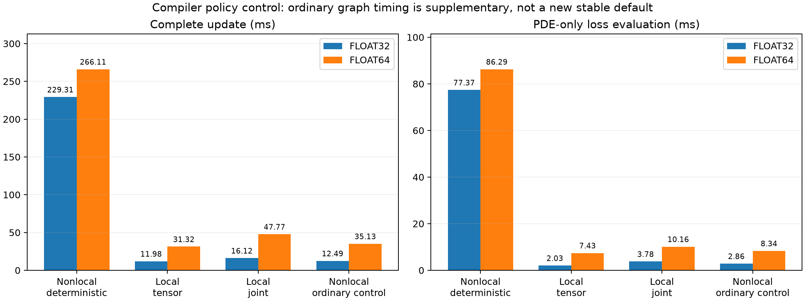

# Corrosion nonlocal versus local-AD performance — completed 2026-10-26

## Goal and outcome

User requested current SOTA versus local PDE/AD speed, including joint random
space/time sampling. Complete: six primary serial GPU workers (3 methods x2
precisions), four isolated graph-kernel policy workers, two additional ordinary
policy graph full-update workers. All12 workers exit0; GPU idle. No production
code/config/default/reference/checkpoint change or Git history operation.

Under the current deterministic GPU policy, local tensor is19.15x faster in
FP32 and8.50x in FP64; joint local is14.23x/5.57x faster than the current graph.
Crucial diagnosis: deterministic graph aggregation is the major throughput
bottleneck in this implementation. Ordinary-policy graph full updates take
12.49/35.13ms instead of229.31/266.11ms, close to local tensor11.98/31.32ms.
Do not attribute the original gap to the equations alone or time JVP versus grad.
Ordinary policy remains a timing diagnostic, not a promoted stable strategy.

## Controlled setup and sampling

Device reports RTX3090/49152MiB, driver580.82.09. Same current original-phase
corrosion config: FiLM4x64/gelu, KKS, raw stable q, AC L1 scale1e-7/CH1,
SOAP lr1e-3, preconditioner every5, GradNorm every25, cap10000, clip100,
normalized concentration BCs (s_bc), all5151 IC nodes,9 pit/201 solid BC nodes.
Stagger/causal/interface/time-window remain off. Same original seed42 initial
parameter file (verified exact); seed is run provenance, not a tuned option.
Inputs/initial parameters are common FP32-generated values exactly promoted
for FP64. Parameter/gradient/SOAP tensors follow precision; unchanged Optax
LR scalar schedule remains FP32. Highest matmul precision for every worker.

Initial model:
`/root/autodl-tmp/tf-logs/corrosion2d/20261025-transport-kks_raw_edges-chl1-s_bc-icmatched_graph-bcmatched_graph-phase-seed42/model_initial.eqx`.
Graph edges/weights match the existing reference; no reference trajectory is
used as training data or to score local accuracy. Raw logs/results/manifests:
`reports/local-ad-performance-20261026/` (kept at this path).

- graph: actual current make_training_losses/make_step, core256, Nt16, pool100;
  padded2559 spatial nodes and3032 edges. All times share the selected graph.
- local_tensor: same free core coordinates/time samples, padded256 points x16;
  batched time JVP, spatial phi/q Hessians by AD. No graph/halo in the PDE.
- local_joint:4096 independent continuous uniform (x,y,t) pairs each update over
  x in[0,1],y in[0,.5],t in[t_min,1]. Per-field scalar time grad, spatial AD
  Hessians; normalized BCs still use the same16 common sampled times.

Each method has exactly the same per-pool count of active residual observations:
235–252 free core nodes times16 =3760–4032, versus nominal4096. Local padding
is masked; joint mask has the same active count. Graph PDE layout has40944
space/time support entries including halo/padding; local layout4096. These are
support locations, not equivalent forward-operation counts: local AD requires
additional derivative work. Every update includes fresh time sampling and joint
sampling where applicable; common precomputed pools reflect actual usage.
Prepared graph-pool buffers are retained in benchmark workers, so memory is
measured process peak, not a theoretical minimum for a standalone local solver.

## Mathematical verification and scope

Local signs follow examples/electropolish2d/losses.py:152, D_delta -> -Laplacian:

$$
r_{AC}=\phi_t-N_3\Delta\phi+N_2(4\phi^3-6\phi^2+2\phi)
-N_1(c-\Delta c\,h(\phi)-c_{le})\Delta c\,h'(\phi),
$$

$$
r_{CH}=c_t-N_{CH}\Delta q,\qquad
q=\tfrac12c_{le}(\tanh v-1),\qquad c_{se}=1.
$$

Here h(phi)=3phi^2-2phi^3 and Delta c=c_se-c_le; all coefficients/time
are the same nondimensional ones as the current trainer.

Stable q Hessian equals the mixture-chain-rule Laplacian. Spatial AD uses
forward-over-reverse Hessians of(phi,q), then traces the two spatial axes;
outer parameter reverse AD therefore includes the required mixed derivatives.
No finite differences, stop-gradient shortcut or omitted concentration PDE.
Manufactured toy/chain-rule tests give max5.55e-17/2.42e-16, same-point tensor
and joint residuals agree, normalized IC/BC losses agree exactly, and parameter
AD0.104565906218 matches finite difference0.104565906212.

Only throughput is compared. Equal point count does not establish equal
accuracy, sample efficiency, physical operators or boundary treatment. Local
retains the same timed Dirichlet/IC data terms, but no additional local Neumann
problem/reference was constructed; finite-horizon graph boundary treatment is
not asserted equivalent to a completed local boundary-value problem. No local
5000-update convergence study or reference regeneration was requested/executed.

## Timing protocol and primary measurements

Separate processes, one GPU worker at a time. Explicit lower/compile, first
execution,50 warm-up updates total,75 measured updates covering three25-update
cycles (15 SOAP,3 GradNorm refreshes). Every returned pytree is synchronized
with block_until_ready; sampling/dispatch included, plotting/I/O excluded.
All losses/parameter gradients checked finite. Report mean across all75
updates; separate ordinary/refresh timings and raw three-cycle means retained.
PDE-only means are30 synchronized frozen-initial-model calls, sampling included,
after separate JIT warmup. IC/BC/optimizer are absent only in this PDE-only row.
Compilation is excluded from update timings; reported compile times are observed
under the study's persistent cache state, not intrinsic cold-compile rankings.
No projection of short timing runs into convergence or L2 performance.

Primary policy: --xla_gpu_deterministic_ops=true for all three methods.

| Precision | Method | Complete update ms | PDE-only ms | Peak active GiB | Observed compile s |
|---|---|---:|---:|---:|---:|
| float32 | graph | 229.311 | 77.369 | 1.536 | 185.98 |
| float32 | local_tensor | 11.977 | 2.035 | 1.047 | 141.88 |
| float32 | local_joint | 16.115 | 3.785 | 1.416 | 207.24 |
| float64 | graph | 266.108 | 86.285 | 3.066 | 166.64 |
| float64 | local_tensor | 31.324 | 7.434 | 2.161 | 141.35 |
| float64 | local_joint | 47.767 | 10.155 | 3.085 | 179.82 |

Local joint is34.6% slower than tensor inFP32 and52.5% slower inFP64 at the
same active count. This does not show which sampling method needs fewer
updates to achieve a target error.

## Compiler-policy diagnosis and full-step controls

Same actual padded operator shape2559x16,3032 edges, fixed common FP32 random
values promoted forFP64;30 synchronized samples after5 warmups. Independent
SciPy diagonal/offdiagonal or exact-edge-row-sum actions agree to relative
<=7.35e-8 FP32 /5.61e-17 FP64. Only compiler policy changes in separate workers.

| Precision | Policy | Diagonal+offdiagonal ms | Edge differences ms |
|---|---|---:|---:|
| float32 | deterministic | 38.30801 | 37.86458 |
| float32 | ordinary | 0.17772 | 0.17141 |
| float64 | deterministic | 38.81385 | 38.42151 |
| float64 | ordinary | 0.16628 | 0.17162 |

Two~38ms graph actions closely account for the~77ms deterministic FP32 PDE
forward cost. This motivates, but does not replace, the measured whole-update
control. Additional ordinary-policy workers use the exact same complete graph
loss/step/data/scales/initial state protocol with XLA_FLAGS empty:

| Precision | Complete update ms | PDE-only ms | Peak active GiB | Speedup vs deterministic graph |
|---|---:|---:|---:|---:|
| float32 | 12.487 | 2.858 | 1.535 | 18.36x |
| float64 | 35.132 | 8.339 | 3.065 | 7.57x |

Ordinary graph is only~4.3%/~12.2% slower than local tensor inFP32/64 here,
versus the large gap under the default deterministic policy. The current
implementation's compiler-policy-sensitive aggregation is therefore a major
measured bottleneck. Do not generalize this to every graph operator/GPU or infer
ordinary-policy long-run reproducibility. The canonical training adapter still
enforces the existing deterministic policy; no production switch was added.

## Joint-time grad versus JVP

Joint random points do not forbid JVP: hold all sampled spatial coordinates
fixed and apply an all-ones tangent to the vector of independent per-point
times. Time-only control, same4096 frozen points/model,30 synchronized samples:

| Precision | Per-field grad ms | Time JVP ms | Max absolute derivative difference |
|---|---:|---:|---:|
| FP32 | 0.89592 | 0.84542 | 6.71e-8 |
| FP64 | 3.42456 | 2.05753 | 1.39e-16 |

These controls exclude spatial Hessians, parameter gradients, BC/IC and sampling;
do not treat this time-only ratio as the full-step speedup. Joint full-step
rows above use the requested time-grad path. No Nx*Nt-fold AD-mode claim.

## Sources, artifacts and verification

[Primary benchmark](local-ad-performance.py),
[manufactured/preflight checks](local-ad-performance-check.py),
[preflight output](local-ad-performance-check.json),
[operator policy controls](local-ad-performance-operator.py),
[ordinary full-step controls](local-ad-performance-ordinary.py),
[validation/plot script](local-ad-performance-summarize.py),
[complete raw-record summary](local-ad-performance-summary.json).
Individual raw JSONs/manifests are copied alongside this record with the same
local-ad-performance prefix. Full stdout logs remain under the direct reports
path above. Sources are runnable as docs.tasks.archive modules from project root;
GPU drivers deliberately require fresh output paths and refuse overwrites.
Choose a new OUT path in an isolated copy to repeat the complete run.

[Primary timing/memory/compile figure](local-ad-performance-summary.png),
[vector primary export](local-ad-performance-summary.svg),
[vector policy export](local-ad-performance-summary-policy.svg).

Validation: manufactured identities and mixed AD; all12 subprocess statuses;
exact shared initial parameters/graph data; same initial IC/BC losses across
methods; all dtypes/finite flags/shapes/active counts;75 samples/3 refresh cycles;
first graph losses replay earlier benchmark within declared floating tolerance;
SciPy operator actions; strict JSON, source AST, direct links and diff format.
Plots visually inspected. All27 archived files/17 strict JSONs, five source
ASTs, relative links,12 worker statuses and operator accuracy checks pass.
Artifact inventory5 cases/303 directories and git diff --check pass.
No production tests repeated for these isolated tools.

## Status and next action

Complete, no blocker. Keep current stable default and its precision policy.
Potential follow-up: optimize deterministic graph aggregation while preserving
numerics/reproducibility, or design separately matched local accuracy/reference
experiments. Neither is delivered or claimed by this throughput study.
