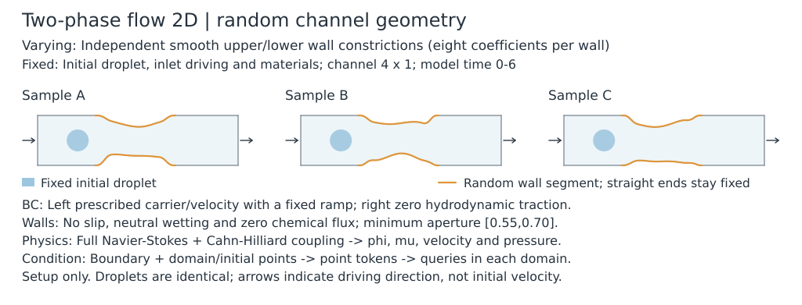
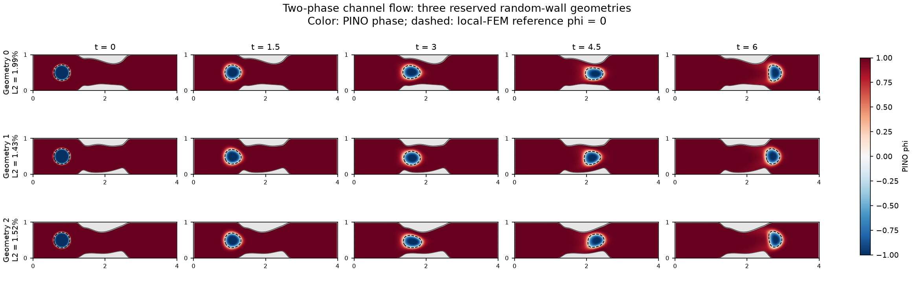

# Two-phase flow 2D — geometry-parameterized NS–CH PINO

## PINO overview

Predict droplet transport/deformation and the coupled flow through a smooth
channel with independently randomized upper and lower walls. **Only geometry
varies**; the initial droplet, inlet driving and material parameters stay fixed.
This example solves full Navier–Stokes/Cahn–Hilliard coupling, distinct from
the prescribed-flow CH pilot in `twophase2d`.

### Problem setup

The constant-density/viscosity local model is

$$
\rho(\mathbf u_t+\mathbf u\cdot\nabla\mathbf u)
=-\nabla p+\eta\Delta\mathbf u-\phi\nabla\mu,
\qquad\nabla\cdot\mathbf u=0,
$$

$$
\phi_t+\nabla\cdot(\phi\mathbf u)=M\Delta\mu,
\qquad\mu=A(\phi^3-\phi)-\kappa\Delta\phi.
$$

Here \(A=3\sigma/(2\sqrt2\epsilon)\), \(\kappa=A\epsilon^2\).
The undeformed channel is4x1. Each wall has8 positive quartic B-spline
coefficients and a compact C3 taper on x=[1.15, 2.75]. Constrained proposals
produce minimum aperture[0.55, 0.70], bounded slope/curvature and straight ends.
Independent wall profiles naturally allow asymmetric constrictions.

The common upstream droplet has center(0.8, 0.5), radius 0.22 and transition0.05;
its phase is negative inside and positive in the carrier. The horizon is6,
with density1, viscosity0.2, mean inlet speed0.2, surface tension0.2, epsilon 0.05,
mobility 0.0005 and a one-unit inlet ramp. Solid walls are stationary/no-slip,
neutral-wetting and chemical no-flux. The inlet supplies carrier phase and a
parabolic velocity; the outlet has zero hydrodynamic traction and zero phase/
chemical normal gradients. Traction fixes the pressure reference without a
separate pressure-point anchor.



The initial droplet and inlet drive stay fixed; only the two wall profiles vary.
These are setup inputs, not predicted flow fields.
[Setup figure inputs and regeneration](../../artifacts/pino_setup_schematics.json).

### Important strategies

| Component | Selected operator recipe |
|---|---|
| Condition / encoder | Boundary(x, y, nx, ny, type) and domain(x, y, phi0) point streams, with physical measures |
| Network | Width192, 4 heads of48, 2 condition blocks, 3 temporal decoder layers, 64 spatial Fourier directions |
| Physical outputs | Phase, chemical potential, velocity, pressure; velocity from a streamfunction |
| Hard constraints | Phase/velocity IC and inlet data; wall velocity, section flux and incompressibility through the lift/curl |
| Spatial derivatives | Moment-corrected integral gradients/Laplacians and BC derivatives, horizon 0.075, capacity128, cubic moments |
| AD work | Streamfunction-to-velocity spatial curl; physical time JVP; parameter gradients through all operations |
| Residual loss | Nine original MSE terms with fixed normalizers; chemical output/row/BC scales4/1/4; no tanh, causal, stagger or gradient balancing |
| Sampling |192x80 subdivisions, 15633 nodes; 36 fresh stratified times/update; two18-time blocks averaged before one update |
| Online geometry |16-slot rolling input pool, B8 with replacement; 2 CPU workers replace2 slots every 50 updates |
| Optimizer | SOAP 20000 cold updates, lr 1e-3 to1e-5, decay `10**(-0.2)` every2000updates, beta 1=beta 2=0.9, refresh 5; ordinary FP32/highest |

The initial droplet is not itself a randomized input. Geometry enters through
physical point sets, normals, operators and the known hard lift; 16 wall
coefficients are not extra learned encoder tokens. Integral consistency does
not by itself supply all physical BCs or exact mass/energy conservation.

### Representative results

Selected SOTA/default, fixed-budget20000 checkpoint:
`/root/autodl-tmp/tf-logs/channel_nsch2d/20261103-pro6000-integral-random-walls-online-width192-b8-time18-nt36-cold20k-lr1e5-04/model_final.eqx`.

| Relative L2 | Development geometry | Mean of3 reserved geometries |
|---|---:|---:|
| Phase, pooled13 times |1.4496%|1.6435%|
| Phase, terminal t=6 |1.9020%|2.1961%|
| Velocity |1.3312%|1.5172%|
| Pressure |4.6703%|5.2840%|
| Minority-phase field |3.8305%|4.3306%|
| Chemical potential |11.6744%|13.9541%|

References are independent, spatial/time-refined **local mixed FEM** solutions.
Each case uses3840 physical queries and13 saved times; flow/muerrors exclude t=0.
The same3 reserved geometries have been reused for validation, not a broad blind
test. Worst reserved pressure error is6.5885%; pressure's between-geometry
response remains less accurate than its total field error suggests. Final
replay/input/constraint checks and252fresh-time diagnostics completed. Average
errors improve over10k, with mixed per-case results documented below.



Rows include all3 predeclared reserved geometries. Columns are0, 1.5, 3, 4.5, 6.
Color shows saved PINO phase; dashed lines are local-FEM \(\phi=0\) interfaces.
The same physical axes are retained; droplet positions are not shifted to align
with the reference. The common color scale spans[-1, 1]; numerical fields are
not clipped. Full speed/pressure galleries remain external artifacts.

### Spatial sampling experiment

The [matched study preset](configs/train_spatial_control.py) keeps the full
geometry encoder and all explicit boundary residuals. It compares the full
grid with 512 scattered PDE draws or 512 draws from eight local tiles.
Every selected row keeps its complete nonzero stencil. Halo points enter the
field queries and support derivatives. The sampled residual mean uses only the
core rows with their original physical measure in expectation.

In the scatter arm each draw is proportional to nodal area. In the tile arm
the probability of a tile is proportional to its total area. Within a tile,
the original nodal weights and, for larger edge tiles, inverse inclusion
probabilities weight the 64 selected rows. Geometry and spatial pools refresh
independently on reproducible schedules. The [study record](../../docs/tasks/archive/pino-spatial-sampling-study.md)
gives the current device, budgets and queue.

### Run and reproduce

```bash
source .venv/bin/activate
XLA_PYTHON_CLIENT_MEM_FRACTION=0.97 python -m examples.channel_nsch2d.train
```

The no-argument entry selects this operator via `configs/train_default.py`.
The qualified96 GB PRO6000 run used about83.50 GiB peak active memory and9.16h
training wall time. The selected18-time-block configuration and historical
smaller-card controls are given
in [default training configuration](#default-training-configuration).
The reference root is
`/root/autodl-tmp/data/channel_nsch2d/random-walls-20261102-02`.
[Complete run/audit record](../../docs/tasks/archive/channel-cold20k-and-four-pino-setups.md),
[figure sources and regeneration](../../artifacts/pino_readme_figures.json).

### Selected20k strategy and historical10k comparison

The default `train_operator_random_walls_width192_batch8_time18_nt36_cold20k.py`
starts a fresh model and complete SOAP state for20000 updates, with36fresh
continuous-stratified times in two18-time blocks, geometry batch8and horizon6.
The existing exponential LR schedule uses
initial1e-3, decay interval2000, rate `10**(-0.2)` and floor1e-5: about1e-4 at10k
and1e-5 at20k, versus1.6807e-4 at the old10k endpoint. The last applied update
uses the19999 schedule index, approximately1.00023e-5. The historical10000/
40-time/block20preset retains its original values for comparison.

The explicit `train_operator_random_walls_width192_batch8_time20_cold20k.py`
and `train_operator_random_walls_width192_batch8_time8_cold20k.py` controls keep
40random times with blocks20and8respectively. The8block reduces memory at the
cost of more work and a different reduction order. Their40-time sampling is
distinct from the selected36-time default. Recorded memory/resource results
remain attached to their original configurations and devices.

```bash
XLA_PYTHON_CLIENT_MEM_FRACTION=0.97 python -m examples.channel_nsch2d.train \
  --config=examples/channel_nsch2d/configs/train_operator_random_walls_width192_batch8_time18_nt36_cold20k.py
```

The finite owner `docs/tasks/channel_cold20k_runner.py` checks the matching
completed10k control, same-GPU/same-shape memory evidence and full802-draw input
construction prefix before launching canonical train.py. It checks actual cold
model/fullSOAP/input equality and, after training, audits/replays the complete
rolling stream, same3reserved FEM cases, fresh-time residuals and field figures.
No FEM generation, fitted-checkpoint import, automatic retry or default promotion
is included. Runtime seed is comparison provenance, not a strategy field.
The smaller-block owner route additionally requires explicit
`--execution-time-block=8` and a matching8-block resource probe; the original
route continues to reject undeclared execution changes. A finite probe's JIT
wrapper is not the exact canonical training executable: validate actual
production updates as well, with memory headroom.
The36/18route uses explicit `--execution-time-block=18` and a matching probe
with `--time-block=18 --time-samples=36`. Its time draws are independently
replayed in36strata; they do not equal the previous40-column time arrays.
Its finite owner uses252fresh diagnostic times, divisible by18; the20/8routes
retain240. These diagnostic samples do not change the training time batch.

The completed36/18cold20k run is
`/root/autodl-tmp/tf-logs/channel_nsch2d/20261103-pro6000-integral-random-walls-online-width192-b8-time18-nt36-cold20k-lr1e5-04`.
Its development-case errors are phi1.4496%, terminalphi1.9020%, velocity1.3312%,
pressure4.6703%, minority3.8305%and chemical11.6744%. Same three reserved
geometries, unchanged refinement-validated local FEM/query arrays:

| Mean relative L2 | Completed10k | Completed20k |
|---|---:|---:|
| Phase field |1.8396%|1.6435%|
| Terminal phase field |2.2708%|2.1961%|
| Minority fraction |4.8474%|4.3306%|
| Velocity |2.0160%|1.5172%|
| Pressure |5.4118%|5.2840%|
| Chemical potential |15.9168%|13.9541%|

Velocity improves on all three cases. Pressure worsens on cases000and002but
improves on case001; its worst-case error drops9.0316%to6.5885%. Phase worsens
slightly on case000; terminal phase worsens on000and001. Thus longer training
has mixed per-case benefits. Mean phase/velocity reductions are10.7%/24.7%;
the mean pressure reduction is2.4%. This is one initialization and three reused
reserved cases, with budget/LR and36vs40time sampling changing together.
The20krecipe is now selected as the default; this does not imply uniform
per-case or cross-seed improvement. Raw paired results/provenance are under the
run's `unseen3/evaluation.json` and the external preparation root's
`final-completion-20261103-210103/endpoint-comparison.json`. The original owner
stopped at the now-corrected240/18diagnostic-count check; its failure journal
is retained separately from the explicit saved-model completion record.

<details>
<summary>Detailed formulation, single-problem PINN defaults and historical controls</summary>

This experimental example develops geometry-only operator learning for a full,
unsteady incompressible Navier–Stokes/Cahn–Hilliard model. The selected random-wall
operator has completed cold training and evaluation against refinement-validated
independent local FEM references on one development and three reserved geometries.
The existing periodic
`twophase2d` prescribed-flow pilot is unchanged.

## Default training configuration

`train.py` defaults to `configs/train_default.py`, selecting the completed
random-wall recipe in `train_operator_random_walls_width192_batch8_time18_nt36_cold20k.py`.
New runs start cold and receive automatic timestamp names. Seeds are runtime
provenance through `--seed`, not strategy configuration fields.

| Setting | Default |
|---|---|
| Geometry | Independent upper/lower smooth profiles,8B-spline coefficients per wall; minimum aperture[.55,.70] |
| Network | Width192,4heads (48channels/head),2condition blocks,3decoder layers;64spatial Fourier directions |
| Training | SOAP20000updates,lr1e-3->1e-5,decay `10**(-.2)` every2000updates,beta1=beta2=.9,precondition every5updates; ordinary FP32/highest |
| Geometry sampling | Online16-slot pool, batch8with replacement;2CPU workers replace2slots every50updates |
| Time sampling |36fresh continuous stratified times per update, physical timeJVP; terminal time6 |
| Spatial derivatives | Moment-corrected quadratic-kernel integral operators, horizon.075,capacity128,degree3; conservative phase flux |
| Time gradient blocks |18times each; average both same-parameter gradients before one SOAP update |

The qualified RTX PRO6000 96GB run used **83.50GiB peak active memory** and
about1.61seconds/warm update (9.16hours training wall time). Set the allocator fraction
explicitly for this aggressive default:

```bash
source .venv/bin/activate
XLA_PYTHON_CLIENT_MEM_FRACTION=0.97 python -m examples.channel_nsch2d.train
```

Historical smaller-card controls explicitly select
`configs/train_operator_random_walls_width192_batch8.py` (two-time blocks,
about19GiB active), or its `_time8.py` variant (about40.2GiB active).
These retain their original40-time objective and10000update budget; they are
not the new36-time/20000default. Floating-point reduction order and trajectories
can differ. No automatic memory fallback is applied. A historical32GB control is:

```bash
python -m examples.channel_nsch2d.train \
  --config=examples/channel_nsch2d/configs/train_operator_random_walls_width192_batch8.py
```

All nine soft losses are summed after their fixed residual normalization:

| Residual | Divisor before squaring |
|---|---:|
| CH transport |0.2|
| Chemical-potential relation |1|
| Both momentum components |1|
| Wall/outlet phase Neumann |1|
| Wall/outlet chemical Neumann |4|
| Outlet traction |1|

Chemical-potential output amplitude remains4, independent of the chemical-row
divisor1. Stream/pressure output amplitudes are.2/1. Known initial fields,
inlet data and stationary-wall velocity use hard lifts. Streamfunction curl
still uses spatial AD; integral derivatives do not automatically impose all
physical boundary conditions. Adaptive gradient balancing, causal weights,
staggering and tanh residual transformation are absent from this default.

The default loads the existing local-FEM reference by direct path:
`/root/autodl-tmp/data/channel_nsch2d/random-walls-20261102-02/development`.
The independent three-case manifest is
`/root/autodl-tmp/data/channel_nsch2d/random-walls-20261102-02/unseen3/manifest.json`.
These evolved fields are evaluation labels only; training uses zero evolved-field
labels. New FEM references must match the physical configuration and pass spatial
and temporal refinement. Do not overlap FEM/MPI and JAX GPU work.

The selected saved20000checkpoint is
`/root/autodl-tmp/tf-logs/channel_nsch2d/20261103-pro6000-integral-random-walls-online-width192-b8-time18-nt36-cold20k-lr1e5-04/model_final.eqx`.
Its relative L2 errors against local FEM are:

| Evaluation | Phase, all saved times | Phase at t=6 | Velocity | Pressure | Chemical potential |
|---|---:|---:|---:|---:|---:|
| Development geometry |1.45%|1.90%|1.33%|4.67%|11.67%|
| Three reserved geometries, mean |1.64%|2.20%|1.52%|5.28%|13.95%|

Each geometry uses3840physical query points and13saved times; velocity,
pressure and chemical errors exclude time0. Worst reserved pressure error is
6.59%. These are three predeclared, reused validation cases, not a large blind
test or cross-seed guarantee. The monitored phase minimum at18000was not saved;
the default is based on the actual20000weights. Final replay, hard constraints,
online-input/cold-SOAP checks and252independent-time diagnostics completed.
Historical presets retain their old values, including the stronger single-bump
GMLS recipe and `configs/train_operator.py` mild pilot. Full evidence is in the
[20k task record](../../docs/tasks/archive/channel-cold20k-and-four-pino-setups.md).

## Formulation and optional controls

The upper/lower stationary walls independently indent inward using the smooth
random profiles defined in the random-wall section below. The historical
single-bump presets use a compact smooth bump;
their amplitude sum controls narrowing and their difference produces centerline
displacement. Inlet/outlet straight sections, initial droplet and all physical
parameters/driving laws stay fixed. No internal holes or extra offset parameter.

For matched constant density/viscosity, the dimensional pilot equations are

$$
\rho(\mathbf u_t+\mathbf u\cdot\nabla\mathbf u)
=-\nabla p+\eta\Delta\mathbf u-\phi\nabla\mu,
\qquad\nabla\cdot\mathbf u=0,
$$

$$
\phi_t+\mathbf u\cdot\nabla\phi=M\Delta\mu,
\qquad \mu=A(\phi^3-\phi)-\kappa\Delta\phi.
$$

Use the energy density A(phi²−1)²/4+kappa|grad(phi)|²/2 and set
kappa=A epsilon², A=3 sigma/(2 sqrt(2) epsilon). This gives planar equilibrium
surface tension sigma. Pressure here follows the capillary-force convention
−phi grad(mu); changing to mu grad(phi) also changes the pressure/traction convention.

Velocity is zero at both stationary walls. The inlet has a fixed parabolic
profile and a smooth ramp from zero flow; initial velocity is zero. The outlet
has zero hydrodynamic traction, fixing the pressure reference with no extra
point pressure anchor. The carrier phase/mu inlet reservoir is(+1,0), neutral phase
wetting and chemical no-flux are imposed on solid walls, and natural zero normal
phase/chemical gradients are used at the distant outlet. Open-channel phase
mass obeys boundary flux balance; no constant-mass projection is applied.

Initial phi is a fixed compact C2 radial smoothstep in squared radius, saturated
to ±1 outside its transition band. This avoids a hidden incompatible initial
normal derivative at a wall or prescribed inlet. It contains no future interface
motion. Terminal time is chosen so the droplet remains upstream of the outlet.

The pilot fixes L=4,H=1,rho=1,eta=.2,U=.2,sigma=.2,epsilon=.05,M=.0005,T=6,
with a one-unit smooth flow ramp (Re=1 based on the undeformed channel height).
The compact C3 wall bump is

$$
b(x)=\max\{1-[(x-2)/0.9]^2,0\}^4,\qquad
y_b=a_b b(x),\quad y_t=1-a_t b(x).
$$

In the historical stronger single-bump preset, each inward amplitude is drawn
uniformly from[.06,.20]. Only those two geometry parameters vary; no random velocity, material, initial phase or future trajectory.
The default keeps16geometry/operator inputs in a rolling pool, replacing2every50
updates using two CPU workers. No evolved field labels are in that bank. The
historical mild pilot instead used[.04,.14] and a fixed16-input bank.

For the streamfunction recipe, let e=(y-y_b)/(y_t-y_b), Q(t) the prescribed
inlet flux, and g(t)=1-exp(-t/.25). Learn a free scalar correction Npsi:

$$
\psi=Q(t)(3e^2-2e^3)+0.2g(t)(x/4)^2\,16e^2(1-e)^2N_\psi,
\qquad (u_x,u_y)=(\psi_y,-\psi_x).
$$

This enforces divergence0, cross-section fluxQ, stationary-wall no-slip and
the initial/inlet velocity. It does not solve momentum or prescribe the evolving
droplet. The loss omits duplicate continuity/velocity-Dirichlet terms. Raw outputs
are(phi,mu,psi,p) in this base recipe; physical fields remain(phi,mu,ux,uy,p).
The optional mixed-stress recipe below changes raw outputs only. Phase uses only the
known initial field and a normalized zero-at-initial/inlet lifting. Mu is a
separate learned field. The default uses the original residual; optional tanh
coordinate/residual controls are documented below.

The shared heterogeneous point encoder receives two weighted streams:
192boundary tokens(x,y,nx,ny,type) and15633domain tokens(x,y,phi0), at width192
with4heads and2condition blocks. Coordinate cross-attention prepares features
once per spatial set; a3layer temporal decoder reuses them across query times.
Different geometries have different physical coordinates, with fixed tensor
sizes. The query carries coordinates/time, not an extra initial-field input.

The optional GMLS controls
`configs/train_operator_width128_gmls_densebc_online.py` and
`configs/train_operator_width128_gmls_densebc_balanced_online.py` keep that
encoder stream unchanged while evaluating BC losses at192 Gauss-Legendre
points per side. Positive arc-length quadrature weights preserve the physical
boundary average and endpoint clustering samples narrow corner neighborhoods;
no corner vertex is assigned an ambiguous normal. `sample.boundary_points`
still controls the original encoder midpoint count. The explicit
`boundary_sampling` record separately controls the BC queries. Its absence
preserves historical inputs and outputs exactly.

The second control adds the existing stopped inverse-L1-gradient-norm weights
for phase, chemical-potential relation, momentum and boundary groups. It uses
the original explicit repository settings (epsilon1e-6,cap1000,new EMA fraction
.9,refresh every100updates). This is gradient-norm balancing, not the learned
GradNorm objective. Both retain the same physical PDEs, AD streamfunction curl,
GMLS residual derivatives/Laplacians, BDF2 and online random geometry inputs.
No reference labels, phase-region masks or additional physical constraints
enter training. The completed matched20k controls did not improve field or
droplet-shape accuracy; inverse-gradient weighting left a large initial-time CH
residual despite tighter boundary enforcement. These remain research controls;
defaults are unchanged. See the [completed investigation](../../docs/tasks/archive/channel-derivative-clarification.md)
for the comparison and independent checks. Use each checkpoint's saved config
for evaluation.

The opt-in `configs/train_operator_width128_gmls_time40_jvp_allterms_online.py`
tests independent adaptive weights for all nine soft terms on the stronger
geometry family. It preserves the physical output amplitudes(mu4,stream.2,p1),
sets the phase/chemical/momentum/Neumann/traction residual divisors to1, and
uses the existing inverse-L1-gradient/EMA algorithm with cap1000,epsilon1e-6,
new-weight fraction.9 and refresh100. This is not original learned GradNorm.
All40 continuously resampled times contribute to each term's gradient before
its norm is taken. Eight-time blocks bound memory; one joint SOAP update follows
the full weighted mean gradient. No causal weighting, evolved labels, regional
weights or time windows are added. The completed matched cold5000 control gives
phi2.877%,velocity5.126%,pressure8.267%,mu38.927%, versus fixed-scale
1.947%/3.059%/3.945%/19.599%. Terminal minority-field L2 is7.689% versus4.869%.
Independent240-time probes find tighter boundary residuals but larger CH and
chemical-relation residuals. Thus equalizing parameter-gradient norms does not
automatically give the best physical accuracy at this budget. Keep this scheme
opt-in; current recommendations/defaults remain unchanged. These are one nominal
development geometry/initialization results, not population accuracy or a test
of every GradNorm variant. See the [completed comparison](../../docs/tasks/archive/channel-allterms-gradnorm.md).

An opt-in experimental `pressure_coordinate.kind=chemical_shift` interprets
the raw pressure channel as Pi=p+phi*mu. The physical wrapper returns
p=Pi-phi*mu; momentum, outlet traction and reported FEM errors always use this
original p. Thus grad(p)+phi*grad(mu)=grad(Pi)-mu*grad(phi) under the existing
AD first derivatives. No zero-traction condition is imposed on Pi itself.
Absence retains the original arithmetic/parameter tree. Load each checkpoint
with its saved configuration: adding the flag changes pressure semantics.
The frozen-basis control did not improve accuracy, so this is not a default.

An opt-in `stress_formulation` uses the established mixed Newtonian-stress
formulation of [Rao--Sun--Liu2020](https://arxiv.org/abs/2002.10558), Eqs3--4.
Its six raw outputs represent(phi,mu,psi,sigma_xx,sigma_xy,sigma_yy), with the
same physical pressure p=-(sigma_xx+sigma_yy)/2. Momentum uses -div(sigma) and
the unchanged capillary force. Exact streamfunction incompressibility leaves
only two independent constitutive equations:

$$
\frac{\sigma_{xx}-\sigma_{yy}}{2}=\nu(\partial_xu_x-\partial_yu_y),
\qquad \sigma_{xy}=\nu(\partial_yu_x+\partial_xu_y).
$$

Enforce these in the interior and on the existing boundary queries. Retain all
original physical boundary losses, including traction computed from physical
velocity/pressure. There is no added pressure/trace/continuity or second
traction loss. This gives13raw loss components: the original9plus two interior
and two boundary constitutive components. The explicit constitutive scale is
the existing pressure unit1. No region/GradNorm/stagger or tanh weighting is
combined with the first trial. The velocity Laplacian is eliminated; stress
gradients use spatial AD, phi/mu Laplacians still use GMLS, and the highest
velocity AD order remains the existing streamfunction Hessian. This is not an
all-spatial nonlocal method.

`configs/train_single_lbfgs_stress.py` imports the audited dt.025SOAP parent
into the full-time250step finisher. Copy every nonoutput array and the first
three output rows; set sigma_xx=sigma_yy=-parent_pressure and sigma_xy=0.
This adds194parameters at width96and preserves initial physical fields and
derivatives. The initial auxiliary stress need not satisfy its constitutive
equations. Parent SOAP state is retained as provenance only; no shape-state
migration is claimed. `train_operator_stress_online.py` is the untrained cold
counterpart with the same original-function initialization. Missing this record
preserves all legacy checkpoint arithmetic; do not load a four-output checkpoint
directly into the six-output template. Neither recipe is a validated default.

`configs/train_single_lbfgs_stress_equilibrated.py` changes only that auxiliary
initialization. Its explicit `train.refinement.stress_initializer` names the
model/report/quadratic by absolute file paths and requires
`kind=physics_auxiliary_block`. A frozen-feature194variable least-squares solve
uses the existing momentum and constitutive losses at every240BDFnode, keeping
phi/mu/psi/physical pressure fixed. No evolved labels or new weights are used.
Before import, reconstruct both rounded auxiliary output rows from stored
coefficients and compare every other model array exactly; replay the physical
fields. Copy all three payloads into the new run and repeat reconstruction in
the independent final audit. This is a warm-transfer experiment, not exact
SOAP/L-BFGS state recovery or evidence of improved trained L2. Cold online
initialization and all defaults remain unchanged.

`configs/train_single_width128.py` is a separate cold capacity control: plain
four outputs, width128/four heads,64spatial Fourier directions, existing8linear
time directions/maxfrequency2,192x80GMLS3/SBP/dt.025and20000SOAPupdates. It changes
no loss weights or physical constraints. SOAP axis cap256still covers the
feedforward width256. This cold finest-grid path differs from the staged96
parent; it is not an isolated width-only attribution. The matching
`train_operator_width128_online.py` retains the original continuous prior,
rolling pool and20kbudget. Both are experimental until measured and audited.

The matched `train_single_width128_dual_time.py` and
`train_operator_width128_dual_time_online.py` change only the existing time
coordinate to four linear plus four log directions, retaining eight directions,
bandwidth2and lifting scale.25. Initial model arrays and all physical BDF times
are unchanged; no extra residual weights or learned trajectory priors are added.
Compare the full cold20kbudget before promoting either variant.

Reference: independent fully implicit mixed Taylor–Hood velocity/pressure and
mixed phase/chemical FEM with BE-started BDF2, executed in `fenicsenv`; JAX runs separately in `.venv`.
Check space/time refinement and physical diagnostics before training. New logs,
weights, arrays and figures remain under existing external data/tf-logs roots.

`solver.fem(..., diagnostic_callback=callback)` optionally passes
`(time, (velocity, pressure, phi, mu), mesh, facet_tags)` at saved snapshots.
Callbacks must be read-only; omitting this diagnostic hook preserves the solver.
Audit natural BCs both at training sites and at independent denser sites,
including near inlet/outlet corners. A low sampled boundary loss alone does not
certify the continuous boundary traces. Native FEM natural BCs are imposed
weakly and need not have exactly zero pointwise derivative/traction traces.

For the historical mild case, the accepted local reference is64×24Taylor–Hood/mixed FEM, dt=.025,BDF2,26909DOFs.
Against40×16and dt=.05 controls, maximum-time phi discrepancies are1.56%/0.77%,
velocity1.54%/0.22%, pressure3.19%/2.01%. Chemical potential is less precise
(11.85%/15.56%) and is reported outside the phi/velocity/pressure gate.
The original monitor queries32×12interior points at13times for one development
geometry(.12,.08). Dense export controls additionally use96×40interior queries;
neither is an evaluation over the geometry distribution.
Training and refinement L2 norms have separately named weights in validation.
These full-domain gates do not by themselves certify droplet shape. Also compare
minority-fraction, interface and zero-contour metrics across reference meshes and
time steps; `docs/tasks/channel_fem_shape_audit.py` audits existing common-query
exports without new solves. Agreement between refinements of one implementation
does not exclude a shared formulation error. Keep local-reference uncertainty,
nonlocal discretization and network optimization errors distinct when interpreting
PINO/FEM shape differences; a lower weighted training loss alone certifies none
of these.

Explicit historical mild-pilot launch (after generating/validating its reference):

```bash
source .venv/bin/activate
python -m examples.channel_nsch2d.train \
  --config=examples/channel_nsch2d/configs/train_operator.py
python -m examples.channel_nsch2d.validate_run --run /absolute/run/directory
python -m examples.channel_nsch2d.evaluate \
  --fields /absolute/run/directory/prediction.npz --output /absolute/figure/directory
```

The historical `train_operator.py` preset selects
SOAP5000,lr=.001,beta1=beta2=.9,precondition every5
updates, condition batch2 and4fresh stratified times. Arithmetic isFP32 with
ordinary GPU compilation. The base recipe has the same formulation with Adam;
neither is promoted as SOTA. The seed is runtime provenance via`--seed`.
Known inputs, actual condition/time draws, source snapshot, initial/final model,
final optimizer, per-loss terms and one-geometry FEM metrics are saved separately.

For independent FEM, deactivate `.venv` and activate `fenicsenv`; never run its
MPI solver concurrently with JAX GPU work. Repeat the solver for grid40×16/
dt.025,64×24/dt.05,and64×24/dt.025, then pass all three to validate_reference:

The commands below reproduce the historical mild geometry. To reproduce the
stronger single-bump geometry, pass the explicit stronger GMLS config to both
modules, use solver amplitudes `--upper .18 --lower .12`, and export matching
`--query-grid 96 40` points in every solve. The random-wall default instead uses
its16coefficients and the qualified reference trios described below. Select
fresh output paths.

```bash
python -m examples.channel_nsch2d.solver --grid 64 24 --dt .025 --query-grid 32 12 \
  --upper .12 --lower .08 --output /absolute/data/bdf-fine.npz
python -m examples.channel_nsch2d.validate_reference \
  --coarse /absolute/data/bdf-coarse.npz --time /absolute/data/bdf-time.npz \
  --fine /absolute/data/bdf-fine.npz
```

Earlier direct5channel fixed-geometry controls are retained by
`configs/train_linear.py` and `configs/train_normalized_direct.py`; absent
velocity/lifting extension records preserve their original arithmetic. At5000
Adam updates the linear control had phi41.99%/u38.63%, normalized direct control
phi43.35%/u98.86%. The latter lost flow from.19995at inlet to.00180at outlet,
despite roundoff-level primal/JVP consistency. These failed controls motivated
the exact streamfunction constraint; lower loss alone is not validation.
The width96/streamfunction SOAP operator trial finishes5000updates in1001s,
with52.9ms warm updates and2.80GiB measured active device peak. On the one
development FEM geometry, equal-query pooledphi/u/p errors are30.59%/4.82%/
22.96%; terminalphi33.73%. This is not an accurate coupled solution. The
dispersed-fluid phase area falls0.15203->0.05587, versus approximately0.15209 in
FEM. Field replay passes7.15e-7; velocity flux/divergence constraints pass, so
the failure cannot be dismissed as a lost inlet flow. All16conditions are visited
592..668times. No parameter or default is promoted on the basis of this trial.
The GMLS native coupled baseline is not yet independently validated, so these
errors do not separate spatial-operator and neural approximation errors.
Initial pilot artifacts used inherited metric names`solid`/`solid_area` for
the dispersed fluid; these are not a solid phase. New reports call them
`dispersed_phase`/`dispersed_area`, while original artifact contents are retained.

`diagnose_phase.py --run /absolute/run/directory --advection-grid 192 80`
checks the open-domain integral phase law, separates the volume/boundary
advection and Laplacian Gauss defects, and refines diagnostic quadrature while
holding encoder inputs/model fixed. It also checks large AD gradients against
central differences. This is diagnostic physics, not an extra training loss or
a constant-mass assumption at an open boundary.

At t1.5 the trained-grid weak phase-balance defect is.17551, versus integrated
strong residual3.86e-5; the transport volume/surface gap is-.17545. Holding the
3977encoder points fixed and integrating on15633queries changes that gap to
.02580, while the storage defect remains.17544. The3largest transport-gradient
locations agree with independent central differences to4.15e-5/6.23e-5relative.
This supports spatial residual/quadrature aliasing as a concern and rules out
a large AD-gradient error at those checked points. It is not a quadrature-
convergence or unique-cause proof. The mobility-scaled Laplacian Gauss defect
is only2.51e-5in that coarse diagnostic, so blaming GMLS diffusion alone is
unsupported. Prioritize consistent conservative phase transport/spatial
collocation checks before a larger network or accuracy claim.

Run-specific results and exact resume state are in
[the task record](../../docs/tasks/archive/channel-nsch-pilot.md).

The default uses physical timeJVP and precomputed moment-corrected integral
spatial gradients/Laplacians on physical domain/wall nodes. The physical
streamfunction-to-velocity curl remains spatial AD.

Current derivative paths are explicit:

| Quantity | Method |
|---|---|
| Physical time derivatives | Time JVP |
| Velocity from psi | Spatial AD: ux=psi_y,uy=-psi_x |
| First field/pressure gradients, normal gradients and outlet stress | Precomputed moment-corrected integral operators |
| Physical Laplacians of phi,mu,ux,uy | Integral operators: horizon.075,capacity128,cubic moments |
| Loss gradients with respect to parameters | Reverse AD through all operations |

The original single-bump integral control remains available as
`configs/train_operator_width128_integral_time40_jvp_stronger_online.py`.
It retains the historical stronger GMLS recipe's physics, single-bump geometry
prior, network, hard lifts, timeJVP40, SOAP5000 and rolling input identities.
Only the spatial PDE/BC stencils and corresponding flux selector change.
Its kernel is the same quadratic radial influence used by the repository's
2D scalar integral operators:

$$
k_\delta(r)=\frac{120}{\pi\delta^4}(1-r/\delta)^2\,\mathbf 1_{r<\delta},
\qquad \delta=0.075.
$$

Use all physical neighbors inside that radius, with a padded capacity128;
overflow or unresolved moments fail rather than truncate/expand the horizon.
With nodal volume \(V_j\), baseline coefficients are
\(a^0_{x,j}=k_\delta V_j\xi_{j,x}/2\),
\(a^0_{y,j}=k_\delta V_j\xi_{j,y}/2\), and
\(a^0_{L,j}=k_\delta V_j\). The full-ball second moment is \(2I\).
For centered, factorial-scaled Taylor monomials \(B\) through degree3 (excluding
the constant), set \(W=\operatorname{diag}(k_\delta V_j)\). Each derivative
target \(t\) determines the corrected coefficients:

$$
a=a^0+WB(B^TWB)^{-1}(t-B^Ta^0),\qquad
D_\delta f(x)=\sum_j a_j[f(x_j)-f(x)].
$$

This is the minimum weighted-norm correction satisfying \(B^Ta=t\), evaluated
with weighted QR in `integral_operators.py`. It preserves the original kernel's
moment-nullspace component; it is an adaptation of
[reproducing constrained integral quadrature](https://arxiv.org/abs/1801.04488)
and [higher-order nonlocal moments, equations26–34](https://doi.org/10.1007/s00366-021-01537-x).
Its moment algebra is related to GMLS; this is an actual horizon/kernel/volume/
coefficient change, not a claim of a fundamentally unrelated approximation.

Truncated supports at walls/inlet/outlet satisfy the same polynomial conditions,
including off-node boundary queries. Physical boundary losses remain explicit;
no-slip does not become a zero-normal-velocity-gradient condition. Corrected
Laplacian coefficients may change sign and need not form a symmetric pair
matrix. Do not infer automatic Neumann closure, exact mass/energy preservation,
pressure stability, or validated continuum convergence from moment consistency.
The original positive symmetric regional scalar Laplacian remains a distinct
scheme. Historical fixed GMLS presets and their saved results are unchanged. Run status and
measured comparison belong to the
[completed integral control](../../docs/tasks/archive/channel-integral-nonlocal-control.md).

`configs/train_operator_width128_gmls_first_online.py` is an opt-in matched
cold20k control. Its `derivatives` record explicitly selects `gmls_first`,
`boundary=gmls`, and `velocity=unchanged_streamfunction_ad`. It replaces the
PDE and normal/traction first derivatives by cubic,36neighbor GMLS weights,
including independently constructed off-node boundary stencils. The physical
network, hard IC/inlet/no-slip/flux, SOAP, BDF2 and online geometry stream remain
unchanged. The current GMLS Laplacian is reused exactly.

Its `phase_transport.kind=gmls_conservative` evaluates GMLS div(phi*v), while
`quadrature=sbp4_mapped` retains the same physical loss measure. This conservative
differential form has no exact SBP boundary-flux identity. All gradient stencils
are precomputed and rank/polynomial-reproduction checked for each actual input.
The original input-only prior screen certifies the unchanged Laplacian, not the
new gradients. Physical velocity is still the original AD curl of psi; there
is no extra approximate-continuity loss. Report discrete GMLS divergence as a
diagnostic separately from the exact physical divergence constraint.

This tests residual-derivative consistency, not an all-spatial-AD-free network
or a different physical nonlocal PDE. GMLS is a neighborhood reconstruction of
local differential functionals, as described in the
[Compadre mathematical overview](https://github.com/sandialabs/compadre#generalized-moving-least-squares-gmls).
Neumann and outlet conditions remain explicit boundary losses; GMLS does not
automatically supply them. This is an experimental control, not a new default.

```bash
source .venv/bin/activate
python examples/channel_nsch2d/train.py \
  --config=examples/channel_nsch2d/configs/train_operator_width128_gmls_first_online.py \
  --config.reference.root=/root/autodl-tmp/data/channel_nsch2d/dense-reference-20261101
```

The separate `configs/train_single_bdf2.py` experiment fixes the geometry to
the declared upper/lower amplitudes(.12,.08) and uses one global-time network
with BE-started BDF2 instead of time JVP in the training PDE. At uniform
positive nodes t_n=n*dt, dt=.05,

$$
D_tq_1=\frac{q_1-q_0}{\Delta t},\qquad
D_tq_n=\frac{3q_n-4q_{n-1}+q_{n-2}}{2\Delta t}\quad(n\ge2).
$$

Apply this rate to physical phi and velocity in their original equations.
All three states come from the same current network, and gradients pass through
each state. The first predecessor is the existing exact initial field/velocity.
The chemical relation and boundary conditions are evaluated at the positive
current node; no initial chemical target is added. The four sampled interval
indices cover equal integer strata of the complete120interval grid; actual
indices/times are saved. Spatial queries and their prepared features remain
shared across all queried times. There are no separate time-window networks.

This opt-in control uses the original additive phase and uniform physical loss,
with no map-Jacobian/region/GradNorm/stagger combination. It introduces temporal
discretization error: the existing FEM .05/.025 comparison motivates the first
step size but does not validate this neural/GMLS approximation. Continuous
time-JVP diagnostics remain available independently. This is an experimental
single-geometry recipe, not an improved default or geometry-generalization result.

`configs/train_single_conservative.py` additionally tests conservative phase
advection on this mapped tensor grid. With computational coordinates(x,eta),
y=b(x)+eta*h(x), and the same learned streamfunction psi, define

$$
q_x=D_\eta\psi,\qquad q_\eta=-D_x\psi,\qquad
A_h(\phi)=\frac{D_x(\phi q_x)+D_\eta(\phi q_\eta)}{h(x)}.
$$

The nonperiodic diagonal-norm SBP4-2 derivatives and positive quadrature weights
follow [Fisher--Carpenter, Appendix A.1](https://ntrs.nasa.gov/api/citations/20130011028/downloads/20130011028.pdf).
Commuting tensor derivatives give discrete divergence-free contravariant fluxes;
the associated quadrature turns the full-grid advection integral into boundary
phase flux. Constant wall stream values supply zero wall advective flux.
This uses neighboring field values rather than pointwise AD phase gradients,
targeting derivative/quadrature aliasing. It is a structured finite-difference
control, not the regional nonlocal pair kernel.

The phase PDE uses A_h in place of velocity dot grad(phi). PDE integration uses
the matching SBP measure; geometry encoder measures stay unchanged. NS spatial
derivatives, GMLS physical Laplacians and physical wall/inlet/outlet conditions
retain their original definitions. This is an advection conservation identity,
not a claim that the entire mixed/GMLS/open-boundary scheme preserves mass or
energy exactly. Independent diagnostics report the training-dtype SBP boundary
identity and the original continuous-JVP physical balance separately.

`configs/train_single_conservative_refined.py` imports the complete model and
SOAP state of the explicit96x40 parent into a new192x80 run. Global training
steps and the learning-rate/random streams continue. Parent replay uses its
original conditioning quadrature; refined conditioning is measured separately.
The optional `train.continuation.kind=strict` disallows even resolution changes;
`refine` permits integer spatial refinement only. Missing or unsupported state
is an error. Old artifacts are never overwritten.

`configs/train_single_gmls4.py` is a separate full-state operator-refinement
control: degree4,48neighbors,weight exponent12, with the same1e9conditioning
limit. `train.continuation.kind=operator` permits only the declared higher-order
GMLS settings and verifies original/new physical fields before updates. The
geometry encoder does not use differentiation rows, so its fields initially
remain unchanged. This preset is not promoted until actual accuracy passes.
Smooth manufactured192x80probe maxima improve Lap(phi)2.55%->.33%, implied
mu5.18%->.67%, and phase RHS16.2%->3.93%; these are consistency tests, not
solution-error bounds or a native coupled solver. Degree4/36 is rank deficient
and rejected. The corresponding online research preset requires a separate
initial-bank/online-prefix conditioning gate before online training.

`configs/train_single_time_refined.py` is a separate full-state time-refinement
control. It retains the192x80/degree3 spatial scheme and linear time embedding,
and changes only BDF2 dt.05 to.025. Explicit continuation kind `time_refine`
requires a smaller integer subdivision of the parent dt; physical predictions
and complete optimizer state are imported unchanged. The corresponding cold
online preset is `train_operator_time_refined_online.py`. Neither is promoted
as a jointly validated default.

`configs/train_single_spatial_fine.py` is a separate spatial-only384x160control
from the completed dt.025SOAP parent, with its actual optimizer state restored
through the existing `kind=refine` contract. It retains degree3/36neighbors,
Nt4, width96, original loss and linear time features; global15000->20000means
5000newupdates. This is an accuracy experiment, not a validated default. Its
cold online counterpart `train_operator_spatial_fine_online.py` explicitly uses
B1/Nt4on32GB, rather than silently reducing a failed batch. Single-geometry
accuracy, actual gradient memory and online generalization require separate
measurement. Frozen-network grid tests hold the original encoder/context fixed;
they measure derivative consistency, not trained field error.

`configs/train_single_lbfgs.py` selects a separate canonical train.py finisher
of the audited dt.025model. Explicit `train.refinement` imports that parent's
model and actual known inputs without new SOAP updates. Each L-BFGS objective
and gradient averages all240positive BDF nodes using fixed8time batches on the
full spatial grid. Every block differentiates the same current global network
and its history states; this is gradient accumulation, not time windows. The
first research control is250accepted steps with explicit line-search/history/
evaluation/tolerance budgets, original variables/scales/loss and one geometry.
It is not yet a validated improvement or an online-operator finisher.

Inherited `sampling.npz` is labeled as the parent's stochastic provenance;
`refinement_nodes.npz` and per-objective records describe the new complete
time support. `validate_run.py` checks both before physical replay. Parent
SOAP state is retained separately as `optimizer_soap.eqx`. The saved L-BFGS
position/gradient is not an exact optimizer-history restart; no misleading
`optimizer_final.eqx` is emitted. Complete-SOAP continuation rejects this stage.

`configs/train_single_dual_time.py` is an optional, untrained alternative that
keeps feature width fixed but uses half linear-time and half log-time Fourier
features, plus raw t/T. The explicit log scale reuses the lifting scale. It
retains one global network and differences physical states for BDF2. Absence
preserves the old feature arithmetic/checkpoints; do not reinterpret a saved
linear-time model with this option. Its first cold trial was stopped before
any update, so only feature/derivative/initial/full-PDE-gradient tests exist.
The separate degree4 combination `train_single_gmls4_dual_time.py` has completed
a cold control; it did not improve the physical-field accuracy. The active task
records that negative result and the completed isolated operator continuation.

The separate `train_single_lbfgs_time_extended.py` control keeps all8learned
linear-time Fourier directions and adds8log-time directions. Backbone width96
and frequency maximum2stay fixed; only the time-encoder MLP input grows17->33
(1536extra weights). Explicit `time_embedding.initialization=preserve_linear`
copies the old linear sine/cosine columns into their new positions and zeros
the log columns. All other arrays are copied unchanged. The initial physical
function is checked before optimization. Its cold online counterpart uses the
same preservation of the half-width linear initialization, without a teacher.
Missing initialization retains all older constructor/RNG behavior.

This is capacity/input-coordinate refinement, not an inverse-Jacobian residual
or an initial/future-solution prior. The full-time refinement importer permits
only this explicit expansion from an audited linear-time SOAP parent and keeps
PDE/grid/dt/scales/loss fixed. Expanded runs retain model_parent.eqx separately;
the verifier reconstructs the exact padded model_initial.eqx from it. No exact
SOAP-state migration across shapes is claimed. Accuracy is still experimental.

`configs/train_operator_conservative_online.py` prepares the cold online
extension with16slots, batch2, two input-only CPU workers, two replacements
every50updates and bounded prefetch. It is an **untrained research preset**.
All initial/final operator inputs, actual sampled draw IDs/amplitudes and FIFO
refresh counters are stored. Evaluation geometry data remain immutable and
separate from the rolling pool. `validate_run.py` reconstructs the actual input
stream and final canonical operators. No training trajectory is generated or
used as supervision. Online continuation is not implemented and is rejected;
single-geometry accuracy and unseen-geometry validation remain separate gates.

That online preset additionally requires an explicit geometry-only
`operator.validation_manifest`. Freeze it once before training, for example:

```bash
python -m examples.channel_nsch2d.cohort \
  --config examples.channel_nsch2d.configs.train_operator_conservative_online \
  --output /root/autodl-tmp/data/channel_nsch2d/unseen-geometry16-20261101/manifest.json \
  --count 16 --query-grid 96 40
```

Existing manifests are never overwritten. The16draws have a separate fixed
sampling namespace; they are excluded from both initial and rolling training
inputs, including their rounded training parameters. No evolved field is read
from this manifest. The separate post-training validation pipeline computes
three FEM space/time controls per geometry, then evaluates the frozen model
only after all references pass. `solver.py --saved-config /absolute/config.json`
uses the actual run parameters. No FEM solve overlaps JAX GPU training.

For spatial interpolation validation, the newer online presets explicitly use
`unseen-geometry16-offgrid-20261101/manifest.json`, with the same16frozen geometry
draws and a101x43midpoint query grid. The cohort CLI requires `--query-grid`
explicitly; use `--query-grid 101 43` when freezing a new off-grid manifest.
The earlier96x40queries all coincide with192x80training nodes: their FEM solves
are independent, but those scores measure nodal accuracy. The final off-grid
pipeline additionally solves a separate nominal-development FEM trio, then
reports that nominal result and all16unseen geometries separately. Existing
manifests/references remain at their original paths.

`cohort_evaluate.py` reports all16individual errors, mean/p90/worst and physical
constraints. Primary L2 uses each full own-domain query grid. Geometry response
uses an additional identical PHYSICAL query set inside the channel formed by
both maximum inward amplitudes, which is contained in every allowed domain.
Mapped(x,eta)response remains a separately labeled diagnostic; it can include
coordinate-map effects even for a geometry-blind ambient field.

Freeze that geometry-only protocol before generating unseen solutions:

```bash
python -m examples.channel_nsch2d.response_queries \
  --config examples.channel_nsch2d.configs.train_operator_width128_online \
  --manifest /root/autodl-tmp/data/channel_nsch2d/unseen-geometry16-offgrid-20261101/manifest.json \
  --output /root/autodl-tmp/data/channel_nsch2d/unseen-geometry16-offgrid-20261101/common-physical-query-protocol.json
```

Existing protocol files are not overwritten. The research post-training driver
requires its explicit `--response-protocol` path. Optional solver
`--common-query-grid Nx Ny` exports these fields from the SAME trajectory;
legacy calls retain the original output. Both query sets must pass the same
independent mesh/time gates. After GPU work exits, the pipeline first runs an
isolated short FEM export-parity fixture, then the actual17reference trios.
The short fixture is not a reference-accuracy validation.
The declared population estimate is the mean per-geometry phi/terminal_phi/
velocity/pressure error; each must be below10%. Worst-case errors and dispersed
fraction errors remain explicit. This finite cohort does not prove uniform
accuracy over the continuous input prior. Initial pressure is not prescribed
and FEM initializes it to zero: pressure errors use positive times, while any
all-time joint diagnostic is labeled separately and never sets acceptance.
Physical-coordinate geometry-response error below1 means improving over a
geometry-blind cohort mean; report this separately when assessing conditioning.
Velocity/pressure response uses positive times, consistent with their field
metrics; initial pressure is not an imposed condition.

The earlier regional integral operator is not currently used. This was a
temporary coupling/BC implementation choice, not evidence against nonlocal
fluid differentiation. Irregular geometry alone is not an obstacle: confined CH
already uses regional pairs on curved domains. Its closed natural-flux closure
does not by itself implement this channel's velocity no-slip/inlet and outlet
stress, or the phase inlet reservoir. Those require an explicit adaptation.

All spatial first/second derivatives can in principle be evaluated from
neighborhood field values, while keeping time JVP and parameter AD. A CPU
integral-kernel consistency probe is available as
`docs/tasks/channel_nonlocal_probe.py`. On the96x40channel grid/horizon.2,
full-horizon smooth-field gradient/Laplacian errors are.357%/.0931%; linear
reproduction, pair mass and weighted-adjoint identities pass to roundoff.
These are operator tests, not NS--CH solution accuracy.

The same bare regional Laplacian fails the wall layer of a no-slip Poiseuille
field: zero wall velocity is a Dirichlet condition and does not imply zero
normal velocity derivative. Likewise a closed negative-adjoint divergence
omits open-boundary flux. An all-spatial integral NS--CH scheme therefore needs
boundary-compatible operators and a pressure-stability check before training;
the current probe supplies neither. The
[Du--Shi nonlocal Stokes volume-constraint formulation](https://arxiv.org/abs/2203.14491)
demonstrates no-slip feasibility with a boundary layer and pressure relaxation,
for linear steady Stokes with entirely prescribed walls. It is not a ready-made
replacement for this open, unsteady NS--CH problem. A
[meshfree mimetic divergence](https://arxiv.org/abs/1903.04621)
is another conservative point-cloud construction, distinct from the established
regional scalar kernel; no such implementation is claimed here.

The opt-in `configs/train_direct_gradnorm.py` predicts physical velocities and
retains soft continuity; `configs/train_stream_gradnorm.py` retains the exact
streamfunction constraint. Both otherwise retain the tested SOAP5000/width96/
16geometry/B2/Nt4 recipe. These test representation/weighting with the same
AD/GMLS derivatives, not a regional-nonlocal comparison. Existing defaults and
saved checkpoints retain their arithmetic.

The explicit balance record follows the repo's KKS convention: L1 norms over
full-model gradients, inverse norm targets(mean norm divided by individual norm),
norm clipping[1e-6,1e6], target weight cap1000,90%new/10%old EMA every100updates.
Weights are stopped for parameter differentiation. Phase,chemical,momentum,
continuity(only when soft),boundary are separate groups; momentum components and
the five boundary residuals retain their existing physical scales and are summed
within groups. This is gradient-norm balancing, not the original GradNorm paper's
learned-weight relative-training-rate objective. Raw terms, group weights/norms,
final balance state and actual condition/time draws are recorded.

Two additional opt-in phase-accuracy controls preserve the PDE and geometry bank:
`configs/train_stream_stagger.py` and `configs/train_stream_regions.py`.
They are separate cold-start experiments, not validated defaults.

Stagger alternates phase/chemical (including phase/chemical BCs) and momentum/
traction losses every25updates for4000updates, then uses1000joint updates.
Cross-physics factors are lagged for differentiation during each block, and
inactive output rows are masked after SOAP so its momentum cannot move them.
The encoder/decoder trunk and global SOAP state/LR schedule remain shared;
this does **not** freeze the complete other physical field. Stage counts and
actual stage switches are saved.

The region metric uses stopped current predictions to define nonnegative soft
regions: droplet(1-s)/2, carrier(1+s)/2, interface1-s², with
s=clip(phi,-1,1) used only in the metric. With physical point measure averages
and each region denoted a_k,

$$
W=0.5+\frac{0.5}{3}\sum_{k=1}^{3}
\frac{a_k}{\max(\langle a_k\rangle,0.001)}.
$$

Multiply the squared phase and chemical PDE residuals by W. Momentum and BC
losses keep their original metrics. The positive full-domain floor preserves
the residual zero set; the explicit denominator floor bounds nearly empty
region weights. Neither output phi nor physical residuals are clipped, and
no reference trajectory is used. This is residual-region balancing, not the
exact inverse-tanh-Jacobian transformation: that inverse Jacobian magnifies
saturated phases, not specifically the interface. Because prediction-dependent
regions alone cannot prevent a disappearing droplet, report dispersed-phase L2,
area and the original global physical diagnostics alongside whole-field phi L2.
The region-balancing recipe remains an optional, unpromoted control; the current
accuracy study does not adopt it.

Actual output-coordinate experiments are available separately as
`configs/train_stream_tanh.py` (map only) and
`configs/train_stream_tanh_preconditioned.py` (map plus transport residual
transformation). These are optional controls, not improved defaults. With
explicit amplitude a=1.25, the finite initial coordinate is
s0=atanh(phi0/a), and the existing time/inlet lift supplies a learned correction
s=s0+gate*raw. The difference form phi=phi0+a(tanh(s)-tanh(s0)) preserves the
hard initial/inlet values exactly. No evolved interface shape is prescribed.
The matched map controls precede the later conservative SBP/BDF2 scheme;
their results do not establish the map's ranking under that newer scheme.

Writing J=a*sech(s)^2, the original mixed phase transport residual and its
transformation are

$$
r_\phi=J(s)(s_t+\boldsymbol v\cdot\nabla s)-M L\mu,
\qquad
\widetilde r_s=\frac{a}{J(s)}r_\phi
=a(s_t+\boldsymbol v\cdot\nabla s)-\frac{aM}{J(s)}L\mu.
$$

Only this row is transformed. The chemical relation, momentum/capillary force,
boundary derivatives and physical neighborhood Laplacians remain unchanged.
The constant a normalizes the transform at s=0; J is differentiated, not
stopped. In contrast to melting's cancelling reaction terms, Lmu does not
automatically factor by J when mu is an independently predicted field, and its
amplification must be assessed. No nonlinear local chain
rule is applied to the finite-neighborhood Laplacian.

Standard tanh would impose a range the quartic CH equation does not guarantee:
the older384-point development FEM queries span about[-1.129,1.030] over time.
The newer dense3840-point fine FEM queries span[-1.1367,1.0467] over all stored
times and[-1.1367,1.0334] at positive times. These are sampled numerical ranges,
not continuum bounds. The explicit
1.25 margin contains those samples, without claiming a universal CH bound;
training fails early if saved validation data fall outside the chosen range.
J is evaluated stably using sigmoid products, with a fail guard at1e-6 for the
inverse transform, rather than an undisclosed denominator floor. Logs include
minimum Jacobian, maximum inverse factor, near-bound fraction and terminal
negative-phase query count. A small transformed loss alone is not accuracy.
The host diagnostic computes nonzero-J ratios in FP64; an underflowed zero J
is explicitly reported as a null inverse factor with its underflow status.
This diagnostic convention never floors or regularizes the training residual.
For the lack of a maximum principle with regular polynomial CH potentials, see
[Giorgini--Grasselli--Wu, introduction](https://ems.press/content/serial-article-files/15928).
The value1.25 contains the recorded samples only, not all possible geometries
or solutions. At the physical pure phases phi=+/-1 its normalized inverse factor
a/J is about2.78, whereas it is1 at phi=0. For a=1, phi=.99 already gives about50.25.
Thus neither the output bound nor inverse-J weighting alone establishes better
interface accuracy. In the mixed system an independently predicted chemical
potential need not vanish with J; transforming the phase-transport row can amplify
chemical-potential errors. Dividing the chemical relation as well introduces
mu/J, so reaction cancellation alone does not resolve the coupled conditioning.

This is a limitation of the current mixed-field transform, not a general
impossibility of CH cancellation. If the chemical relation is imposed exactly
by eliminating mu, continuous chain rules can factor the fourth-order term.
An independent2D fourth-derivative check for a=1 and1.25 is recorded in
`docs/tasks/channel-tanh-elimination-check.json`. That identity is not a discrete
GMLS chain rule or a demonstrated trained improvement. Standard a=1 still
excludes overshoots and has infinite initial latent values at the compact pure
phases. Inverse-J scaling also upweights small-J bulk residuals; it is not
automatically an interface-only emphasis.
The current conservative SBP/BDF2 path must transform its assembled physical
residual, if this option is studied there. Continuous identities such as
phi_t=J*s_t or div(phi*v)=J*v.grad(s) cannot simply replace the corresponding
discrete time/flux operators: a nonlinear discrete chain rule has not been
established for them. The continuous identity check is consequently algebraic
evidence, not validation of a new discrete training scheme.

The opt-in `configs/train_single_lbfgs_droplet.py` instead tests a positive,
bounded minority-phase residual norm on a complete audited parent. It keeps
the physical output/PDE/BCs and existing SBP/BDF/GMLS operators unchanged. Let

$$
m(\phi)=\frac{1}{1+\exp(\phi/\tau)},\qquad
w=\frac{1+\alpha m(\phi)}{1+\alpha\langle m(\phi)\rangle_{\rm interior}}.
$$

Here alpha=24 and tau=.2 are explicit research settings. The interior measure
is the same PDE quadrature, so the spatial mean of w is one at every time and
all points retain positive weight. The corresponding residual transform is
sqrt(w)*R for phase/chemical/momentum rows; BC losses stay unchanged. This is
a diagonal loss metric, not a tanh output constraint or a demonstrated condition-
number improvement. It makes no assumed bound on quartic-CH phase values.

For L-BFGS, phi and w are evaluated from the frozen parent at every positive BDF
node before optimization. A changing stop-gradient weight would not be the true
derivative of the line-search objective. The fixed phase/weights/time payload
is stored as `frozen_droplet_metric.npz` and reconstructed during validation;
no reference mask or evolved reference label is used. The first trial permits
only this metric change, not simultaneous output/time-coordinate changes.
It remains an unpromoted experiment until actual shape/flow checks support it.
Whole-field phi L2 should be accompanied by minority-fraction/interface/zero-
contour/IoU diagnostics: their evaluation masks may use the reference but never
enter training. See `docs/tasks/channel_droplet_metrics.py` for saved-field checks.

The GMLS Laplacian is a finite-neighborhood differentiation stencil, **not** the earlier regional
pair kernel, and does not inherit automatic boundary flux/energy properties.
All wall and inlet/outlet conditions remain explicit. The derivation follows
the [Compadre GMLS functional reconstruction](https://github.com/sandialabs/compadre#generalized-moving-least-squares-gmls).
The initial32×12/degree3/weight4 stencil reproduces polynomials but poorly resolves
a thin interface; it is not used as the training default. A96×40 grid and a more
local positive weight exponent16 reduce a standalone epsilon.05 tanh-Laplacian
probe to7.8%relative error. That probe is not a bound on field/solution error.
The compact C2 initial profile has a less accurate initial Laplacian; training
uses positive times and the prescribed phase/velocity IC exactly, not a separate
inaccurate t0 chemical target. Degree5/48neighbors and exponent32 controls fail
conditioning checks and are rejected, without silent regularization.

The optional `configs/train_operator_width128_gmls_time40_online.py` tests
40random positive BDF times per update, rather than4, with the same original
GMLS model, SOAP and rolling geometry inputs. It uses40equal temporal strata
and a finite5000-update cold budget. `train.microbatch={kind:time,size:8}`
averages five block gradients at the same parameters, then clips once and
updates SOAP once. It does not freeze histories or train separate time windows.
This bounds memory while retaining the40-time mean objective up to floating-
point summation differences. The preset currently uses ordinary uniform loss;
causal weighting needs a separate matched40-time control. It is a research
configuration, not a demonstrated improvement or new default.

`configs/train_operator_width128_gmls_time40_adaptive_causal_online.py` is the
matched cold5000-update adaptive causal experiment. For each geometry, sum the existing nine
spatially normalized MSE terms separately at each of40ordered times, and apply
stopped `exp(-epsilon*prefix_loss)` weights to all nine terms. Prefixes span all
40times before slicing into8-time memory blocks. A forward-only block pass
computes weights; a second pass accumulates gradients at unchanged parameters,
then clips and updates SOAP once. Positive-time reference fields do not enter
this objective, and the model/initial/flow constraints are unchanged.

Explicit `causal` fields are `kind=coupled_prefix_mse`, `weight_gradient=stop`,
`boundary=same_time_weights` and `adaptation`. The latter declares
`kind=weight_feedback`, `eps_init=1`, `step_size=1.1`, `max_eps=100`,
`max_last_weight=.99`, `min_mean_weight=.5`, `geometry_reduction=minimum`.
Reuse the existing melting/corrosion/electropolish `CausalWeightor.update_eps`:
increase strength if the last time weight exceeds.99; reduce strength when
mean weight is below.5; otherwise hold. Evaluate each geometry separately and
take the minimum proposal for their shared strength, so one difficult sample
can trigger backoff and all must pass before an increase. The mean threshold
must exceed1/Nt: the first weight is always1. These are explicit numerical
settings, not a proven optimum.

The earlier `configs/train_operator_width128_gmls_time40_causal_online.py`
retains its fixed(.01,.1,1,10,100)/1000update stages for reproducibility. That
budget schedule differs from convergence-triggered annealing in
[causal PINN training](https://arxiv.org/html/2203.07404v1). The adaptive variant
reuses this repository's bidirectional weight-feedback controller, rather than
claiming an exact implementation of that paper's stage algorithm.
No inverse-gradient weighting or stagger is combined with the first control.
`causal.jsonl` records full sampled weights/segments and unweighted losses;
`causal-controller.jsonl` additionally records every adaptive update's used/next
strength and pergeometry mean/last weights. `causal-validation.json`
independently reconstructs the full state chain and periodic prefixes/objectives.
Small discounted loss
or large sampled weights alone do not establish convergence: compare physical
L2, minority phase/contours and the complete unweighted240node residual audit.
The finite owner requires `--comparison-control` pointing directly to the
completed40-time uniform run and audits actual model/SOAP/input/time parity.

The temporal control
`configs/train_operator_width128_gmls_time40_adaptive_jvp_online.py` inherits the
adaptive causal recipe, removes `time_discretization`, and declares
`time_derivative={kind:jvp,sampling:continuous_stratified}`. It evaluates exact
time JVPs of the physical phase and velocity while retaining GMLS spatial
gradients/Laplacians, the same model/IC/BC/SOAP and eight-time memory blocks.
Every optimizer update draws40fresh continuous times, one per equal stratum;
the conditions share these times and each condition retains its own spatial
queries. The decoder has no cross-time interaction, so the all-ones time tangent
returns the individual time derivatives. This removes the BDF approximation;
it does not establish that BDF error caused the observed shape discrepancy.

For this temporal control the runner's `--comparison-control` points to the
completed adaptive BDF run. It verifies the same initial model/fullSOAP and
actual geometry stream, while independently replaying the intentionally new
continuous time draws. The endpoint `diagnose_time` stage reports unweighted
PDE/BC losses at240independently sampled continuous times. It never applies the
BDF-specific residual auditor to this configuration. Both time operator and
sampling differ in this experiment; interpret any gain with that scope.

`configs/train_operator_width128_gmls_time40_jvp_uniform_online.py` instead
inherits the uniform40-time BDF preset and changes only its time derivative /
sampling to the same physical JVP / fresh continuous strata. Causal weighting
is absent; retain the original nine soft terms and eight-time accumulation with
one clipping/SOAP update per40-time batch. This is an explicit research control,
not a default. The finite runner's `--comparison-control` must name a completed
uniformBDF40 run; it rejects a causal BDF control for this uniform configuration.
The completed adaptiveJVP control differs only by causal weighting, allowing
an additional comparison when actual cold/input/time streams match. No phase
coordinate, chemical projection, new physical law or training labels are added.

The optional positive `loss.chemical_residual_scale` separates chemical-row
normalization from the physical mu output amplitude. Legacy `chemical_scale`
still sets that amplitude; without the new field it also remains the row
normalizer, preserving existing checkpoint behavior. With the field present,
the chemical soft term is

$$
\mathcal L_\mu=\left\langle\left[
\frac{\mu-A(\phi^3-\phi)+\kappa L_{\mathrm{GMLS}}\phi}{s_\mu}
\right]^2\right\rangle,\qquad s_\mu=\texttt{chemical\_residual\_scale}.
$$

`configs/train_operator_width128_gmls_time40_jvp_chemical_online.py` is a
research control with output amplitude4 and residual normalizer1. At identical
parameters/samples this multiplies only chemical MSE by16 relative to the
shared-scale4 control. The other eight soft terms, boundary scales, physical
fields and initial/flow constraints retain their definitions. It adds no
reference labels, masks, output map or equation. An independent normalizer is
rejected when the chemical row is eliminated. The finite comparison requires
the completed original shared-scale control and exact initial model/fullSOAP /
actual time/geometry input parity. Reports record both scale roles explicitly.
This chemical-row1 recipe is retained by the random-wall default through its
stronger-geometry/integral ancestors; earlier finite validation is recorded in the
[completed task](../../docs/tasks/archive/channel-derivative-clarification.md).

`configs/train_operator_width128_gmls_time40_jvp_stronger_online.py` retains
that recipe and increases nominal wall amplitudes from(.12,.08) to(.18,.12),
reducing the minimum height from.80 to.70. Its declared independent-amplitude
prior is[.06,.20], with minimum height.60. Initial drop, driving flux and
material/time parameters retain their definitions. This geometry needs its own
refinement-validated reference. Evaluating the earlier frozen operator at
upper amplitude.18 is extrapolation beyond its original[.04,.14] prior;
distinguish that from training on the wider family. The finite experiment is
recorded in [the completed stronger-constriction task](../../docs/tasks/archive/channel-stronger-constriction.md).
This remains an explicit historical preset. `train_default.py` now selects
the validated width192/B8random-wall configuration described at the top, with
fresh automatic naming; the historical preset values are unchanged.

Formulation background: [Jacqmin1999](https://doi.org/10.1006/jcph.1999.6332),
[Abels–Garcke–Grün](https://arxiv.org/abs/1104.1336). Full coupled feedback and
inertial terms are retained; low Reynolds number is a choice of regime.

Saved-field galleries use `python -m examples.channel_nsch2d.evaluate --fields
/absolute/path/to/fields.npz --output /absolute/path/to/gallery`. Optional
`--field pressure --times 0.5 1.5 3 4.5 6` selects existing snapshots and sets
display scales over that selection; repeat `--field` for several fields.
Absent time/field selectors retain the original three-field/five-column gallery.
Missing or unordered requested times are rejected; no temporal interpolation is
performed. Spatial interpolation is for display only. Pressure at time zero is
unprescribed and excluded from the established pressure L2 metric; show positive
times when comparing its physical evolution. A plotted partial checkpoint does
not imply completed training or recovery of its optimizer state.


### Optional streamfunction inlet-envelope normalization

`configs/train_operator_width128_gmls_time40_jvp_stream_online.py` is an opt-in
conditioning control inheriting the adaptive-causal40-time JVP preset. It adds
`stream_lifting={kind:normalized_inlet}` and reuses the existing positive
`lifting.inlet_length_scale` (no additional geometric/interface prior). In the
streamfunction correction it replaces the factor `(x/L)^2` by
`(1-exp(-x/ell))^2`. Both factors and their first derivative vanish at the inlet;
the unchanged squared wall factor also has zero value/gradient on both walls.
The full inlet velocity, no slip, prescribed section flux, hard initial zero
velocity and physical curl incompressibility are retained. PDE/BC loss terms
and the reference remain unchanged. The absent record preserves all original
checkpoint arithmetic. Raw initial parameters/SOAP and actual samples match the
completed JVP control; positive-time initial physical velocity intentionally
changes with this trial-function coordinate. This is a research control, not a
validated default or a statement that its conditioning must improve accuracy.


`configs/train_operator_width128_gmls_time40_jvp_height_online.py` selects the
separate `stream_lifting={kind:normalized_height}` research control. It uses
`(1-exp(-x/H))^2` with the existing channel height, retaining the same hard
initial/inlet/wall velocity and flux identities. The earlier `normalized_inlet`
option remains available for replay; reusing its short phase inlet length can
create large third streamfunction derivatives and poor conditioning in NS.
The corresponding narrow-scale5000 control failed accuracy and is not
recommended. The height-scale5000 control also failed accuracy; neither
normalization is recommended. A frozen initial-model conditioning improvement
is not a trained accuracy result.
Both options remain explicit and preserve the original absent-record behavior.

### Optional interior chemical elimination

`configs/train_operator_width128_gmls_time40_projected_mu_refine_online.py` is a
research configuration, not a validated default. It declares
`chemical_constraint={kind:interior_gmls_projection,boundary:decoder_trace,query:mapped_bilinear}`.
On interior GMLS nodes only, recover the chemical potential exactly:

$$
\mu_I=A(\phi_I^3-\phi_I)-\kappa(L_{\mathrm{GMLS}}\phi)_I.
$$

Retain all boundary nodal values and independent boundary-query traces from the
decoder. This eliminates the interior constitutive equation algebraically;
it does not change the nodal equation system's zero set or add a boundary law.
The finite neural function classes need not be equivalent. Remove the redundant
chemical soft loss. Eight soft terms remain: CH, two momentum components, wall
phase/mu gradients, outlet traction and outlet phase/mu gradients. Hard initial
phase, flow constraints and physical BCs remain the same.

`projected_fields` factories return the physical state; the ordinary coordinate
`fields`/`potentials` APIs reject this flag to prevent reporting raw interior mu
as physical mu. Phase/velocity/pressure retain the coordinate decoder. Physical
mu at a native query is its nodal value; elsewhere use explicit mapped bilinear
interpolation, preserving the decoder trace on nonnative boundary queries.
`evaluation_query_rule.npz` records the rule. This value/time reconstruction
does not define a classical AD spatial chemical field; spatial PDE/BC derivatives
use GMLS. Use the saved configuration with canonical `validate_run`,
`diagnose_phase` and `diagnose_time`.

The first planned test imports only `model_final.eqx` from the explicitly named,
completed original pure-physics JVP5000 run. `train.initialization` requires
`kind=physics_model`, an absolute `source_run` and `optimizer=fresh`. It starts
fresh SOAP, rolling-pool/global counters and lr1e-4 for5000 new global-time
updates. Forty continuous times are resampled every update; this is not time
windowing. `initialization.json` and its independent audit prove exact parent
model bytes and the complete fresh optimizer state. No evolved field labels or
diagnostic fitted coefficients initialize this stage. Parent5000 plus5000 new
updates is not an equally trained single-factor comparison. Its accuracy is
pending. The first production FP32 probe completed20finite gradient updates but
failed the unchanged physical-mu timeJVP primal replay gate (2.786e-5 versus
2e-5); no full refinement stage has been launched. Frozen query diagnostics
reproduced this limitation, and tested materialization barriers did not fix it.
FP64 contract tests do not establish production FP32 replay or shape accuracy.
See the active investigation for the current result and resume point.

## Random smooth-wall geometry and smaller presets

`configs/train_operator_random_walls.py` extends the channel geometry only.
Upper and lower stationary inward profiles each have8positive quartic B-spline
coefficients, with a compact C3 septic taper on x=[1.15,2.75], taperwidth.35.
Uniform coefficient proposals[.01,.45] are accepted only when the exact
piece-polynomial extrema satisfy minimumgap[.55,.70], maximumwall slope1.25 and
maximumcurvature16; rejection budget10000raises on exhaustion. Thus accepted
coefficients follow a constrained prior. Straight inlet/outlet and the common
upstream diffuse droplet are preserved. IC, materials, inletflux, neutral-wetting
and traction/no-slip conditions are unchanged. No trapping/breakup claim follows.

The generic point encoder is unchanged: wall(x,y,nx,ny,type) and domain(x,y,phi0)
streams. Coefficients construct points, normals, operators and the mapped hard
lift, and are NOT additional learned encoder features. Array counts stay fixed;
the legacy saved key `amplitudes` now holds16coefficients in upper-then-lower
order for this explicit family. Legacy two-amplitude configurations retain their
original draw arithmetic, identity and payloads.

The original `train_operator_random_walls.py` preset retains width128, SOAP,
FP32, moment-corrected
quadratic integral spatial derivatives, physical timeJVP40/eight-time gradient
accumulation, fixed residual normalization and online rolling16-pool/B2.
Streamfunction-to-velocity curl still uses AD. The current default selects
the width192/B8/Nt36/timeblock18/20000descendant. New references require their own independent
FEM trios:64x24versus96x36, dt.05versus.025; all diagnostics at96x40midpoints
must lie inside the actual chord-wall mesh (no extrapolation). Three independent
reserved prior draws are frozen before solving or model scoring, in addition to
one nominal development geometry. Evolved solutions are evaluation only.

Canonical training entry, after reference/input/resource qualification:

```bash
.venv/bin/python -m examples.channel_nsch2d.train \
  --config=examples/channel_nsch2d/configs/train_operator_random_walls.py
```

Compare centroid trajectories, deformation and centroid-aligned zero contours,
pressure response and minority/interface errors as well as global phi L2.
Current qualification/status and direct artifact paths belong in
[the completed20k task](../../docs/tasks/archive/channel-cold20k-and-four-pino-setups.md).

The opt-in `configs/train_operator_random_walls_width192_batch8.py` tests a
larger cold model: width192,4heads (48channels/head),8geometry samples and40fresh
continuous times per update, for10000updates. Depths and Fourier features stay
unchanged. The online pool still holds16candidates and replaces2every50updates;
pool capacity differs from geometry batch size, and slot sampling is with
replacement. Time microbatches of2accumulate all20block gradients at the same
parameters before one clip/SOAP update. This bounds memory without changing the
mathematical full-time mean. It is a combined capacity/batch/budget experiment,
not a continuation or an isolated batch-size ablation. Production resource and
extended input-prefix checks passed. This explicit
two-time-block preset remains available as a historical smaller-GPU control;
the selected default uses36times in two18-time blocks and20000updates.
Outcomes belong to the completed task.

For the96GB hardware timing study,
`configs/train_operator_random_walls_width192_batch8_time8.py` changes only
the time microbatch from2to8: five blocks still average the complete40-time
gradient before one SOAP update. Floating-point reduction order may differ.
The finite owner additionally requires `--hardware-trial`, the matching actual
GPU resource probe and unchanged capacity control/input screen. It checks the
physical GPU UUID and memory headroom; no default or accuracy promotion follows
from a timing result alone. See the completed task for measured speed and interrupted-run
provenance.

The aggressive96GB variant
`configs/train_operator_random_walls_width192_batch8_time20.py` uses two20-time
blocks for the same40-time mean. Its finite owner requires the matching full
resource probe and explicit `--hardware-trial --memory-fraction .97`. The
allocator fraction is separately recorded; it does not measure actual live
memory. `docs/tasks/channel_gpu_memory_probe.py` checks compiled temporary/output
requirements plus existing live buffers before a candidate executes, then
measures synchronized full-gradient/SOAP updates if it fits. A memory-preflight
skip is explicit and does not silently change block size or numerical scheme.

</details>
