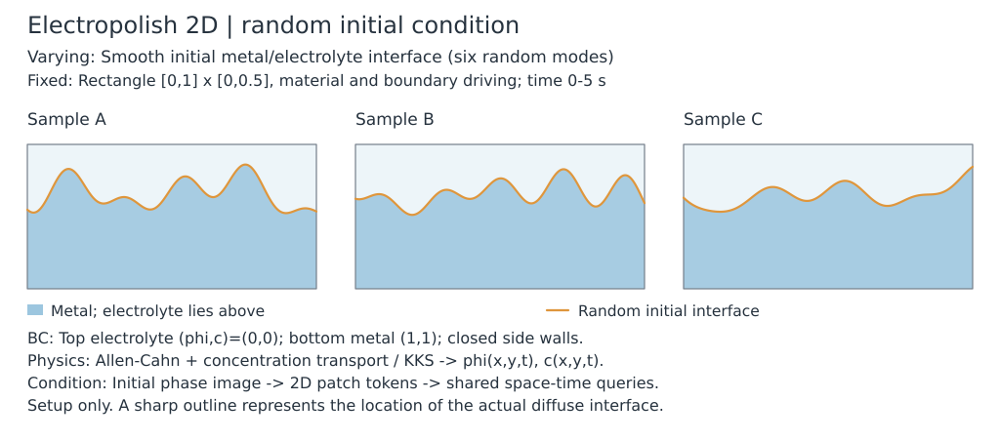
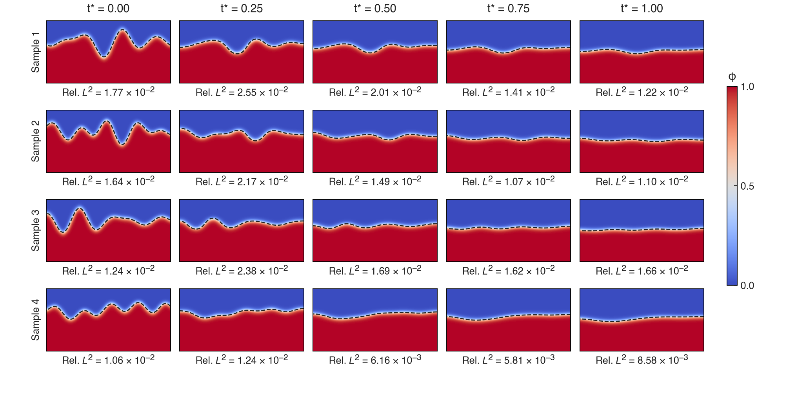
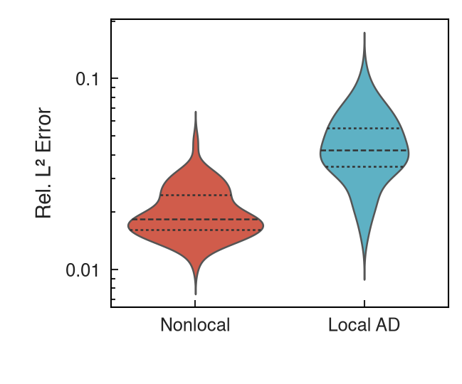
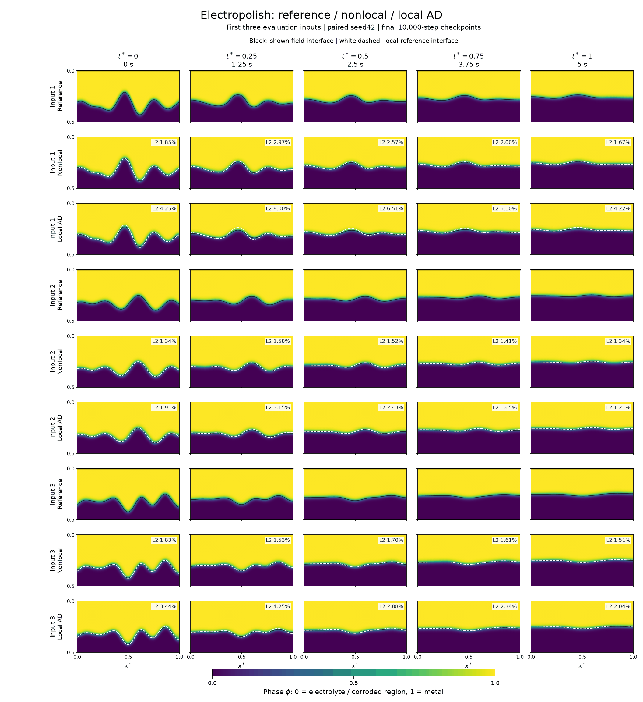

# Electropolish 2D — random-initial-condition PINO

## PINO overview

Predict phase and concentration during electropolishing for a continuously
sampled rough initial metal/electrolyte interface. Geometry, material parameters
and boundary driving are fixed. Only the initial interface changes; training
uses physical equations and known initial/boundary data.

### Problem setup

The KKS model couples Allen–Cahn phase evolution and Cahn–Hilliard concentration
transport in \(\Omega=[0,1]\times[0,0.5]\). Metal has \(\phi\approx1\), electrolyte
has \(\phi\approx0\). The physical horizon is5 s, mapped to \(t^*\in[0,1]\).
The top is prescribed electrolyte \((\phi,c)=(0,0)\); the bottom is metal
\((1,1)\). Left/right inert walls have no external transport.

Each initial profile contains6 random modes, nominal height0.33, amplitude0.03
and frequency range[1, 5], conditioned to remain inside the domain. The initial
phase uses distance to the **piecewise-linear interface**, not vertical distance
alone. Initial endpoint slopes are preserved; they need not satisfy classical
Neumann compatibility at time0. The nonlocal model represents closed pair
interactions at the side walls; finite-horizon closure is distinct from imposing
a pointwise zero AD normal derivative.



The rectangle and boundary driving stay fixed; only the initial rough interface
varies. These are prescribed inputs, not predicted fields.
[Setup figure inputs and regeneration](../../artifacts/pino_setup_schematics.json).

### Important strategies

| Component | Selected operator recipe |
|---|---|
| Condition / encoder | One 32×64 initial phase image, 4×8 patches, 64 tokens, width 96, 2 blocks, 4 heads |
| Decoder | [Spatial-only cross-attention](#time-injection-ablation), then time FiLM in all three pointwise MLP hidden layers; time JVP |
| Condition injection | Image-only conditioning, `arch.local_input=zero`; spatial coordinates enter attention and time enters the decoder |
| Physical outputs | Bounded phase and an unrestricted liquid-concentration output; total concentration reconstructed by the KKS mixture |
| Loss | Original AC/CH absolute residuals + initial/top/bottom physical MSE; five losses balanced by inverse parameter-gradient norms |
| IC / BC | Soft initial and top/bottom constraints; side closure supplied by the native graph |
| Sampling | 8 fresh rough interfaces per update, 16 shared times, 101×51 graph, horizon 0.02, 256 cores + halo, 32 initial sets followed by background rolling updates |
| Optimizer | Adam, initial learning rate 1e-3, 10,000 updates, ordinary FP32 with highest matmul precision |

Removing query-local IC features prevents the decoder from bypassing the image
encoder. It does **not** remove the IC loss. The KKS relation is enforced
algebraically; no extra KKS constraint loss is needed. The raw liquid output is
unrestricted because total concentration has no justified hard upper bound1.

### Representative results

The selected final checkpoint uses 16 shared times, width 96, 10,000 updates
and a rolling spatial pool. The table reports the better observed final run
of the two paired runtime seeds on 64 unseen initial interfaces. Runtime
seeds are provenance, and the default creates a fresh run.

| Mean per-interface relative L2 | Pooled over 21 times | At 5 s |
|---|---:|---:|
| Phase, independent local FD101 | **1.547%** | **1.326%** |
| Concentration, independent local FD101 | 1.860% | 1.580% |
| Phase, native nonlocal reference | 1.406% | 1.130% |
| Concentration, native nonlocal reference | 1.698% | 1.347% |

Each sample uses 101×51 evaluation nodes and 21 uniform saved times.
The four predeclared refinement cases score 1.615% pooled phase on FD101
and 1.637% on FD401. The two-seed spatial comparison below supports the
rolling recipe; the selected score remains a finite-cohort measurement.
The earlier fixed-pool 10,000-step result was 1.740% pooled and 1.540%
terminal phase L2. Its same-trajectory 5,000-step checkpoint scored 3.934%
pooled phase. [Historical budget and reference audit](../../docs/tasks/archive/electro-time-reference-audit.md).



Rows are the predeclared inputs0,21,42,63, at \(t^*=0,0.25,0.5,0.75,1\) (0..5s).
Color shows the selected final rolling10k PINO phase. Dashed curves are the
independent local-FD101 \(\phi=0.5\) interfaces. Each panel reports its own
instantaneous spatial phase relative L2, with equal weights on original queries;
it is distinct from the pooled values above. Fields are raster, text/contours
editable vector;170mmwidth and equal physical scales are retained.
[PDF](../../assets/pino-main/electropolish2d.pdf) ·
[Source/style specification](../../artifacts/electropolish_main_figure.json).

The separate [current nonlocal/local-AD comparison](#current-rolling-nonlocallocal-ad-research-control)
below includes two cold initializations, convergence curves, three-input
reference/prediction fields and a complete figure-reproduction manifest.

### Run and reproduce

```bash
source .venv/bin/activate
python -m examples.electropolish2d.train --config=examples/electropolish2d/configs/train_operator.py
```

The selected model is stored at
`/root/autodl-tmp/tf-logs/electropolish2d/pino-spatial-pools-20261111-01-electropolish2d-s42-rolling_pool/model_final.eqx`.
The prepared monitor bank is
`/root/autodl-tmp/data/electropolish2d/operator_random16_v1`;
training generates fresh initial profiles online. The64-input native/local test
banks are `operator_test64_20261028` and `operator_local_test64_20261029` under
the same data root. No-argument `train.py` keeps the single-interface SOAP PINN.
[Historical local-AD comparison](../../docs/tasks/archive/electropolish-operator-local-comparison.md),
[conditioning diagnosis](../../docs/tasks/archive/electropolish-operator-training.md),
[figure sources and regeneration](../../artifacts/pino_readme_figures.json).

<details>
<summary>Detailed formulation, single-problem PINN defaults and historical controls</summary>

## Single-interface PINN default

Seed is not a strategy parameter. The canonical `get_config()` has no
`train.seed`; choose a run with `train.py --seed=2026`. With no override, the
common untuned run seed is42. Saved resolved config metadata still includes
`train.seed` for reproducibility and old checkpoint compatibility. The best
observed run below is provenance, not a seed to optimize or an accuracy promise.

The matched default requires the sparse graph/minibatches and does not accept
legacy causal/interface weighting, bias schedules or optional diagnostic
switches; unsupported overrides fail explicitly. Use a legacy config for those
controls. Changing physical/operator/grid settings requires a matching reference.

Use [train.py](train.py) with [configs/train_base.py](configs/train_base.py):

```bash
source .venv/bin/activate
python -m examples.electropolish2d.train
# Equivalent direct script:
python examples/electropolish2d/train.py
# Give a fresh cold start an explicit name:
python -m examples.electropolish2d.train --config.log.run_name=my-electropolish-run
```

The default now explicitly uses **ordinary GPU compilation and FP32**, with the
original residual and physical random IC/BC losses. Two full5000-update/5s
cold starts at predeclared seeds42/2026 give terminal phi/c
**0.004757/0.005738** and **0.003399/0.004118**. Both retain a single interface
in every column at all21 reference times. Late4000–5000 phi medians are
0.004421/0.004525. The historical deterministic FP32 seed42 failure (phi0.290928)
is rescued in this ordinary run, while deterministic seed2026 was slightly
more accurate at the final checkpoint (phi0.002832). This supports the new
speed/reliability choice, not uniform superiority or statistical robustness.

Ordinary FP64 fails seed42 (phi0.299757 with extra bands); seed2026 gives0.003551.
Higher precision is therefore not the default here. See the
[completed validation](../../docs/tasks/archive/ordinary-policy-defaults.md) and
[unfiltered convergence curves](../../docs/tasks/archive/ordinary-policy-defaults-electropolish2d-convergence.png).
The historical individual seed7 winner below is preserved separately.

| Setting | Default SOTA |
|---|---|
| Physical horizon / updates | 5 s /5000 |
| Network | MLP,6 layers x64,gelu; tensor_split=True |
| Spatial / temporal embeddings | 64 /64 dimensions, scales2 /2 |
| Operator / grid | Sparse cubic graph,delta0.02,101x51 |
| Core / pool / times | 256 /100 /16; uniform t* in[0.001,1) |
| IC samples | 1000 global +1000 near-interface random points |
| BC samples | 128 random top +128 random bottom points |
| Objective / concentration map | Original phase residual; physical phi,c data; KKS |
| CH evaluation / norm | `physical_difference` /L1 |
| AC / CH scale | 1 /1 |
| Optimizer / initial rate | SOAP /1e-3 |
| SOAP beta1 / beta2 / refresh | 0.9 /0.99 /5 updates |
| Rate schedule / gradient clip | Continuous0.95 per1000 updates,floor1e-5 /50 |
| GradNorm alpha / refresh / cap | 1 /25 updates /1000 |
| Stagger / causal / interface weight / time window | Off /off /0 /off |
| Late rate / CH-RMS continuation | Off /off |
| Floating arithmetic | FP32 (`train.compute_dtype="float32"`) |
| Matmul / GPU runtime | `highest`; ordinary (`train.gpu_policy="ordinary"`) |

Network/time RNG uses the runtime `--seed`; the prescribed rough surface and fixed random
IC/BC samplers retain their original seed42. Before backend initialization, the
entry applies the explicit policy and rejects a deterministic flag inherited
from `XLA_FLAGS` in ordinary mode. Unrelated flags are retained. Use
`--config.train.gpu_policy=deterministic` for the historical policy. This is not a
cross-hardware exact-replay guarantee.
Both IC and BC are soft losses. Positive-time interior reference fields enter
only evaluation; no hard IC or interface-motion prior is introduced.

The [GPU policy performance audit](../../docs/tasks/archive/phasefield-gpu-policy-audit.md)
measures this exact default configuration in FP32 using production loss/step
functions:197.73ms/update under deterministic policy versus10.98ms ordinary,
about18.0x. Each worker runs125 updates, with50 warm-up and75 synchronized
measurements including sampling, SOAP refreshes and GradNorm; evaluation/logging/
saving are excluded. Initial arrays, all100 pool batches and125 time samples
match exactly across policies. Fixed operator forward/input-gradient errors
against independent SciPy are below2e-7. Deterministic HLO expands3032-edge
aggregation into loops, including the reverse path; ordinary keeps scatter.
This establishes the previous default-policy speed bottleneck. The full-run
accuracy evidence for the new default is reported above.

For an ordinary default run in a shell that previously set the deterministic flag:

```bash
XLA_FLAGS='' python -m examples.electropolish2d.train --config.train.gpu_policy=ordinary
```

Switching policy changes floating-point update paths. The completed control
above validates this default at two seeds. Compiled-step throughput and first
compilation cost are reported separately in the audit.

Representative current-default checkpoint (untuned seed42):
`/root/autodl-tmp/tf-logs/electropolish2d/20261026-defaultcheck-ordinary-float32-seed42/ckpt_005000.eqx`.
The independent2026 checkpoint is
`/root/autodl-tmp/tf-logs/electropolish2d/20261026-defaultcheck-ordinary-float32-seed2026/ckpt_005000.eqx`.

### Historical best individual checkpoint (deterministic FP32)

| Verified final5 s metric | Selected checkpoint |
|---|---:|
| phi relative L2,all5151 nodes | 0.0011378188435460965 |
| c relative L2,all5151 nodes | 0.0013578160145092115 |
| q relative L2,free nodes | 0.0115080 |
| Dq relative L2,free nodes | 0.0377613 |

Checkpoint:
`/root/autodl-tmp/tf-logs/electropolish2d/20261025-data-physical-icrandom_interior-bcrandom-phase-stagger0-seed7/ckpt_005000.eqx`.
Reference:
`/root/autodl-tmp/data/electropolish2d/results_matched_graph_20261024.npz`.
The reference is independent SciPy integration of the same fixed graph, with
time-refinement discrepancy1.52e-8; it is not the older local-FEM array or a
continuum-convergence result. Pooled phi/c L2 is0.00213641/0.00260170, distinct
from the terminal values above.

**Historical deterministic-policy seed limitation:** the same random-data setting with seed42 ends at
phi/c0.29093/0.29901. The all-node IC/BC + `s_bc` candidate instead gives
0.002106/0.002518(seed42) and0.002389/0.002869(seed7), but does not beat the
selected seed7 endpoint. To reproduce that candidate through the same entry,
set `train.gpu_policy=deterministic`, `train.compute_dtype=float32`,
`experiment.initial_sampling=matched_graph`,
`experiment.boundary_sampling=matched_graph`, `experiment.data_loss_mode=s_bc`,
and the runtime argument `--seed=42`. The best observed seed is not a general strategy guarantee.
See the [optimization record](../../docs/tasks/archive/electropolish-field-optimization.md),
[convergence curves](../../docs/tasks/archive/electropolish-convergence-curves.md)
and [earlier promotion](../../docs/tasks/archive/phasefield-sota-defaults.md).

Empty `log.run_name` generates a fresh timestamped directory. Existing explicit
names fail; no saved checkpoint is overwritten or automatically resumed.
Outputs include config/source snapshots, initial/1000-update/final weights,
TensorBoard, loss/metric JSONL, `prediction.npz` and `summary.json`.
Models/references load by direct paths with compatibility checks, no file hashes.
The validated trainer is shared internally with corrosion; `train.py` is the
canonical user entry. The old301x151/6000-update preset and FD/local controls
remain under [configs/train_legacy.py](configs/train_legacy.py).


### Historical deterministic-policy independent seed check —2026-10-26

The same strategy with new predeclared `--seed=2026`,5000 updates and5 s gives
terminal phi/c **0.00283171/0.00342674**, with pooled phi/c0.00225795/0.00275241.
Independent CPU q/Dq free errors are0.0185384/0.0549065. Every column at all21
times retains one interface. Late4000..5000 phi median is0.00463667,
range0.00275226–0.00712757: physical fields are accurate, with visible late
fluctuations. This additional run reproduces low error, but the existing
seed42 result0.29093/0.29901 remains a counterexample to strategy-wide stability.
Do not promote a successful seed to a strategy parameter. No fixed-control
setting was retuned; see the [validation](../../docs/tasks/archive/phasefield-seed-stability.md)
and [curves](../../docs/tasks/archive/phasefield-seed-stability-results-convergence.png).

## Motivation

This example compares nonlocal, finite-difference (FD) and local AD treatments
of a rough dissolving interface. Left/right walls have no external transport.
The graph implements this through in-domain pairs; the FD control truncates
its stencil. Neither is pointwise identical to a classical Neumann condition
at finite resolution. A local AD model needs explicit boundary treatment.

The initial interface is a **rough, randomly-generated surface** described by
a signed-distance function (SDF) to a piecewise-linear profile.

## Physical Setup

A metal workpiece is held between **insulating (inert) fixtures** on the left
and right sides; only its top surface is exposed to the electrolyte.  The
fixture walls are electrochemically inactive — no reaction, no current.

```
                   electrolyte  φ=0, c=0 (top, Dirichlet)
  ┌─────────────────────────────────────────────┐
  │                                             │
  │  electrolyte   φ≈0,  c≈0                   │ ← inert wall
  ├──────── rough interface ~~~~~~~~~~~~~~~~~~~─┤   ∂φ/∂n = 0
  │                                             │   ∂c/∂n = 0
  │  solid metal   φ≈1,  c≈1                   │ ← inert wall
  │                                             │
  └─────────────────────────────────────────────┘
                   solid metal  φ=1, c=1 (bottom, Dirichlet)
```

- **Top** ($y=0.5$): liquid electrolyte, $\phi=0$, $c=0$
- **Bottom** ($y=0$): solid metal, $\phi=1$, $c=1$
- **Left / Right** ($x=0$, $x=1$): inert insulating fixtures, $\partial\phi/\partial n=0$, $\partial c/\partial n=0$
- **Interface**: initial rough surface at $y\approx 0.33$; metal dissolves at the interface

The Neumann (zero-flux) condition on the side walls is physically justified:
the insulating fixture does not participate in the electrochemical reaction,
so there is no flux of either the phase-field or the concentration field across
the fixture surface.  This is the standard inert-wall assumption used in
phase-field corrosion and electropolishing models.

### Boundary interpretation

In-domain pair interactions have no exchange with points outside the graph.
This is a discrete no-external-flux model; it does not impose an exact zero
normal derivative on the neural field at each boundary point. The truncated
FD graph also supplies discrete boundary treatment without a separate loss.

The rough initial profile may not satisfy the classical local Neumann trace
at time zero. A local PDE can develop an initial boundary layer. Graph and
local FEM solutions can therefore differ near walls and interfaces, even when
physical parameters agree. Compare the PINN to direct integration of its own
graph to isolate training error, and assess convergence toward a local PDE
separately. This example alone does not establish operator superiority.

## Governing Equations (Local / Classical)

### Scope: net dissolution does not imply pointwise irreversibility

The implemented Allen–Cahn/KKS model does **not** enforce \(\partial_t\phi\leq0\).
The output map bounds \(\phi\) between zero and one, but leaves its time derivative
unrestricted. The interfacial-energy term can fill a concave valley while the
overall solid area decreases. This is a property of the equations being solved,
not evidence that reverse metal growth is physically appropriate for an
anodic, dissolution-only electropolishing experiment.

The selected rolling 10k model and its 64 local-FD references were audited on
all 25 saved snapshots. Both have 62/64 inputs with a fixed-node phase increase
above 0.01; 57/64 PINO inputs and 58/64 references cross from below to above
\(\phi=0.5\) somewhere. Nevertheless, all 64 inputs in both methods have decreasing
integrated diffuse solid area between saved times. Four existing FD201/FD401
and native-graph checks retain the reverse motion. These finite snapshots can
disprove monotonicity, but cannot certify monotonicity between snapshots.

Consequently, a low reference error validates numerical agreement with this
model; it does not validate dissolution-only physics. No unilateral constraint
or clipping has been added. Reproduction paths, driving-term checks and the
diagnostic figure are recorded in
[the monotonicity audit](../../docs/tasks/archive/electropolish-monotonicity.md).

### Free energy and evolution

2D KKS phase-field model for electropolishing. Domain: $\Omega = [0,1] \times [0,0.5]$ (non-dimensional).

With $\Delta c_0 = c_{Se} - c_{Le}$ and
$q = c - h(\phi)\Delta c_0 - c_{Le}$, the free-energy density is

$$f = A q^2 + \omega_\phi g(\phi) + \frac{\alpha_\phi}{2}|\nabla\phi|^2.$$

**Allen-Cahn:**

$$
\frac{\partial \phi}{\partial t}
= L\left[\alpha_\phi \nabla^2\phi
- \omega_\phi g'(\phi)
+ 2Aq\Delta c_0 h'(\phi)\right]
$$

**Cahn-Hilliard:**

$$\frac{\partial c}{\partial t} = D\,\nabla^2\!\left[c - h(\phi)\Delta c_0 - c_{Le}\right]$$

The constant $c_{Le}$ is inert under the CH Laplacian, but remains part of
$q$ in the Allen-Cahn driving force.

**Interpolation functions:**

$$h(\phi) = -2\phi^3 + 3\phi^2,\quad g(\phi) = \phi^2(1-\phi)^2$$

### Geometry & Boundary Conditions

```
y=0.5  ┌─────────────────────────┐  Top: φ=0, c=0 (liquid electrolyte)
       │                         │
       │   domain                │  Left/Right: Neumann (∂φ/∂n=0, ∂c/∂n=0)
       │                         │  → no BC loss terms — key ablation point!
       │  ~~~~ rough ~~~~        │  Initial interface (SDF-based tanh)
       │                         │
y=0    └─────────────────────────┘  Bottom: φ=1, c=1 (solid metal)
```

| Boundary | Condition |
|---|---|
| Top ($y=0.5$) | $\phi = 0,\; c = 0$ (liquid electrolyte) |
| Bottom ($y=0$) | $\phi = 1,\; c = 1$ (solid metal) |
| Left ($x=0$) | $\partial\phi/\partial n = 0,\; \partial c/\partial n = 0$ (Neumann) |
| Right ($x=1$) | $\partial\phi/\partial n = 0,\; \partial c/\partial n = 0$ (Neumann) |

**Initial condition** — SDF-based tanh profile on rough surface:

$$y_{\text{surf}}(x) = y_0 + \sum_{i=1}^{n_\text{modes}} a_i \bigl[\sin(2\pi f_i x + \theta_i) + \cos(2\pi f_i x + \theta_i + 0.3)\bigr]$$

$$\phi_0(x,y) = \frac12\bigl[1 + \tanh(k \cdot \text{sdf}(x,y))\bigr],\quad c_0 = h(\phi_0) \cdot c_{Se}$$

Here \(k=\sqrt{\omega_\phi/(2\alpha_\phi)}L_c\). The implemented distance is
a signed Euclidean segment-distance approximation:2000polyline vertices,
33candidate segments around the query x-index, positive below the curve. It
is not the vertical gap and need not equal the global closest distance to the
entire curve. This definition is shared by prescribed ICs and aligned references.

---

## Non-Dimensionalisation

Characteristic length $L_c = 100~\mu\text{m}$ and time $T_c$ define:

$$\bm{x}^* = \frac{\bm{x}}{L_c},\qquad t^* = \frac{t}{T_c}$$

Four non-dimensional parameters:

$$N_{\text{CH}} = \frac{D T_c}{L_c^2},\quad N_{\text{AC,1}} = 2A L T_c,\quad N_{\text{AC,2}} = L\omega_\phi T_c,\quad N_{\text{AC,3}} = \frac{L\alpha_\phi T_c}{L_c^2}$$

### Non-dimensional Allen-Cahn

$$\frac{\partial\phi}{\partial t^*} - N_{\text{AC,3}}\,\nabla^{*2}\phi + N_{\text{AC,2}}\,g'(\phi) - N_{\text{AC,1}}\bigl[c - h(\phi)(c_{Se}-c_{Le}) - c_{Le}\bigr](c_{Se}-c_{Le})h'(\phi) = 0$$

### Non-dimensional Cahn-Hilliard

$$\frac{\partial c}{\partial t^*} - N_{\text{CH}}\,\nabla^{*2}\!\bigl[c - h(\phi)(c_{Se}-c_{Le}) - c_{Le}\bigr] = 0$$

with $\Delta c_0 = c_{Se} - c_{Le}$.

---

## Nonlocal (Peridynamics-Inspired) Formulation

Replacing $\nabla^{*2}$ with the nonlocal operator $D_\delta$:

$$\frac{\partial\phi}{\partial t^*} + N_{\text{AC,3}}\,D_\delta\phi + N_{\text{AC,2}}\,g'(\phi) - N_{\text{AC,1}}\bigl[c - h(\phi)\Delta c_0 - c_{Le}\bigr]\Delta c_0\,h'(\phi) = 0$$

$$\frac{\partial c}{\partial t^*} + N_{\text{CH}}\,D_\delta\!\bigl[c - h(\phi)\Delta c_0 - c_{Le}\bigr] = 0$$

In the local limit $D_\delta \approx -\nabla^{*2}$. The nonlocal operator is defined by a compactly-supported kernel $J(r)$:

$$(D_\delta u)(x_i) = \sum_{j \in N_\delta(i)} w_{ij}\,(u_i - u_j),\quad w_{ij} = -D_{ij}$$

Edge weights pre-computed from the `SparseD` operator. Supported kernels: `cubic`, `quartic`, `wendland`.

### Finite Difference (Ablation)

With `configs/train_legacy.py`, setting `--config.nl.method=fd` switches to a 5-point FD Laplacian on the structured grid. The FD stencil is truncated at left/right Neumann boundaries, while the nonlocal operator requires no boundary handling.

---

## Physical Parameters

| Symbol | Value | Unit | Description |
|---|---|---|---|
| $D$ | $8.5 \times 10^{-10}$ | m²/s | Diffusion coefficient |
| \(A\) | \(5.35 \times 10^7\) | J/m³ | Chemical-energy coefficient |
| \(L\) | \(1.0 \times 10^{-6}\) | m³/(J·s) | Interface mobility |
| $\alpha_\phi$ | $1.03 \times 10^{-4} / 4$ | J/m | Gradient energy coefficient |
| \(\omega_\phi\) | \(1.76 \times 10^7\) | J/m³ | Barrier height |
| $c_{Se}$ | 1.0 | — | Equilibrium concentration (solid) |
| $c_{Le}$ | $5100 / 1.43 \times 10^5$ | — | Equilibrium concentration (liquid) |

These units follow the volumetric free energy and dimensional AC equation above;
concentration is normalized. The old energy-density `/s` and mobility length
power in this table were documentation errors, not changes to the implemented
parameter values. See the [dimensional audit](../../docs/tasks/archive/particle-corrosion-dimensional-audit.md).

### Non-Dimensionalisation

| Scale | Value | Description |
|---|---|---|
| $L_c$ | $100~\mu\text{m}$ | Characteristic length |
| $T_c$ | 5.0 s | Characteristic time |

---

## Rough Surface Configuration

| Parameter | Default | Description |
|---|---|---|
| `y0` | 0.33 | Mean interface height |
| `n_modes` | 6 | Number of Fourier modes |
| `amplitude` | 0.03 | Max amplitude of roughness |
| `freq_lo` | 1.0 | Min spatial frequency |
| `freq_hi` | 5.0 | Max spatial frequency |
| `seed` | 42 | RNG seed for reproducibility |

The signed distance is computed via the perpendicular distance to each segment of the piecewise-linear profile, using a sliding window (`window=16`) over query points for efficiency.

---

## Project Structure

```
electropolish2d/
├── solver.py               # FEM reference solver (FEniCS, MPI)
├── train.py                 # PINN training (MLP / FiLM)
├── losses.py                # Loss functions (AC, CH, BC, IC)
├── operator_data.py         # Random input family and aligned graph references
├── operator_training.py     # Physics-only conditioned-operator training
├── online_conditions.py     # Continuous coefficients and fixed-shape SDF sampler
├── configs/
│   ├── solver_base.py       # FEM solver config
│   ├── train_base.py        # Default observed-field SOTA
│   ├── train_operator.py    # Recommended online B8 image-only operator
│   ├── train_operator_legacy.py # Historical finite-input pilot
│   ├── train_operator_single.py # Fixed-input fitting control
│   ├── train_operator_online.py # Continuous online B8 training
│   ├── train_operator_causal.py # Online B8 per-time causal control
│   └── train_legacy.py      # Historical large-grid/FD/local controls
├── README.md
```

---

## Usage

### Run FEM Solver

```bash
conda activate fenicsenv
cd examples/electropolish2d

# Serial
python solver.py --config=configs/solver_base.py

# MPI (18 processes)
mpirun --allow-run-as-root -np 18 python solver.py --config=configs/solver_base.py
```

Output: `.npz` file at `/root/autodl-tmp/data/electropolish2d/results_rough.npz` with `X`, `Y` meshgrids, `time` array, and `phi`, `c` fields over time. Also saves snapshot plots (`snapshot_phi.png`, `snapshot_c.png`).

### Train PINN

```bash
# From project root
python examples/electropolish2d/train.py --config=examples/electropolish2d/configs/train_base.py

# FD ablation (legacy loop, separate reference validation required)
python examples/electropolish2d/train.py --config=examples/electropolish2d/configs/train_legacy.py \
    --config.nl.method=fd --config.log.run_name=fd_run

# Spatial minibatch
python examples/electropolish2d/train.py --config.sample.K_core=400 --config.sample.K_pool=400
```

### Legacy-loop Config Options

```bash
# Architecture
--config.arch.type=film          # or "mlp"
--config.arch.hidden_dim=64
--config.arch.spatial_scale=2.0   # single scale or tuple, e.g. (1.0, 3.0, 6.0)

# Nonlocal operator
--config.nl.delta=0.02
--config.nl.kernel=cubic
--config.nl.method=sparse         # "sparse" | "fd"

# Spatial minibatch (core+halo sub-sampling)
--config.sample.K_core=400        # 0 = full grid
--config.sample.K_pool=400

# IC sampling
--config.sample.N_ic_global=2000
--config.sample.N_ic_local=2000   # oversampling near interface

# Staggered training
--config.loss.stagger_steps=1000
--config.loss.stagger_switch_every=25

# Hard constraint (enforce c bounds)
--config.arch.use_hard_constraint=True

# Causal training
--config.loss.use_causal=True
--config.causal.n_chunks=0
```

### Key Design Decisions

- **Side boundaries have no separate loss term.** The graph omits exterior
  edges and FD truncates its stencil; these are discrete boundary treatments,
  without an exact pointwise local Neumann guarantee.
- **Rough initial interface** is defined by SDF to a piecewise-linear profile, not simple y-distance, for smooth $\phi$ at t=0
- **IC oversampling** near the interface (`N_ic_local`) ensures the sharp tanh transition is adequately resolved
- **Output constraint** (`use_hard_constraint=True`) uses the KKS mixture
  \(c=c_L+h(\phi)(c_{Se}-c_{Le})\), with bounded \(c_L\); it is independent
  of the soft initial-condition loss.


## Matched residual experiment

The shared [experiment runner](../corrosion2d/residual_experiment.py) compares
original and transformed phase residuals with the existing KKS output map and
soft IC/BC losses. Its separate 101x51 sparse-graph preset retains this case's
physical parameters, rough surface and 5 s horizon. The canonical default
now uses this validated engine with the SOTA settings above; the research CLI
retains its historical defaults for archived commands. See the [corrosion experiment instructions](../corrosion2d/README.md#matched-residual-experiment)
for settings, reference checks and commands; use `--case electropolish2d`.
The [paired pilot record](../../docs/tasks/archive/coupled-latent-residual-experiments.md)
documents field errors and extra-interface diagnostics; algebraic equivalence
does not establish a precision improvement.

The FEM solver now evaluates the same SDF initial function directly, applies
Dirichlet traces to its initial vector, and uses actual time increments when
hitting save/final times. Existing reference files are historical: a source
fix does not update their contents. New graph references have distinct names
and explicit model/BC/physical-time metadata.

### Research data and temporal-window controls

The shared runner also supports all graph-node analytic ICs (with the same
Dirichlet overrides as the graph reference), all nodal Dirichlet BCs, and
`--data-loss-mode s_bc`. This last option fits the existing KKS concentration
variable \(s=c_L/c_{Le}\) at the boundaries; it changes data-loss coordinates
and concentration scale while preserving the prescribed physical BCs at zero
loss. Away from zero loss this is not merely a constant multiplier on total-c
error, since \(c=c_L+\Delta c\,h(\phi)\) couples the two outputs.
`s_bc_ic` additionally normalizes IC
concentration; neither option imposes hard initial conditions.

`--time-ramp-steps R --time-ramp-early a` is a **research-runner sampling**
curriculum. At zero-based update \(k\), sample the same fixed-size time batch
uniformly from \([t_{min},T_k]\), with

$$
T_k=a+(1-a)\min(k/R,1),\qquad R>0.
$$

The final \(5000-R\) updates cover the full5 s horizon. Disabled by default
(`loss.t_ramp_steps=0`), it reproduces the original random time samples exactly.
The early sampling objective intentionally emphasizes the current time window;
there is no importance correction making it a full-horizon loss before \(R\).
It introduces no interface-motion/reference-trajectory targets, residual
weight, network constraint or optimizer reset. Enabled settings require
\(t_{min}<a<1\), integer \(0<R<\text{iterations}\), and full-horizon endpoint1.
In this research runner, `loss.t_ramp_early`/`t_ramp_late=1` specify sampling
endpoints. Canonical matched configs use this sampling mechanism; the helper
in the explicitly selected legacy loop is a separate time-weight mechanism.

For example, from the repository root with no FEniCS/MPI process running:

```bash
XLA_FLAGS=--xla_gpu_deterministic_ops=true XLA_PYTHON_CLIENT_PREALLOCATE=false \
  .venv/bin/python -m examples.corrosion2d.residual_experiment train \
  --case electropolish2d --formulation phase --seed 42 \
  --data-loss-mode s_bc --initial-sampling matched_graph \
  --boundary-sampling matched_graph
```

This candidate uses SOAP, lr1e-3,5000 updates, the original phase residual and
full-horizon time sampling. Both initial and boundary values remain soft loss
terms. Full-grid IC sampling uses5151 analytic initial-value points, rather than
2000 random IC points; graph-node BCs use101 top and101 bottom points, rather
than128 random points on each. Positive-time interior reference fields are
used for evaluation, not supervised training. The update budget is equal;
computational work is not, because IC sample counts differ.

To test the separate curriculum, add `--time-ramp-steps 3000
--time-ramp-early 0.05`: the upper time bound starts at0.25 s, reaches5 s at
index3000, and the last2000 updates cover the full interval. The tested window
does not beat its original-residual counterparts at the5000 endpoint; it
reduces extra bands in the full-latent arm, whose physical errors remain higher.
Compare `--formulation latent` with the same data/time settings when assessing
the transformation, retaining phi/c L2, q/Dq and interface-count diagnostics.

The [optimization record](../../docs/tasks/archive/electropolish-field-optimization.md)
contains two-seed validation and direct checkpoint/config paths. The candidate
avoids the large-field-error seed42 result and has a single interface in both
tested seeds; seed7's already accurate random-data baseline has smaller terminal
phi/c and Dq errors, while the candidate improves q. These two seeds do not
establish universal superiority. The current default explicitly selects the
best observed random-data seed7 terminal field instead of that candidate.

Completed run directories are preserved; the CLI refuses existing names. For
a fresh replay, use `train.py` with explicit `--config.experiment.*` overrides
and a new `--config.log.run_name`. Load saved configs/checkpoints by their
explicit paths.

## Project split (2026-10-24)

This example belongs to `nonlocal-pinn`. Install the project and run from its
repository root; existing external data/output paths are retained. Shared
implementation paths changed during the split; see
[the source map](../../docs/migration/source-map.json) and
[migration notes](../../docs/migration/README.md).

## Random-initial-interface neural operator (opt-in)

The canonical entry accepts [configs/train_operator.py](configs/train_operator.py)
as the **current recommended NO preset**. It learns random initial fields over
0–5s. No-argument `train.py` retains the single-interface PINN default.

| Setting | Recommended NO |
|---|---|
| Input sampling | Fresh online six-mode rough interfaces; 8 conditions/update |
| Optimizer | Adam, initial learning rate 1e-3, 10,000 updates |
| Compilation | Ordinary FP32, highest matmul precision |
| Conditioning | Width 96, initial-image encoder, spatial attention and time FiLM, `arch.local_input=zero` |
| Physics | Original AC/CH, soft IC and top/bottom BC: five losses, gradient balancing |
| Sampling | 16 shared times and background rolling core+halo sets, with causal weighting disabled |

```bash
XLA_PYTHON_CLIENT_PREALLOCATE=false python examples/electropolish2d/train.py \
  --config=examples/electropolish2d/configs/train_operator.py
```

The evaluation bank must already be prepared; the historical preparation command
below uses the same bank. Training draws new inputs online, not from that bank.
The earlier 5,000-step, width-64, four-time recipe is available as
[`configs/train_operator_5k.py`](configs/train_operator_5k.py).
Its original image-only run is
`/root/autodl-tmp/tf-logs/electropolish2d/20261028-electro-operator-online-global-adam-01`:
64 unseen graph-reference inputs give mean pooled/terminal phi4.506/3.502%.
A matched repeat of this strategy against64 independent local-FD references gives
4.427/3.176%; these are different runs/reference targets, not interchangeable
checkpoint scores. The validation sections below retain these historical controls.

Generated figures/arrays are optional local artifacts; see the root
[artifact restoration policy](../../README.md#artifacts-and-recovery).

### Current rolling-pool default

The canonical `configs/train_operator.py` starts with 32 complete 256-core
sets, then replaces one set each update from a bounded background FIFO.
Each update draws fresh initial profiles and times. The graph, physical
parameters and five loss terms are shared by the fixed and rolling controls.
Safe capacities are 3,328 graph nodes and 3,072 edges, with one CPU worker
and 32 prefetched sets. Every time in a batch shares the spatial queries.

The matched cold 10,000-step study uses width 96, batch 8 and 16 shared
times. Both modes have identical initial model/Adam state, actual initial
profiles, times and IC/BC draws, the first 32 spatial sets, and fixed padding.

| Runtime seed | Spatial pool | Phase pooled / terminal L2 | Concentration pooled / terminal L2 | Warm effective median |
|---|---|---:|---:|---:|
| 42 | Fixed | 1.747% / 1.526% | 2.089% / 1.827% | 40.06 ms |
| 42 | Rolling | **1.547% / 1.326%** | **1.860% / 1.580%** | 41.61 ms |
| 43 | Fixed | 2.633% / 2.050% | 3.142% / 2.440% | 39.78 ms |
| 43 | Rolling | **2.465% / 1.672%** | **2.930% / 2.001%** | 41.93 ms |

Errors are means over the same 64 local FD101 cases. Warm timings were
remeasured serially on one RTX 4090 with 49,140 MiB, excluding the first
100 updates and including synchronized condition preparation, spatial
retrieval/transfer and GPU updates. Peak active GPU memory is about 13.0 GiB
in all four arms. Cold process times are 607.0/630.0 s for fixed/rolling at
seed 42 and 610.2/626.5 s at seed 43. Compilation and evaluation contribute
to those cold times. These measurements belong to this card.

Rolling improves both physical fields in both seed pairs at roughly 4–5%
more warm step time. The seed-to-seed spread exceeds the within-pair pooled
improvement; the representative image uses the better observed final run.
The first and second pairs retain their own saved configs under
`/root/autodl-tmp/tf-logs/electropolish2d/pino-spatial-pools-20261111-01-electropolish2d-s42-<mode>`
and the corresponding `s43` paths, where `<mode>` is `fixed_pool` or
`rolling_pool`.

The earlier spatial-control presets below retain width 64, four times and
5,000 steps. To repeat the current comparison with matched safe padding:

```bash
python -m examples.electropolish2d.train \
  --config=examples/electropolish2d/configs/train_operator.py
python -m examples.electropolish2d.train \
  --config=examples/electropolish2d/configs/train_operator_fixed_pool.py \
  --config.arch.width=96 --config.sample.Nt=16 --config.train.iterations=10000
```

Use the same runtime `--seed` for both arms to reproduce a paired experiment.
Actual condition/time/core traces, saved fields and timing records are linked
from the [study record](../../docs/tasks/archive/pino-spatial-sampling-study.md).

### Full, fixed-pool and rolling-pool spatial controls

Three optional presets use the same canonical `train.py` with the historical
width-64, online B8/Adam5000/Nt4 image-only network, five physical losses and
initial/time streams:

| Preset | Spatial PDE sampling |
|---|---|
| `configs/train_operator_full.py` | All5151graph nodes, residual on all4949free nodes |
| `configs/train_operator_fixed_pool.py` | Cycle32precomputed K256core+halo sets |
| `configs/train_operator_rolling_pool.py` | Same first32sets, then one fresh uniform core set per update |

For example:

```bash
python -m examples.electropolish2d.train \
  --config=examples/electropolish2d/configs/train_operator_rolling_pool.py
```

Fixed/rolling controls share safe capacities3328nodes and3072edges, derived from
the actual graph's maximum degree12; the older observed32pool maxima are smaller.
Padding never truncates a core or its neighbors. The full-coordinate arm uses
the original complete graph, with the same free-node residual normalization and
separate unchanged IC/BC query blocks. Halo values support the graph action but
are excluded from the sampled residual mean.

The optional `sample.spatial` record explicitly declares
`mode/max_nodes/max_edges/workers/prefetch`. Rolling uses one NumPy CPU worker
and32bounded prefetched entries. Draw IDs0..31match the fixed pool; subsequent
IDs equal the global zero-based update counter. FIFO consumption is independent
of worker completion order. Coordinates, edges, masks and SDF nearest indices
are replaced together; no learned encoder cache is reused. Every time within
an update still shares spatial preparation and time JVP. Initial interfaces
continue to be drawn online; no reference trajectory is generated for training.

Runs save actual core/draw identities, coverage, producer wait/transfer times,
initial/final model and Adam state. Experimental timings synchronize condition
construction separately from the GPU update. Shared safe padding can cost more
than the historical tight pool, so comparisons should use the matched controls
and distinguish cold compilation from steady updates. Saved old configs without
`sample.spatial` retain the original training path and defaults.

The matched5000-update comparison on RTX6000D gives the following **mean over
the same64development interfaces**, using the common local FD101reference:

| Spatial mode | Pooled phi L2 | Final phi L2 | Pooled c L2 | Final c L2 |
|---|---:|---:|---:|---:|
| Full coordinates |4.4813% |3.7741% |5.2960% |4.4908% |
| Fixed pool |4.9640% |3.8333% |5.8494% |4.5412% |
| Rolling pool |4.8578% |3.6507% |5.7312% |4.3586% |

| Spatial mode | Cold process wall | Warm effective step | Peak active GPU memory |
|---|---:|---:|---:|
| Full coordinates |4.109min |15.834ms |3.744GiB |
| Fixed pool |3.915min |13.215ms |2.719GiB |
| Rolling pool |4.090min |15.078ms |2.720GiB |

Cold wall includes setup, initial compilation,5000updates, periodic small-bank
evaluation and saving; final64input evaluation is separate (~31–33s per model).
Warm effective time averages updates100..4999and includes synchronized GPU
update, condition construction and spatial retrieval/transfer. Rolling total
producer wait is0.0276s; full/rolling cover all4949free nodes, fixed3938(79.57%).
Native64phase pooled/final errors are4.4640/3.7163%,4.9391/3.7375%,4.8597/3.6111%
in the same order. Existing FD201/401references on four declared inputs are
reported separately; this is not a continuum-converged64input claim.

Rolling modestly improves final64error versus fixed, with~14.1%higher warm cost;
full has the lowest pooled error at this5151node scale. One matched initialization
and reused development inputs do not establish stable superiority. Actual initial
models/Adam states, all40000conditions, time and IC/BC arrays match; fixed/rolling
share their first32sets. Same-GPU checkpoint replay and independent64saved-field
metric calculations pass. The current recommended default remains the earlier
validated recipe; these are explicit comparison controls.

An additional **CPU/GPU composed-attention replay discrepancy remains open**:
the same parameters/inputs can give substantially different CPU fields. This
comparison measures the verified GPU execution path, without assuming CPU
portability or unique sampling-related causes for its accuracy differences.
See the [recorded issue](../../docs/issues/electropolish-attention-replay.md)
and [complete comparison record](../../docs/tasks/archive/electropolish-spatial-pool-comparison.md).
Direct run/model/figure paths are in `artifacts/index.yaml`; generated payloads
remain external. Convergence plots use the four small-bank native diagnostics;
the table above uses all64fixed-budget final evaluations.

### Historical finite-input pilot

The following pilot description and commands use
[configs/train_operator_legacy.py](configs/train_operator_legacy.py).
The original online/single/causal/local control presets retain their previous
semantics; canonical `train_operator.py` selects the image-only recipe above.

The pilot uses the same six-mode random rough-profile/SDF generator, material
parameters,101x51 grid, sparse graph, top/bottom Dirichlet data and side-wall
pair closure. Sixteen input realizations are used for physics training; four
independent identities are held out. Dataset generation records its random seed
and all interface identities as provenance, without a best-seed strategy field.
References are generated only for two training-monitor cases and four test cases.
They solve physical phi/c with the existing independent SciPy BDF/Jacobian,
with strict time refinement. This measures same-graph training/generalization
error; it is not a local-PDE spatial-convergence validation.

### Architecture and shared-space evaluation

[ConditionalFieldOperator](../../src/nonlocal_pinn/nn/conditional.py) is an
independent Equinox implementation inspired by the
[PI-CViT source](https://github.com/NanxiiChen/PI-CViT/blob/main/models/cvit.py):

1. Encode the1x32x64 initial phase image as64 patches using two self-attention
   blocks, width64 and four heads.
2. Prepare a spatial hidden field from coordinates and the known local
   initial phi/c values. With `arch.conditioning=cross_attention`, spatial queries
   attend to the encoded patches. With `arch.conditioning=film`, the pooled encoder
   output produces feature-wise affine modulation instead. Both use known
   local input-function features; no future interface is supplied.
3. Decode all times using time FiLM and three pointwise hidden layers. The
   expensive condition encoding/spatial preparation is shared across all times;
   temporal modulation is computed once per time and broadcast over space.
   Time JVP acts only through this temporal decoder and physical output map.

The architecture is deliberately **separable**, not exactly equivalent to
upstream PI-CViT: time is introduced after spatial cross-attention. Within this
variant, shared evaluation equals paired coordinate/time evaluation; derivatives
and parameter gradients are checked independently. Learned preparation is
computed inside each forward/loss call so parameter AD reaches the encoder;
never reuse a learned cache after an optimizer update. Coordinate frequencies
are frozen. Query points may vary, but image sensors are fixed and local input
values must be provided at queries; no resolution-invariance claim is made.
The public API is `encode`, `prepare_encoded`, `prepare`, `decode`, `paired`
and the combined call. Case physics stays outside this reusable raw network.

Pooled [FiLM](https://arxiv.org/abs/1709.07871) is a cheaper condition-injection
control with a global bottleneck. A branch/trunk
[DeepONet](https://doi.org/10.1038/s42256-021-00302-5) is another natural simple
baseline, but is not implemented in this pilot. Spatial attention preserves
location-dependent access to the initial geometry; whether it improves this
family must be measured rather than inferred from its architecture.

### Output coordinates and loss

Random-interface graph references have small regions with positive
\(q=c_L-c_{Le}\). The old bounded KKS map enforces \(q\le0\) when
\(c_{Se}=1\), so the new operator explicitly uses
`operator.concentration_map=linear_liquid`:

$$
\phi=\tfrac12(1+\tanh z),\qquad
c_L=c_{Le}s,\qquad c=c_L+(c_{Se}-c_{Le})h(\phi).
$$

Here \(s\) is an unrestricted network output. The KKS mixture and physical
PDEs are unchanged; this removes an artificial output bound. Total c is not
hard bounded, so field ranges are reported. Initial/Dirichlet values are soft
losses; there is no imposed interface trajectory or hard initial constraint.
The five losses remain original AC and CH mean absolute residuals and
physical top/bottom/initial mean-square errors, averaged over the sampled
conditions. The existing inverse-L1-gradient norm balancing rule is reused;
it is not relative-training-rate GradNorm. Positive-time reference arrays
never enter the step/payload. All tests are evaluated at fixed budget; there
is no checkpoint selection on the test set.

The initial architecture pilot uses Adam/LR1e-3/2000 updates, ordinaryFP32,
two conditions/update, four shared times,256 free-node cores from32 fixed-shape
halo pools, and1024 known IC nodes. It is an explicit smaller-budget experiment,
not the established single-IVP SOAP SOTA recipe. Architecture options are under `arch`; condition-dataset/input settings are
under `operator`, following the repository configuration convention.

```bash
# One-time CPU condition/reference preparation; output directory must be new.
JAX_PLATFORMS=cpu JAX_ENABLE_X64=true OPENBLAS_NUM_THREADS=1 \
  python examples/electropolish2d/train.py \
  --config=examples/electropolish2d/configs/train_operator_legacy.py \
  --config.operator.reference_action=prepare

# Physics-only operator training (after preparation).
XLA_PYTHON_CLIENT_PREALLOCATE=false python examples/electropolish2d/train.py \
  --config=examples/electropolish2d/configs/train_operator_legacy.py

# Lighter condition-injection control, same input set and budget.
XLA_PYTHON_CLIENT_PREALLOCATE=false python examples/electropolish2d/train.py \
  --config=examples/electropolish2d/configs/train_operator_legacy.py \
  --config.arch.conditioning=film
```

Default condition/reference root:
`/root/autodl-tmp/data/electropolish2d/operator_random16_v1`.
Override `operator.dataset_path` for another prepared dataset. Training and
loading validate the partition, physical specification, coordinates, fields,
graph arrays, boundary traces and reference refinement through direct paths.
Each run saves initial/final weights, config/source snapshot, condition IDs,
losses, per-condition/per-time and mean L2 histories, final fields and summary.
No existing artifacts are overwritten. Small held-out-family experiments do
not establish generalization to arbitrary topologies/materials or seed stability.

### First operator pilot —2026-10-28

Same16 training/four held-out initial interfaces and2000Adam updates:

| Conditioning | Mean test pooled phi L2 | Mean test terminal phi L2 | Mean test terminal c L2 | Trainer seconds including compilation/evaluation |
|---|---:|---:|---:|---:|
| Spatial cross-attention |17.185% |13.305% |14.929% |245.7 |
| Pooled condition FiLM |17.462% |11.936% |13.520% |160.9 |
| Frozen initial field |31.877% |47.721% |48.309% |— |

All errors are across the four predeclared test inputs, with no test checkpoint
selection. The route learns evolution, but remains substantially less accurate
than the original single-IVP PINN. Two monitored training inputs have similar
pooled errors; this supports underfitting/optimization as a concern, without
isolating the mechanism or evaluating all16 training fields. Plots show excessive
early smoothing of geometry. Terminal q errors are5.73%/5.30%, while free-node
Dq errors81.46%/76.60% remain high. One small-family/single-training-seed pair
does not prove a stable architecture ordering; no default/SOTA promotion.

Run paths (load saved initial experimental architecture from its `operator`
record explicitly; the final public config puts it in `arch`):

- `/root/autodl-tmp/tf-logs/electropolish2d/20261028-electro-operator-cross-01`
- `/root/autodl-tmp/tf-logs/electropolish2d/20261028-electro-operator-film-01`

The private template builder accepts `(architecture, image_shape, key)`; for
these two early saved configs use `(saved.operator, saved.operator.image_shape,
key)`, and for the current schema `(saved.arch, saved.operator.image_shape, key)`.
Neither original config/checkpoint is rewritten. Exact same-backend template
initialization and all common initial parameter arrays were checked. Fourteen
of15 source snapshots match; the sole difference is the CLI success return.
The first cross trainer finished/saved correctly but its original new absl branch
returned a dict, producing process exit1; the branch is fixed and separately
checked. Film finishes with CLI exit0. This is not a numerical training failure.

Explicit shared-space/time preparation reduces warmed forward+time-JVP median
at1024 spatial points/four times from.723 to.622ms (cross) and.593 to.535ms
(FiLM). These1.16x/1.11x ratios exclude PDE/parameter gradients/optimizer and are
not training-speed factors. With promoted trained FP64 weights/inputs the split
and repeated-query outputs/JVPs match exactly in this probe. Trained FP32 cross
attention has a measured batching sensitivity: raw output/JVP relative differences
2.28e-4/1.62e-4. Its CPU physical fields differ from GPU by up to.00162, while
pooled/terminal test L2 changes only.0023/.0099 percentage points. Film CPU gap
is1.43e-6. GPU replay at saved highest precision reproduces cross fields exactly
and FiLM within6.26e-7. Do not describe FP32 as bitwise/batch invariant or count
the strict cross CPU pointwise probe as passed. No production arithmetic was
changed to conceal this; see the full reproducible
[pilot record](../../docs/tasks/archive/electropolish-neural-operator.md),
[convergence](../../docs/tasks/archive/electro-operator-convergence.png) and
[unseen phase fields](../../docs/tasks/archive/electro-operator-film-fields.png).


### Fixed-input and continuous-online controls

The original operator pilot trains16 distinct inputs with two conditions per
update. The loss uses `vmap` over conditions and averages the five loss parts
across the condition batch. It is not a single-input fit.

For a fixed initial-interface diagnostic, use:

```bash
python examples/electropolish2d/train.py \
  --config=examples/electropolish2d/configs/train_operator_single.py

# Same input/model/budget with SOAP.
python examples/electropolish2d/train.py \
  --config=examples/electropolish2d/configs/train_operator_single.py \
  --config.train.optimizer=soap
```

This explicitly selects `operator.training_indices=(0,)`, batch1, from the
unchanged source dataset. The chosen interface is fixed before running, not
selected for low error. Excluded source-training monitors are `unused_train`,
not training accuracy; held-out inputs remain `test`. Empty, duplicate, noninteger,
negative and held-out subset IDs, or a batch larger than the subset, are rejected.
Absent selection retains the original all16 input draw schedule exactly. Saved
`training_selection.json` and actual `sampled_conditions.npy` record input use.
Fixed-input fitting cannot establish neural-operator generalization.

The established single-IVP PINN uses SOAP. Both initial NO architecture pilots
use Adam. One matched fixed-input2000-update comparison gives Adam phi pooled/
terminal2.483%/3.387%, SOAP4.187%/3.214%; c2.965%/4.031% vs4.941%/3.700%.
Adam takes237.3s, SOAP387.3s including first compilation/evaluation. Both use
identical73 initial parameter-array leaves and every actual update uses input0.
SOAP slightly improves the terminal metric but loses on pooled error and cost;
this small control does not establish a universal optimizer ordering. Retain
Adam as the first continuous-online baseline and SOAP as an explicit override.

```bash
python examples/electropolish2d/train.py \
  --config=examples/electropolish2d/configs/train_operator_online.py
```

The online preset uses batch8, Adam/LR1e-3/5000 updates. Each update draws new
continuous triples for six rough-interface modes: amplitude in[0.3A,A), frequency
in[f_lo,f_hi), phase in[0,2pi). It does not choose from a finite input bank.
The function family still has the declared six-mode height-profile form; this
is not a claim of coverage of arbitrary topologies or all function spaces.
A fixed4B candidates are drawn; the firstB whose2000-point profile lies within
(.005,.495) are retained. This **conditions the input distribution** on physical
height validity. If fewer thanB pass, training raises before applying an update;
no padding candidate or numerical fallback is silently used.

[online_conditions.py](online_conditions.py) computes the original piecewise-
linear signed distance using the same2000 curve vertices and±16-segment query
window. Query/sensor grids and nearest-vertex indices are precomputed once for
fixed-shape pools; JAX evaluates fresh initial images and all local IC data.
The two data views use the same coefficient triples. Input construction is
outside parameter AD; time derivatives remain decoder JVP. Boundary IC overrides
match the graph reference. Independent NumPySDF/FP64 identity and batched fresh/
replayable/range/BC checks pass. Neither physics nor evolved-field labels change.

The existing `operator.dataset_path` is now an **evaluation/reference bank** in
online mode. Its two historical source-training monitors are called `monitor`;
the four held-out references remain `test`. None of these bank fields enters a
training payload. There is no `train` reference L2 in online mode. Save actual
`online_coefficients.npy` and candidate acceptance counts for replay, plus
`memory.json` allocator measurements at first/25th/final updates. Batch size is
explicit and is never silently reduced. Original PINN and finite-input presets
remain available; no pretrained checkpoint is automatically resumed.

First online5000-update run completes in326.7s:40000 distinct stored coefficient
vectors, minimum31 of32 candidates valid per update. Batch8 fits comfortably:
peak active JAX memory2.15GiB, allocator pool5.01GiB, observed device allocation
about5.3GiB on48GiB. No batch16 run was needed or claimed. Mean over four held-out
references: phi pooled/terminal17.748%/12.355%, c19.317%/14.029%. Sampling is
continuous and fresh, but physical accuracy remains limited; the prior finite
pilot differs in budget/batch/distribution, so this is not an isolated accuracy
comparison. GPU checkpoint replays agree within1.43e-6 across the three new runs;
independent same-input errors and40000-profile/height/BC audits pass.
[Controls, exact paths and limitations](../../docs/tasks/archive/electropolish-operator-single-online.md),
[fixed-input optimizer curves](../../docs/tasks/archive/electro-single-convergence.png),
[online held-out curves](../../docs/tasks/archive/electro-online-convergence.png),
[actual online profile stream](../../docs/tasks/archive/electro-online-profile-stream.png).

For operator validation, inspect concentration transport \(D_\delta q\),
retention of differences between input interfaces, and near-initial-time PDE
residuals alongside global field L2. A small error in \(q\) alone does not
guarantee accurate transport, and balanced gradient norms do not guarantee
correct evolution. The [frozen-checkpoint balance diagnosis](../../docs/tasks/archive/electropolish-operator-balance.md)
records measured losses, gradient directions and these field diagnostics;
it does not change the training strategy or claim a validated remedy.

Architecture remains unchanged across these controls: encoder2blocks/width64/
4heads/FFN128; one spatial cross-attention block, three width64GELU time-FiLM
layers, spatial32sine/cosine pairs plus rawxy/localphi0c0, temporal8pairs plus rawt.
Initial image1x32x64/patch4x8 gives64tokens. Raw output2 maps to phase and physical
concentration via the declared KKS mixture.146178trainable array values plus64
frozen spatial frequency values (146242total); fixed positional/time frequencies
are metadata. Inputs in each condition batch remain independent, with one shared
model and mean batch loss; no model/time-window duplication is introduced.

### Causal online control

The existing shared `CausalWeightor` can also be enabled for the operator:

```bash
python examples/electropolish2d/train.py \
  --config=examples/electropolish2d/configs/train_operator_causal.py
```

This preset retains online batch8,5000 Adam updates, the same uniform four-time
draws, network, IC/BC losses and nonlocal PDEs. For each input and each equation,
sort the sampled times and form the mean absolute residual over genuine free
core nodes, excluding padded halo. Reuse the shared stopped causal weights:

$$
w_{b,e,k}=\exp\!\left[-\min(\epsilon_{AC},\epsilon_{CH})
\sum_{j<k}\ell_{b,e,j}\right],\qquad
L_e=\frac{1}{B N_t}\sum_{b,k}w_{b,e,k}\ell_{b,e,k}.
$$

Here \(e\) is AC or CH; \(w_{b,e,0}=1\), and weights are not differentiated.
No normalization by their sum is introduced. Each condition computes its own
weights before batch averaging. The existing helper adapts the two eps values
from batch-mean AC/CH weights; the initial eps is1, maximum100, multiplier1.1,
last-weight threshold.9 and mean-weight threshold.01. IC/BC stay active, and
the original inverse-L1-gradient balancing remains. Only per-time mode
(`causal.n_chunks=0`) is supported in this operator path.

`loss.jsonl` records both causal `parts` and physical `unweighted_parts`, plus
sorted times, per-condition weights/segments and eps used/next. Evaluation
always uses physical fields against the same independent reference bank.
This is one global-time model; uniform sampling still need not include the
narrow initial transient in every batch. The opt-in control does not promote
a new default or establish an accuracy improvement without its measured result.

The first matched5000-update control (2026-10-28) takes324s and reproduces all
73initial arrays,40000actual inputs and temporal draws of the noncausal run.
Mean over the same four unseen references:

|Physical relative L2|Original online|Causal online|
|---|---:|---:|
|phi pooled time|17.748%|17.932%|
|phi terminal|12.355%|13.105%|
|c pooled time|19.317%|19.521%|
|c terminal|14.029%|14.802%|

This run does not improve accuracy; retain causal as an opt-in control. Input
differences still collapse rapidly, and unseen16 terminal Dq error rises from
80.70% to88.27%. Per-time causal operates only on the current four times:
84% of logged batches contain no t*<.05 (median earliest t*.193), so it often
misses the narrow initial layer. This is an observed limitation, not proof of
causal weighting's general ineffectiveness or an isolated sampling cause.
[Reproducibility and limitations](../../docs/tasks/archive/electropolish-operator-causal.md),
[convergence](../../docs/tasks/archive/electro-causal-convergence.png),
[physical phase fields](../../docs/tasks/archive/electro-causal-fields.png),
[input response](../../docs/tasks/archive/electro-causal-condition-response.png).

For conditional-training diagnosis, historical control presets use
`arch.local_input=initial`: each query includes its known initial phi/c values.
The recommended `train_operator.py` now selects `zero`. Explicit
`--config.arch.local_input=zero` disables those feature channels while retaining
the global initial image and **all true initial-condition loss targets**. It
does not impose a hard IC or alter the prescribed initial field. Parameter
shapes/initial arrays remain identical; old saved configs without the option
retain `initial` behavior. Use `predict_fields` and the saved config for replay.
The [training and distance audit](../../docs/tasks/archive/electropolish-operator-training.md)
compares this shortcut with image conditioning and documents the current
finite-window distance approximation; no global-distance reference change is
implicitly made by selecting this option.

The initial phase uses a windowed signed-distance approximation:

$$
\phi_0(x,y)=\frac{1+\tanh(k d_{\mathrm{win}}(x,y))}{2},\qquad
k=\sqrt{\frac{\omega_\phi}{2\alpha_\phi}}L_c,\qquad
c_0=c_{Se}h(\phi_0).
$$

For the randomly prescribed height curve \(y=f(x)\), the sign is positive
below the curve and negative above. The magnitude is the shortest Euclidean
distance to the33candidate segments around the query's x-index on a2000vertex
polyline. The vertical gap determines only the sign; it is not the tanh distance
magnitude. This local search is not guaranteed to equal the global shortest
distance to the whole curve. PINN, operator inputs and aligned references share
this definition and prescribed nodal top/bottom overrides. Exhaustive-search
diagnostics must not silently replace initial data or reference identities.

### Conditional-input shortcut diagnosis —2026-10-28

Uniform-time single-input fitting already works, so the missed early transient
does not establish that stratified sampling is necessary. Frozen input swaps
show the original model fits t0 mainly from query-local IC features while
largely ignoring the full input image. Mean gradients across conditions do not
strongly cancel on the inspected batches; encoder gradients are nonzero.
Disabling only query-local features tests this training shortcut while keeping
the IC loss, random times, physical model and all initial parameters intact.

Two fitted inputs/B2/2000Adam give mean phase pooled/terminal9.470%/5.920% with
local features versus2.601%/2.704% without. Fitted-input0 image-swap response at
t*.25 recovers from.224% to92.46% of the reference input difference. This is a
fitting control; its unseen error after only two inputs is still high.

A matched continuous-onlineB8/5000 control then uses the exact same40000actual
profiles,73initial arrays, optimizer and uniform-time scheme as the original:

|Four-unseen physical relative L2|Image + local IC|Image only|
|---|---:|---:|
|phi pooled|17.748%|5.573%|
|phi terminal|12.355%|4.372%|
|c pooled|19.317%|6.452%|
|c terminal|14.029%|5.124%|

This is the best measured online control, reproducible through the canonical
entry (existing default/legacy options remain intact):

```bash
python examples/electropolish2d/train.py \
  --config=examples/electropolish2d/configs/train_operator_online.py \
  --config.arch.local_input=zero
```

Run: `/root/autodl-tmp/tf-logs/electropolish2d/20261028-electro-operator-online-global-adam-01`.
Checkpoint replay must use its saved config. Training takes315.8s. Unseen16
phi pooled/terminal1.834%/1.690%, Dq17.79% versus original80.70%; across four
inputs, phase variation at t*.25 recovers80.36% of reference versus original
.943%. Harder unseen18 remains10.44%/8.88% in phase, so the operator problem
is improved, not fully solved. This one matched pair supports the shortcut
mechanism under current settings; seed stability and broader distributions
are not established. No causal/stratification/hard-IC/PDE/SDF/reference change.
[Convergence](../../docs/tasks/archive/electro-training-online-convergence.png),
[phase fields](../../docs/tasks/archive/electro-training-online-fields.png),
[input response](../../docs/tasks/archive/electro-training-online-response.png),
[full diagnosis](../../docs/tasks/archive/electropolish-operator-training.md).

The final image-only checkpoint also has a larger, post-training independent
test:64new interfaces from the same six-mode distribution, conditioned on the
online height bounds. Identities are declared before reference solves, with
no actual training-profile overlap or test-based model selection. Each field
uses101x51nodes and21times through5s; report per-interface relative L2 before
averaging across interfaces, with pooled-time and terminal metrics separate.
All64same-graph references pass the original time-refinement gate (maximum
4.60e-8). Mean phi pooled/terminal is4.506%/3.502%;90th percentiles6.909%/5.850%,
worst10.541%/8.210%. Mean c is5.323%/4.163%. These are new test estimates for
the same frozen model, not a retraining gain over the old four-interface mean.
Training remains5000Adam/B8/~315.8s; no larger bank is added to every periodic
training evaluation. Keep a small monitor bank and use the larger independent
bank for final evaluation. References take~797s on four CPU workers in this
session; cold GPU evaluation~26s includes~24sJIT, warm full-field inference
~2.23ms per interface. These costs are distinct from physics-only training.
[64-interface results and local cost scope](../../docs/tasks/archive/electropolish-operator-test64.md).

The original operator trainer used sparse nonlocal differentiation.
A same-core B8/Nt4 PDE-loss plus parameter-gradient benchmark gives~7.62ms
nonlocal versus~6.99ms local AD. Local AD shares the encoder and differentiates
query cross-attention/decoder with directional Hessian traces; it needs245core
queries versus2453core/halo queries for nonlocal. This is a component benchmark,
not full local training, boundary enforcement, or an accuracy comparison.
Nonlocal timings had concurrent CPU reference workers while local warm timings
followed their completion; the small difference is not a stable speed ordering.
Local compilation wall time also includes a deliberate process pause and must
not be interpreted as a pure compilation measurement. Complex encoders alone
do not establish a nonlocal speed advantage.

An explicit full local AD control now enters through the same `train.py`:

```bash
python examples/electropolish2d/train.py \
  --config=examples/electropolish2d/configs/train_operator_local.py
```

This preset retains the original random-interface IC, image-only conditioning,
onlineB8/Adam5000 and physical output map. `nl.method=local_ad` uses coordinate
Hessian traces of phi/q and the existing time JVP; the encoder stays outside
coordinate AD and inside parameter AD. Core points match the graph pool exactly,
with fixed-shape padding/masks, and local removes halo queries. IC/top/bottom
losses remain physical MSE. A sixth loss explicitly enforces side-wall
\(\partial_n\phi=0\) and \(\partial_nq/c_{Le}=0\), with
`loss.neumann_scale=1` and the same inverse-L1 gradient balancing algorithm.
It is evaluated only at sampled positive times; IC slopes are not flattened
and no Neumann condition is imposed at t0. Corners belong to the prescribed
top/bottom values. The local preset requires `arch.local_input=zero`, no causal
weights, and reference-bank loading. Old sparse/legacy saved configs retain
their previous semantics. The existing reference bank is a common graph
diagnostic for local training, not a continuum/local reference or model selector.

New runs save `sampling.npz` (actual times, matched core masks/IDs and IC/BC IDs)
and `timing.json` (setup, synchronized optimizer updates, first-call compilation,
sampling and evaluation). First-update compilation is separated from warm
updates; full cold-start comparisons also include setup and timed evaluations.
`operator_reference.py` independently integrates physical fields with a SciPy
matrix and explicit early snapshots; local matrices use the existing centered
FD/Neumann-mirror implementation. Finite-horizon graph closure and classical
Neumann closure remain distinct. Full comparisons must report a common target
and reference discretization uncertainty, as well as the extra local BC loss.
The new reference helper checks finite fields and the invariant phase interval;
it records total concentration extrema without imposing a unit-interval maximum
principle. The term \(-N_{CH}(c_{Se}-c_{Le})\nabla^2h(\phi)\) is a source in the
concentration equation, so \(c\leq1\) does not follow from \(\phi\in[0,1]\).
This matches the unrestricted liquid output; no concentration clipping is used.

### Current rolling nonlocal/local-AD research control

The explicit research pair uses the current width96/Nt16/B8/Adam10000 recipe:

```bash
python -m examples.electropolish2d.train \
  --config=examples/electropolish2d/configs/train_operator_rolling_nonlocal.py --seed=42
python -m examples.electropolish2d.train \
  --config=examples/electropolish2d/configs/train_operator_rolling_local.py --seed=42
python -m examples.electropolish2d.operator_pairing \
  --nonlocal-run=/path/to/nonlocal-run --local-run=/path/to/local-run
```

Both arms draw the same rolling cores, online profiles, times and IC/Dirichlet
points. Local AD evaluates only the256padded cores,1024IC points,202Dirichlet
points and98side-wall points; graph halos never enter its network queries.
Its extra side-wall loss and positive-time compatibility treatment are the
same as the historical local control above. The original rough input family,
physical normalization and five common losses are unchanged. These presets
save the5000checkpoint in addition to the fixed10000endpoint; production and
historical presets retain their existing settings.

`method_control.json` records the method, boundary semantics and direct input
paths. The audit checks cold model/Adam bytes, source snapshots, all actual
time/profile/core/IC/BC identities and sampled actual encoder/IC/Dirichlet
inputs at the initial, first-replacement and final updates. IC values allow
only a declared3e-7FP32 fusion tolerance. No evolved-field labels enter training.
The common64local-FD reference cohort remains a reused development set.

To match the core stream exactly, local AD currently retains the shared graph
and subgraph preparation. Its setup/producer cost must be reported separately;
this comparison does **not** measure an optimized graph-free local preparation
pipeline. First-call compilation, synchronized warm updates, data sampling and
evaluation are recorded separately. The completed two-initialization study is
in the [comparison record](../../docs/tasks/archive/pino-rolling-local-ad-controls.md).
One full pair passes the strict audit; the other retains a recorded FP32
encoder/IC value mismatch despite identical physical draws, with a separate
qualified report. Neither production defaults nor audit tolerances were
changed. Historical controls below use an older, smaller recipe.

#### Completed 10,000-step comparison

Both methods use width96, B8 fresh initial profiles, Nt16 random shared times,
256 cores and32rolling spatial sets, ordinary FP32 and Adam1e-3 (decay0.95
every1000updates, floor1e-5). Five common losses use inverse-gradient balancing
refreshed every25updates; AD adds the explicit side-wall Neumann group.
The network has two patch-encoder blocks, four attention heads and three
pointwise decoder layers with time FiLM. Both use shared-time JVPs; only the
spatial differentiation/boundary formulation differs. The exact configurations
for all four runs are preserved in the figure manifest, including runtime seeds.

The distribution uses the **final 10,000-step seed-42 weights on the same 64
local-FD101 development inputs**. This is the first strictly audited training
pair, not a seed chosen by error. Both methods are evaluated on identical inputs.

For each test input \(i\), first compute the relative L2 for each physical
solution channel over the complete space-time evaluation set \(Q_i\), then
average the two channels \(u=(\phi,c)\):

$$
e_{i,k}=\frac{\sqrt{\sum_{q\in Q_i}|\hat u_{i,k}(q)-u_{i,k}(q)|^2}}
{\sqrt{\sum_{q\in Q_i}|u_{i,k}(q)|^2}},\qquad
e_i=\frac{e_{i,\phi}+e_{i,c}}{2},\qquad
\bar e=\frac{1}{64}\sum_{i=1}^{64}e_i.
$$

The violin displays the 64 individual \(e_i\); the reported mean is \(\bar e\).
Each channel is normalized separately before averaging. We do not concatenate
channels before normalization or average instantaneous relative errors. The
KDE uses all64samples and Scott bandwidth in log-error coordinates; thin dashed
lines indicate the25th,50thand75thpercentiles. The compact figure displays raw
error ratios on a logarithmic axis, without percentage scaling, dots or mean
annotations. Tails extend three bandwidths beyond the observed log extrema;
they represent smoothed density, not extra samples. Matplotlib autoscales y.
These describe variation across inputs, not confidence intervals.
The figure omits the example-name title; both exports are named
`electropolish2d_distribution.pdf` / `.png`. The source manifest below records
the editable PDF path and the matching README PNG.

The evaluation set contains all 101×51 spatial nodes at 21 uniformly spaced
times from \(t^*=0\) to 1 (0–5 s), including endpoints. Ordinary discrete L2
assigns equal weight to these points. Four extra early-time diagnostic snapshots
in the saved field files are outside this declared uniform evaluation grid.
Both channels are physical phase and concentration, evaluated before averaging.

| Method | Mean error | Median | Interquartile range |
|---|---:|---:|---:|
| Nonlocal | 2.047% | 1.838% | 1.622%–2.473% |
| Local AD | 4.631% | 4.246% | 3.460%–5.505% |



Only final seed-42 errors are displayed; the sparse checkpoint convergence
curves have been retired from this section. Existing fields are reused and
all metrics recomputed; no new training or reference solve is needed. Other
initializations and their original audit status remain in the archived study:
in particular, seed 43 is still recorded as failing its strict FP32 input-value
pairing check, and is not part of this figure or table.

On the same49140MiB RTX4090, two-seed mean warm
updates cost42.77ms(nonlocal) versus28.54ms(AD), with active peaks13.00 versus
5.31GiB. Complete cold child processes take10.46 versus11.47minutes: AD's
longer first compilation outweighs its faster updates at this budget. These
process totals include setup/output, exclude later64case evaluation/audits,
and retain the shared graph-preparation overhead in AD. They do not establish
a nonlocal warm-update speed advantage.



Each group of three rows shows local FD101, nonlocal PINO and local AD PINO.
The first three64cohort entries (zero-based0,1,2) are shown, without error-based
selection, using the strict seed42pair's final10kmodels. Columns are actual
saved \(t^*=0,0.25,0.5,0.75,1\), or0,1.25,2.5,3.75,5s. Black contours show
the displayed field's \(\phi=0.5\) interface; white dashed contours show the
local reference. All panels share0..1phase colors; labels give phase-only
spatial L2 at the displayed time, separate from the channel-averaged violin metric.
Gouraud interpolation is display-only. No numerical field or saved time is
smoothed/interpolated. The displayed pair favors nonlocal on this cohort;
individual inputs/times need not have the same ordering.

The [figure source manifest](../../artifacts/pino_derivative_comparisons.json)
records full saved configurations, final/midpoint checkpoints, numerical
source snapshots, reference/prediction paths and original surface identities.
The [validation and plotted values](../../artifacts/pino_derivative_comparison_validation.json)
store every plotted per-channel and channel-averaged error, numerator/denominator
norms, evaluation grids, KDE settings and rendering versions. See the [evaluation record](../../docs/tasks/archive/pino-derivative-evaluation64.md)
for exact inference commands and replay checks, and the
[distribution record](../../docs/tasks/archive/pino-final-violin-figures.md)
for the new metric and superseded-figure archive.
From the repository root, regenerate these two images with:

```bash
JAX_PLATFORMS=cpu OPENBLAS_NUM_THREADS=1 OMP_NUM_THREADS=1 \
  .venv/bin/python scripts/render_pino_derivative_comparisons.py --case electropolish2d
```

Existing external fields/logs are required; no training, model inference or
reference solve is performed. The renderer checks source configuration and
saved-field identities rather than substituting current defaults. Weights and
raw arrays are not copied into the repository.

### Historical matched5000-step local AD/nonlocal comparison

Two fresh canonical runs retain the original incompatible random ICs, identical
73initial parameter arrays and all40000actual online profiles, time/core/IC/BC
draws. Both use image-only conditioning, Adam1e-3, B8,5000updates and ordinary
FP32 through5physical seconds. Positive-time fields are never training labels;
the final checkpoint is fixed before test evaluation. Local adds the sixth
side-wall loss described above; nonlocal retains its five losses:

|Term|Physical quantity and norm|
|---|---|
|AC|Scaled mean absolute phase-equation residual on free core points|
|CH|Scaled mean absolute concentration-equation residual on free core points|
|Top|Mean of \(\phi^2+c^2\) at \(y=0.5\)|
|Bottom|Mean of \((\phi-1)^2+(c-1)^2\) at \(y=0\)|
|Initial|Mean of \((\phi-\phi_0)^2+(c-c_0)^2\) at \(t=0\)|

These are balanced by the existing inverse-L1 parameter-gradient rule. Initial
fields condition the encoder and supervise the initial output; there is no hard
IC. Halo values support the nonlocal stencil and do not contribute extra core
PDE terms. Neither method changes the initial endpoint slopes.
Both use `ac_scale=ch_scale=1`, refresh balancing weights every25updates, and
disable staggered/causal weighting. The bounded phase output is differentiated
in the original physical residual; no inverse-map residual transformation is
enabled in this comparison.

The following are means of per-interface physical relative L2 on the same64
unseen interfaces against a common, independent local FD101 reference. Pooled
errors use21uniform times on \(t^*\in[0,1]\); terminal means \(t^*=1\).

|Metric|Nonlocal|Local AD|
|---|---:|---:|
|phi pooled|4.427%|8.595%|
|phi terminal|3.176%|5.498%|
|c pooled|5.222%|9.835%|
|c terminal|3.779%|6.431%|
|Full cold-start process time|368.35s|693.03s|
|First update, compilation plus call|223.35s|533.87s|
|Warm synchronized update mean|16.71ms|19.35ms|

Full time includes setup, compilation, sampling, balancing and periodic small-
bank evaluation; it excludes reference preparation and the final64-input test.
CPU reference workers were paused during both training timings. Most of the
1.88x cold-start difference is compilation; warm update means differ by15.8%.
Against the common graph target, phase pooled/terminal is4.392/3.041% versus
8.635/5.508%, so the ordering is not caused by choosing the nonlocal target.
Nonlocal has lower pooled phase error on64of64inputs, terminal on62of64.

At \(t^*=0.001,0.003,0.01,0.025,0.05\), side-strip pooled phase errors against
local FD101 average4.219% versus12.223%. The strip is width0.02 at both sides,
excluding top/bottom corners; within its reference interface band
\(0.1<\phi<0.9\), errors are19.469% versus47.433%. Local AD's early wall-normal
RMS is nevertheless smaller: phi0.0246 versus2.0223, normalized q0.00834 versus
0.41544. Explicit classical Neumann enforcement is working, while initial/early
field fitting is worse at this budget. A finite-horizon closed pair graph does
not imply an exactly zero pointwise network normal derivative.

This is one matched initialization/stream pair, not a training-seed stability
study or proof that boundary competition is the sole cause. Defaults are not
promoted from this comparison. Direct run paths are
`/root/autodl-tmp/tf-logs/electropolish2d/20261029-electro-operator-match-nonlocal-01`
and
`/root/autodl-tmp/tf-logs/electropolish2d/20261029-electro-operator-match-local-01`.
Use each run's saved config with `model_final.eqx` for replay.

Spatial checks use the four predeclared interfaces0,21,42,63, with independent
local FD201 and FD401 references and extra early native-graph snapshots. All76
reference solves pass coarse/fine time checks (maximum2.583e-8). The local
FD101-to-201 pooled phase differences are0.302..0.334%; FD201-to-401 differences
are0.068..0.076%. Against FD401 on these four inputs, nonlocal/local mean phase
pooled is5.065/8.773%, terminal2.945/4.886%; early side-strip3.829/10.336%.
These are a four-interface refinement check, separate from the64-input means;
they do not establish continuum convergence for all64interfaces. Native graph
versus FD401 phase differences are0.56..1.01% pooled, so finite-horizon/model
discretization differences remain measurable even with accurate time integration.

[Full comparison and validation](../../docs/tasks/archive/electropolish-operator-local-comparison.md),
[training convergence](../../docs/tasks/archive/electro-operator-local-convergence.png),
[64-test distribution](../../docs/tasks/archive/electro-operator-local-test64.png),
[early boundary errors](../../docs/tasks/archive/electro-operator-local-boundary.png),
[representative phase fields](../../docs/tasks/archive/electro-operator-local-fields.png).

### Time injection ablation

The selected operator uses **spatial coordinates alone as cross-attention
queries** to the encoded initial interface. For a fixed condition and set of
\(N_x\) query locations, the decoder reuses the spatial attention output at
all \(N_t\) sampled times. A time embedding supplies a separate FiLM scale and
shift for each of the three pointwise MLP hidden layers.

The opt-in `configs/train_operator_temporal_query.py` uses the same physics
and sampling with two explicit choices for `arch.temporal_query`.

- `query_film` moves the first time FiLM pair to the coordinate query before
  cross-attention. The second and third decoder layers keep their FiLM pairs.
- `joint_query` applies an affine query projection to the concatenated spatial
  and time Fourier features. The three decoder layers use ordinary GELU.

Both variants encode the initial interface once. Their attention queries
depend on time, so the same \(N_x\) locations produce \(N_t N_x\) attention
queries to the same encoder tokens. At \(N_t=4\), this is four times the query
count. Both designs already decode fields at all \(N_t N_x\) pairs. The
attention expansion increases one part of the training step, alongside
condition encoding, temporal decoding, PDE residuals and the optimizer.

Three cold runs used seed 42 and the same 5,000-update budget, initial
interface draws, and space and time samples. Errors are mean per-interface
relative \(L^2\) against the independent local FD101 reference for 64 unseen
interfaces. Pooled errors use 21 saved times and terminal errors use 5 s.
Timings are median synchronized warm updates without a loss-weight refresh,
measured on a 48 GB RTX 4090 with ordinary FP32 compilation.

| Time injection | Phase pooled | Phase terminal | Concentration pooled | Concentration terminal | Median warm update |
|---|---:|---:|---:|---:|---:|
| **Spatial attention, then three FiLM layers** | **3.985%** | **3.043%** | **4.724%** | **3.628%** | **10.39 ms** |
| Query FiLM, then two FiLM layers | 5.908% | 4.781% | 6.931% | 5.637% | 20.87 ms |
| Joint \((x,t)\) query | 8.085% | 6.237% | 9.324% | 7.278% | 19.77 ms |

Moving the first FiLM pair to the query kept the model size and all initial
weights equal, while increasing pooled phase error by 1.92 percentage points.
The joint query took about 1.90 times the warm update time of decoder FiLM
and used about 17% fewer parameters. This experiment covers one case and one
seed. Its accuracy and timing favor spatial attention followed by layerwise
time FiLM for the selected Electropolish recipe.

The local-AD training path requires the standard temporal decoder. To run the
joint-query variant, use the explicit opt-in configuration.

~~~bash
python -m examples.electropolish2d.train \
  --config=examples/electropolish2d/configs/train_operator_temporal_query.py \
  --config.arch.temporal_query=joint_query --seed=42
~~~

See the [time injection comparison](../../docs/tasks/archive/electro-temporal-conditioning.md)
for refinement results, pairing checks, and run paths.
The [time sampling, width and budget comparison](../../docs/tasks/archive/electro-time-sampling-width.md)
records the four- and 16-time controls and the separate 10,000-update run.

For a within-run budget comparison, set `--config.log.checkpoint_step=5000`
with the recommended 10,000-step `configs/train_operator.py`.
The optional intermediate step must coincide with a monitor evaluation and
precede the final update. It saves model weights and monitor predictions
while training continues with the same optimizer state. The default value
of zero disables the intermediate write.

The [paired budget and reference audit](../../docs/tasks/archive/electro-time-reference-audit.md)
reports 1.740% pooled phase relative L2 at 10,000 steps for 16 times and
width 96 on 64 local FD101 cases. The equal-width time-count effect at
5,000 steps changes sign across two seeds.

</details>
