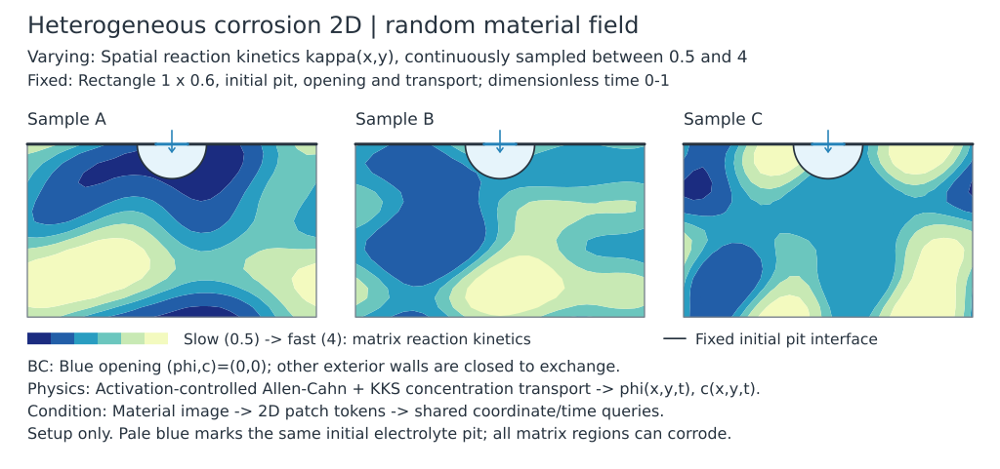
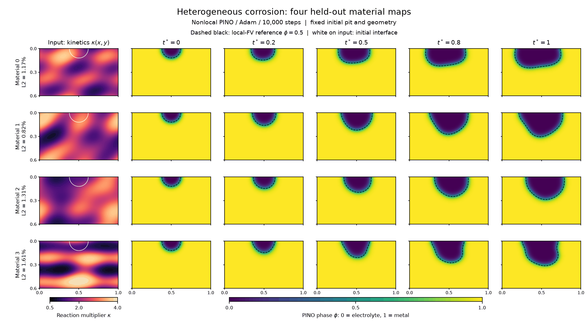

# Heterogeneous corrosion 2D — material-conditioned PINO

A physics-informed neural operator predicts pitting corrosion in a material
whose reaction rate varies with position. **The material map changes between
samples; the domain, initial pit and boundary conditions stay fixed.** Training
uses only governing equations and prescribed inputs, without solution labels.

The case is inspired by Figure 9 of Mai, Soghrati and Buchheit (2016),
[A phase field model for simulating the pitting corrosion](https://doi.org/10.1016/j.corsci.2016.04.001).
It models activation-dominated corrosion (活化控制), rather than reproducing the
paper's dimensional calibration. All material regions can dissolve. Inert
ceramic particles, evolving grains, mechanics and electric-potential fields
are outside this example.



## Problem setup

| Quantity | Definition |
|---|---|
| Domain | \([0,1]\times[0,0.6]\), with \(y\) increasing downwards |
| Time | Dimensionless \(t\in[0,1]\), not seconds |
| Phase | \(\phi=1\): metal; \(\phi=0\): electrolyte |
| Concentration | \(c\): total concentration in the KKS mixture |
| Initial pit | Semicircle centered at \((0.5,0)\), radius \(0.12\) |
| Reservoir opening | \(y=0,\ \lvert x-0.5\rvert\le0.055\): \(\phi=c=0\) |
| Other walls | No normal phase gradient or solute flux |
| Operator input | A stationary positive reaction-rate field \(\kappa(x,y)\) |
| Operator output | \((\phi,c)(x,y,t;\kappa)\) |

The common initial condition, away from the opening, is

$$
\phi_0=\frac{1+\tanh[30(r-0.12)]}{2},
\qquad c_0=c_{Se}h(\phi_0),
\qquad r=\sqrt{(x-0.5)^2+y^2}.
$$

Both initial fields are set to zero on the opening, consistently in the neural
targets and reference solvers.

Define

$$
h(\phi)=3\phi^2-2\phi^3,\qquad
g(\phi)=\phi^2(1-\phi)^2,\qquad
\Delta c=c_{Se}-c_{Le},\qquad
q=c-\Delta c\,h(\phi)-c_{Le}.
$$

The dimensionless local equations are

$$
\partial_t\phi
=\kappa(x,y)\left[N_3\Delta\phi-N_2g'(\phi)
                   +N_1q\Delta c\,h'(\phi)\right],
\qquad
\partial_t c=N_{\mathrm{CH}}\Delta q.
$$

Here \(q\) is a concentration deviation proportional to the chemical potential,
not the total concentration. The closed-wall conditions are
\(\partial_n\phi=\partial_nq=0\); together they also imply
\(\partial_nc=0\). The coefficients are
\(N_{\mathrm{CH}}=80\), \(N_1=24.3181818\), \(N_2=4\),
\(N_3=4/(2\cdot30^2)\), \(c_{Se}=1\), and \(c_{Le}=5100/143000\).

The nonlocal implementation replaces \(-\Delta\) by the cubic-kernel pair
operator \(D_\delta\). The material field multiplies the **whole AC driving
force**; it is not placed inside the Laplacian and does not change diffusivity.
A near-zero reaction coefficient alone would not represent an impermeable
particle.

## Parameterization and network

Fresh Gaussian coefficients generate a smooth latent field with six spatial
sine/cosine modes. A bounded logistic map converts it to positive \(\kappa\).
The stronger prior fixes the latent constant mode to zero and uses standard
deviation \(1.3\) for the remaining 12 coefficients, giving
\(0.5<\kappa<4\). It does not prescribe a left/right corrosion direction or
fix the exact physical mean after the nonlinear mapping.

The encoder receives a normalized **32×64 material image**, divided into
64 patches of 4×8 pixels. Two self-attention blocks encode the patches.
Coordinate queries cross-attend to these tokens, followed by three
time-conditioned decoder layers. All materials share query coordinates;
neither the local material value nor the initial field is appended directly
to decoder queries. Spatial preparation is reused across times, and time
derivatives use JVP.

The two raw outputs \((z,s)\) become

$$
\phi=\frac{1+\tanh z}{2},\qquad
c_L=c_{Le}s,\qquad
c=c_L+\Delta c\,h(\phi),\qquad
q=c_{Le}(s-1).
$$

This enforces the KKS mixture algebra without an extra KKS loss. The liquid
concentration channel \(s\) is linear and unbounded; the legacy constraint
\(c_L\le c_{Le}\) is not imposed. The phase is bounded, but **the original
physical PDE residuals are used without dividing by the tanh Jacobian**.

## Representative training strategy

The displayed result uses
[configs/train_stronger_wide.py](configs/train_stronger_wide.py).
The command-line default remains the earlier mild
[configs/train_base.py](configs/train_base.py): width 64, 5,000 updates and
\(1<\kappa<3\). Select the stronger preset explicitly to reproduce this page's
main result; no default promotion is implied.

| Component | Stronger width-96 configuration |
|---|---|
| Architecture | Width 96, 4 heads, encoder depth 2, decoder depth 3; 48 spatial Fourier frequencies; 323,522 trainable parameters |
| Optimizer | Adam, 10,000 updates; LR \(10^{-3}\), continuous factor-0.5 decay per 2,000 updates, floor \(10^{-5}\); gradient clip 10 |
| Precision / compilation | FP32, ordinary compilation, highest matmul precision |
| Spatial discretization | 81×49 nodes, nonlocal horizon \(0.026\), cubic kernel |
| Online sampling | 8 fresh material maps and 8 uniform random times per update |
| Spatial sampling | 256 core nodes with complete halo, 32 precomputed spatial batches |
| Initial / reservoir data | 1,024 fixed IC nodes and all 9 opening nodes; soft constraints |
| Loss weighting | Stopped inverse-L1 parameter-gradient normalization every 25 updates; new-weight fraction 0.9, cap 1,000 |

There are **five losses**:

1. AC mean absolute residual.
2. CH mean absolute residual.
3. Opening phase MSE.
4. Opening concentration MSE, normalized by \(c_{Le}\).
5. Joint initial-field MSE, with concentration normalized by \(c_{Le}\).

The AC/CH residual scales are both 1. The graph supplies the finite-horizon
closed-wall treatment without extra Neumann losses. This is not exact pointwise
local Neumann enforcement; its discretization difference is checked separately.
There is no causal weighting, staggered update or initial-condition hard
constraint. Runtime seeds are provenance, not tuned strategy parameters.

## Representative results



Each row is one of all four held-out material samples. The first column shows
\(\kappa\), with the initial interface in white; the remaining columns show
\(\phi\) at dimensionless times \(t=0,0.2,0.5,0.8,1\). Color fields are
predictions from the nonlocal Adam **10,000-step endpoint**. Black dashed lines
show the independent local-FV reference interface \(\phi=0.5\). These are
actual saved times, with smooth spatial display interpolation only.

All errors below are the arithmetic mean of four per-material relative L2
errors, evaluated on all 3,969 nodes and 11 saved times. The same predictions
are compared with two different targets:

| Stronger-prior field | Native nonlocal reference | Independent local FV reference |
|---|---:|---:|
| Phase, all times | 0.865% | 1.227% |
| Phase, terminal | 1.306% | 2.086% |
| Concentration, all times | 1.044% | 1.487% |
| Concentration, terminal | 1.598% | 2.551% |

The independent local reference uses a nodal **finite-volume** discretization
and SciPy BDF, not FEM. The native reference integrates the production
nonlocal pair operator in FP64. Neither trajectory enters training.

For the stronger bank, native/local phase discrepancies are 0.40–0.64%
over time. Refining the first local reference from 81×49 to 161×97 changes
phase by 0.212% over time and 0.404% at the endpoint. Doubling diffusivity
changes area advance by 1.86–2.27% on these four maps, supporting
activation-dominated rather than strictly diffusion-free dynamics.

The reference/PINO mean terminal mirror asymmetry is 15.08%/14.96% against
the native reference. After subtracting the cohort mean field, the remaining
material-response phase error is 9.46% over time and 8.31% at the endpoint.
Thus material-dependent shape differences are captured, but less accurately
than the full field.

### Local AD and optimizer controls

The stronger experiment was replayed from the same initial network and
material/time/core/IC draws. Both methods below use the **same local FV target**
and fixed 10,000-step budget:

| Method | Phase, all times | Phase, terminal | Mean warm update |
|---|---:|---:|---:|
| Nonlocal + Adam | 1.227% | 2.086% | 14.60 ms |
| Local AD + Adam | 0.872% | 1.516% | 17.92 ms |

Measured on RTX6000D, nonlocal/AD peak active memory was 3.93/3.02 GiB.
Observed complete process time was 380/673 s; AD startup overlapped other
controls, so the uncontended warm-update measurements are the cleaner
comparison. Local AD adds two explicit Neumann losses on 248 wall nodes and
uses no halo. This compares complete derivative/boundary schemes, not only
the interior derivative.

The tested SOAP settings (beta1 0.95, beta2 0.9, refresh every 10 updates,
maximum precondition dimension 256, no 1D preconditioning) failed at LR
\(10^{-3}\): both spatial methods reached approximately 100% terminal phase
error through erroneous tanh saturation. Nonlocal SOAP at LR \(3\times10^{-4}\)
still gave 22.67% all-time phase error. These negative controls are retained;
they do not establish a general optimizer ranking. Adam remains the successful
configuration for this example.

This is evidence from **one paired initialization and four held-out maps**,
not a population or cross-seed accuracy ranking. The earlier mild 5,000-step
run is also retained: native/local all-time phase errors were 0.795%/1.010%.
Full run history and direct checkpoint paths are in the
[pilot record](../../docs/tasks/archive/heterogeneous-corrosion-pilot.md) and
[paired comparison](../../docs/tasks/archive/heterogeneous-corrosion-local-ad.md).

## Reproduce

Run from the repository root using `.venv`. Each output directory must be
new. All training variants enter through [train.py](train.py).

```bash
# Evaluation-only references for the stronger material prior.
JAX_PLATFORMS=cpu OPENBLAS_NUM_THREADS=1 OMP_NUM_THREADS=1 .venv/bin/python \
  -m examples.heterogeneous_corrosion2d.qualify \
  --config examples.heterogeneous_corrosion2d.configs.train_stronger \
  --output /tmp/corrosion-stronger-reference --seed 962014

# Cold physics-only nonlocal training. --reference enables reporting only.
OPENBLAS_NUM_THREADS=1 OMP_NUM_THREADS=1 XLA_PYTHON_CLIENT_MEM_FRACTION=0.20 \
  .venv/bin/python -m examples.heterogeneous_corrosion2d.train \
  --config examples/heterogeneous_corrosion2d/configs/train_stronger_wide.py \
  --output /tmp/corrosion-stronger-wide-cold10000 \
  --reference /tmp/corrosion-stronger-reference/native_reference.npz

# Evaluate the same final model against the independent local target.
.venv/bin/python -m examples.heterogeneous_corrosion2d.evaluate \
  --run /tmp/corrosion-stronger-wide-cold10000 \
  --reference /tmp/corrosion-stronger-reference/local_reference.npz \
  --output /tmp/corrosion-stronger-wide-local-evaluation

# Optional matched cold local-AD control; no trained endpoint is reused.
OPENBLAS_NUM_THREADS=1 OMP_NUM_THREADS=1 XLA_PYTHON_CLIENT_MEM_FRACTION=0.30 \
  .venv/bin/python -m examples.heterogeneous_corrosion2d.train \
  --config examples/heterogeneous_corrosion2d/configs/train_stronger_wide_local_adam.py \
  --paired-run /tmp/corrosion-stronger-wide-cold10000 \
  --output /tmp/corrosion-stronger-wide-local-adam10000 \
  --reference /tmp/corrosion-stronger-reference/local_reference.npz
```

[solver.py](solver.py) runs the independent activation-control checks;
[compare.py](compare.py) evaluates saved checkpoints against one common local
reference. [audit.py](audit.py) evaluates full-grid **nonlocal** residuals and
must not be interpreted as the local-AD training residual.
[replay.py](replay.py) validates matched cold configurations, initial states and
actual sampled inputs. Saved models must be loaded with their saved config.

## TODO: improve convergence

The current fields are useful results, **not a claim of fully converged
training**. Preserve the 10,000-step endpoint and its controls. Future work
should retune the learning-rate schedule and training budget, then check whether
both field errors and physical residuals converge more completely.

Priorities are early-time concentration transport, natural-wall coverage and
independent full-grid residuals. The stronger run still has positive-time
AC/CH mean absolute residuals of 0.00712/0.08060, with larger CH errors at
unvisited wall cores and at \(t=0\). Lower training loss alone is insufficient.
Repeated initializations and a larger held-out material set are also needed
before claiming stable accuracy improvements. These are deferred experiments;
no additional training was launched for the README update.
