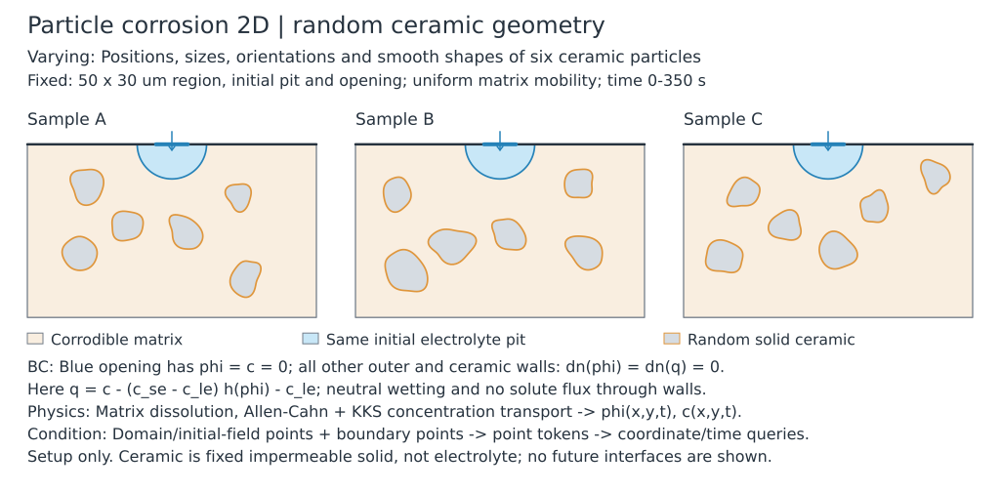
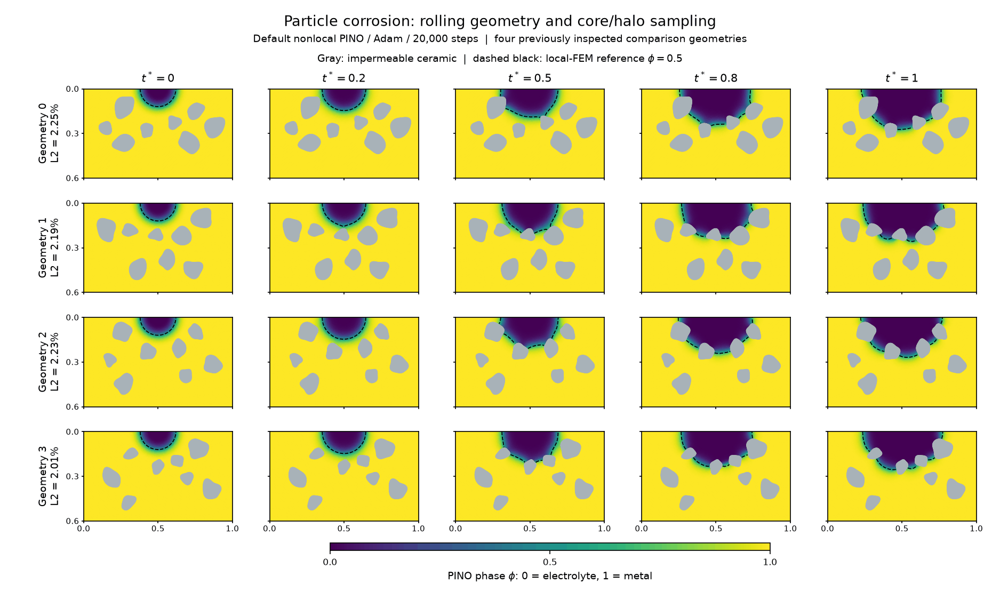

# Ceramic-particle corrosion 2D — geometry-conditioned PINO

A physics-only neural operator predicts how a metal pit grows around **eight
random, smooth, noncorroding ceramic particles**. Only the particle geometry
varies; the initial pit, external domain, reservoir and material coefficients
are shared. The current default uses a width-192 network and **rolling geometry
and core/halo sampling**, trained cold for 20000 Adam updates.



The setup schematic shows prescribed geometry and conditions, not a computed
future solution. Ceramic interiors are excluded from the solution domain but
remain physical solid particles after the surrounding metal dissolves.



Each row is one of the **first four of eight reused evaluation geometries**;
columns show \(t=0,0.2,0.5,0.8,1\). Color shows the default rolling model's
metal phase \(\phi\), gray regions are ceramic, and dashed curves mark the
independent local-FEM interface \(\phi=0.5\). The model uses no evolved solution
labels in training. On all eight cases, phase relative L2 is **1.9827% overall
and 3.1209% at the final time**.

## Problem setup and random geometry

The domain is \([0,1]\times[0,0.6]\) minus the ceramic interiors, with depth
\(y\) increasing downwards and \(t\in[0,1]\). The interpretation follows
Figure 8 of [Mai et al. (2016)](https://doi.org/10.1016/j.corsci.2016.04.001);
fixed impermeable particles and neutral wall energy are explicit modeling
choices here, rather than a reproduction of every detail of that paper.

Each contour is a smooth positive radial graph, area-normalized and transformed
by a rotated, area-preserving ellipse:

$$
\mathbf x(\theta)=\mathbf c+Q(\alpha)\operatorname{diag}(\sqrt a,1/\sqrt a)
\,r(\theta)(\cos\theta,\sin\theta)^T,\qquad
r(\theta)=R_s\exp\!\left[\sum_{k=3}^{5}A_k\cos(k\theta)+B_k\sin(k\theta)\right].
$$

Centers, rotations, mode coefficients, equivalent radii \(0.045\!:\!0.075\)
and aspect ratios \(1\!:\!1.45\) are random. At least four particles lie within
0.12 of the initial pit boundary. The `near_first` prior places four near-pit
particles, then four elsewhere in the allowed region, and shuffles their order.
Wall, interparticle and pit clearances are 0.025, 0.035 and 0.03; minimum sampled
curvature radius is 0.015. Invalid proposals are rejected and resampled without
changing these bounds. Geometry construction never consults future fields.
See [geometry_base.py](configs/geometry_base.py) for all bounds and checks.

## Governing equations, initial state and boundaries

The KKS model uses metal phase \(\phi\in[0,1]\) and total concentration \(c\):

$$
h(\phi)=3\phi^2-2\phi^3,\quad g(\phi)=\phi^2(1-\phi)^2,\quad
\Delta c=c_{Se}-c_{Le},\quad q=c-\Delta c\,h(\phi)-c_{Le},
$$
$$
\phi_t=\kappa\left[N_3\nabla^2\phi-N_2g'(\phi)+N_1\Delta c\,q\,h'(\phi)\right],
\qquad c_t=N_{\mathrm{CH}}\nabla^2q.
$$

The uniform matrix coefficients are \(\kappa=2\), \(N_{\mathrm{CH}}=80\),
\(N_2=4\), \(N_3=4/(2\cdot30^2)\),
\(N_1=4\cdot2(5.35\times10^7)/(1.76\times10^7)\), \(c_{Se}=1\), and
\(c_{Le}=5100/143000\). This is a controlled dimensionless case, not a calibrated
reproduction of the paper's material/time units.

The shared semicircular pit has center \((0.5,0)\) and radius 0.12:

$$
\phi_0(x,y)=\tfrac12\left[1+\tanh\!\left(30
\left(\sqrt{(x-0.5)^2+y^2}-0.12\right)\right)\right],
\qquad c_0=c_{Se}h(\phi_0).
$$

The diffuse 10–90% thickness is approximately 0.0732, consistent with
\(30^2=N_2/(2N_3)\). At the reservoir mouth
\(y=0,\ |x-0.5|\le0.055\), impose \(\phi=c=0\), overriding the initial
formula at mouth nodes. All remaining outer and ceramic walls have
\(\partial_n\phi=\partial_nq=0\): neutral phase-wall energy and impermeable
transport. The initial field need not satisfy classical particle-wall Neumann
compatibility at \(t=0\). The reservoir exchanges concentration; there is no
constant-total-mass projection.

## Default network and training strategy

The general GNOT-inspired `HeterogeneousPointOperator` reads two point streams:

| Encoder stream | Features | Integration measure |
|---|---|---|
| Domain | \((x,y,\phi_0)\) | Physical areas on a masked 25×41 ambient map |
| Boundary | \((x,y,n_x,n_y,\mathrm{kind})\) | Physical arc lengths |

Each stream is lifted independently. Two normalized integral cross-attention
blocks let **coordinate-only queries** read both streams, without particle IDs
or a particle-specific distance bias. Spatial preparation is shared across all
times, followed by three temporal FiLM decoder layers. Different geometries
have their own physical query nodes and masks. The network has width 192,
four heads, 96 spatial Fourier directions (192 sine/cosine features), and eight
temporal frequencies spanning 1–4 in \(\pi t/T\).

Two raw channels \(z,s\) map algebraically to physical fields:

$$
\phi=\tfrac12(1+\tanh z),\qquad
c=c_{Le}s+\Delta c\,h(\phi),\qquad q=c_{Le}(s-1).
$$

The liquid-concentration channel \(s\) is unrestricted. This enforces the KKS
concentration relation without an extra constraint loss. We retain the
**original PDE residuals**, with no division by the tanh Jacobian. The initial
condition and reservoir conditions are soft losses, not hard output constraints.

Spatial diffusion uses symmetric visible nonlocal exchanges with physical nodal
volumes, horizon **0.026**, and the positive negative-Laplacian convention.
Pairs whose segment crosses a ceramic polygon are excluded; wall flux is closed
by the regional operator. Diffusion of \(q\) is evaluated as \(c_{Le}D(s)\)
to avoid cancellation in FP32. Time derivatives use **physical-time JVP**
through the complete output map.

There are five losses: AC, concentration transport, mouth phase, mouth
concentration divided by \(c_{Le}\), and the initial fields with concentration
error divided by \(c_{Le}\). PDE terms use mean absolute residuals; IC/BC terms
use squared errors. Stopped inverse-L1 parameter-gradient normalization updates
every 25 steps, with EMA and an explicit weight cap. This is the repository's
gradient balancing scheme, not original learned-weight GradNorm; there is no
staggered solve.

| Default setting | Value |
|---|---|
| Entry / preset | [train.py](train.py); [train_default.py](configs/train_default.py) → [train_online.py](configs/train_online.py) |
| Optimizer / budget | Adam; cold 20000 updates; no checkpoint initialization |
| Learning rate / precision | \(10^{-3}\), halved every 3000 updates, floor \(10^{-5}\); gradient clip 10; ordinary FP32 compilation |
| Batch | 4 geometries × 8 freshly sampled uniform times |
| Mesh / ceramic contour | Target spacing 0.015; 128 polygon edges per particle |
| Input pool | 64 geometries; 8 core/halo sets per geometry; 256 cores per set |
| Core / IC sampling | With replacement, proportional to physical nodal volume; 1024 IC points |
| Background geometry refresh | Replace 4 slots every 250 updates |
| Background spatial refresh | Refresh 4 slots every 50 updates: all core/halo sets and IC draws |
| Preparation / padding | 4 CPU workers; 4 prefetched events; halo 3072 and 64 neighbors |

Each core retains its complete halo. Workers build known geometry, operators,
quadrature and initial/boundary inputs only; **no reference trajectories are
needed to refresh the pool**. Shapes are fixed and neighborhoods are never
truncated. Runtime seeds are recorded for replay, not tuned configuration
parameters. Intermediate checkpoints do not support exact online continuation;
use a new directory for a cold run.

## Representative results and scope

All methods below use scheduled 20000-step endpoints and the **same eight
reused local-FEM geometries**. Errors are the arithmetic mean of per-geometry
relative L2, using physical spatial quadrature and trapezoidal time weights;
“final” uses only \(t=1\). Reference fields never enter gradient updates.

| Sampling | Phase overall / final | Concentration overall / final | Held update | Total run | Active peak |
|---|---:|---:|---:|---:|---:|
| Fixed geometry/core pool | 1.9587% / 3.4236% | 2.3510% / 4.0898% | 19.69 ms | 747.9 s | 4.17 GiB |
| **Rolling core/halo — default** | **1.9827% / 3.1209%** | **2.3964% / 3.7405%** | **22.56 ms** | **959.0 s** | **4.93 GiB** |
| Rolling full grid — opt-in | 1.7451% / 2.8658% | 2.1093% / 3.4481% | 32.53 ms | 1065.8 s | 7.18 GiB |

The differences are modest: full-grid phase error is about 0.24 percentage
points lower overall and 0.26 points lower at the final time than rolling
core/halo, at **11.1% greater total cost**. Its held updates cost 44.2% more;
less producer waiting partly offsets this in total runtime. All eight pooled
phase errors and seven final errors improve in this paired comparison.
**Rolling core/halo remains the default**; the full-grid experiment is not an
automatic promotion, and none reaches the original 1% goal.

Full-grid uses every non-mouth mesh row with physical volume weights, including
ceramic and outer-wall rows. Mouth predictions remain operator neighbors but
have zero PDE-row weight; padded rows also have zero weight. It targets the
same discrete spatial mean estimated by volume-proportional core draws.
The full/core comparison matches cold model/optimizer states, geometry,
IC/BC and time draws; independent graph and input replay audits passed.
Fixed-versus-rolling additionally changes padding and sampler implementation,
so it is not a strictly isolated sampling-only ablation.

Times are synchronized RTX 5090 measurements and include setup, compilation,
development evaluation and I/O, excluding separate final audits/evaluation.
Active peaks include development evaluation, not merely the training step.
Producer waiting is already included in total time. One paired initialization
and an already-inspected cohort do not establish cross-seed or population
rankings. The default's corroded-field \(1-\phi\) errors are larger, 5.9004%
overall / 6.8598% final; low whole-field error does not imply equally accurate
interface changes.

The independent reference uses P1 weak-form stiffness, lumped mass and sparse
BDF integration, with target spacing 0.01 and 256 contour edges. On the first
eight-particle geometry, further local refinement to spacing 0.0075 changes
phase by 0.0670% overall / 0.0817% final. The direct nonlocal solution differs
from local FEM by 1.1412% / 2.1371% there, separating discretization error from
neural training error. Finite-horizon regional closure is **not an exact
pointwise local Neumann condition**; contour and horizon refinement remain
relevant. These qualification numbers concern one geometry.

A matched fixed-bank local-AD control, with two additional explicit wall losses,
collapsed to a nearly dissolved state (97.27% overall phase error). Cold states
and sampling audits passed. This is failed optimization under that recipe,
**not intrinsic AD inaccuracy**, nor a derivative-only accuracy comparison.
Full-domain residual diagnostics also retain wall and late-time tails; the
current small L2 values are not a pointwise PDE-convergence certificate.

Results and detailed audits: [rolling task](../../docs/tasks/archive/particle-corrosion-online.md),
[full-grid task](../../docs/tasks/archive/particle-corrosion-full-grid.md),
[fixed-bank / AD task](../../docs/tasks/archive/particle-corrosion-pino.md),
[default evaluation](/root/autodl-tmp/tf-logs/particle_corrosion2d/20261106-online-w192-reused8-final-02/metrics.json),
[full/core comparison](/root/autodl-tmp/tf-logs/particle_corrosion2d/20261106-full-grid-vs-core-halo-w192-01/comparison.json).
Figure provenance is in [pino_readme_figures.json](../../artifacts/pino_readme_figures.json).

## Run the example

Use `.venv`; CPU meshing requires the optional `gmsh==4.15.2` dependency. Run
from the repository root and replace placeholder paths with external locations.
Each output directory must be new. Reference solves are for independent
validation only; they are not labels for training.

```bash
# Preview independent evaluation geometries.
.venv/bin/python -m examples.particle_corrosion2d.preview \
  --output /path/to/preview --count 8

# Initial known-input bank, without solving trajectories.
.venv/bin/python -m examples.particle_corrosion2d.prepare \
  --config examples.particle_corrosion2d.configs.train_default \
  --output /path/to/input-bank --workers 4

# Local FEM targets for evaluation geometries only.
.venv/bin/python -m examples.particle_corrosion2d.qualify \
  --config examples.particle_corrosion2d.configs.train_default \
  --preview /path/to/preview/manifest.json --backend local \
  --spacing 0.01 --boundary-points 256 --output /path/to/local-reference

# Cold physics-only training with the default rolling inputs.
.venv/bin/python -m examples.particle_corrosion2d.train \
  --config examples/particle_corrosion2d/configs/train_default.py \
  --inputs /path/to/input-bank --reference /path/to/local-reference \
  --output /path/to/new-online-run
```

`prepare` and `qualify` accept dotted config modules; `train` accepts a file.
The development-reference geometries are excluded from training automatically;
add `--exclude-reference /path/to/separate-test-reference` for a separate test
cohort. Select the scheduled endpoint rather than a test-reference minimum.

Historical [train_wide.py](configs/train_wide.py) retains fixed-bank training;
[train_wide_local_ad.py](configs/train_wide_local_ad.py) pairs with it via
`--paired-run /path/to/completed-fixed-run`. For a cold full-grid comparison,
use [train_full_grid.py](configs/train_full_grid.py) with the same input/reference
arguments and `--full-grid-control /path/to/completed-rolling-core-halo-run`.
For fixed-versus-rolling pairing, use `train_online.py` with
`--sampling-control /path/to/completed-fixed-run`. These controls validate
common initialization and actual input draws; they do not resume a checkpoint.
